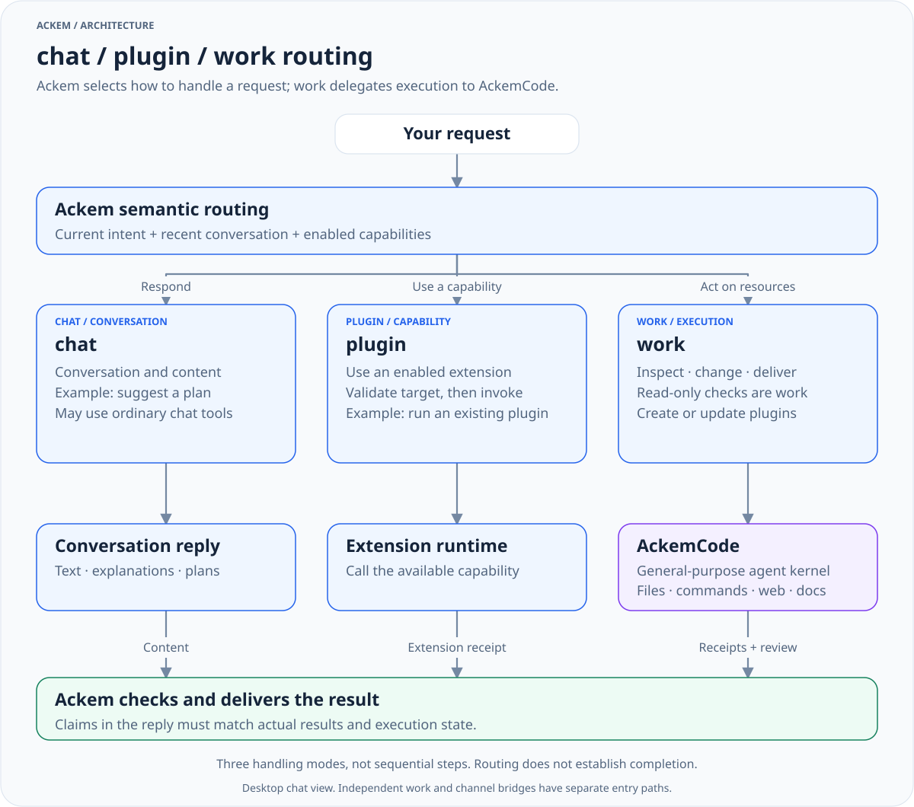

<div align="center">

# 💫 Ackem

### A companion for your days. An agent for your work.

<p><strong>A</strong>utonomous <strong>C</strong>ompanion <strong>K</strong>eeping <strong>E</strong>motional <strong>M</strong>emory<br>
<sub>Conversation · Memory · Personality &amp; emotion · Real task execution</sub></p>

<p>
<a href="package.json"></a>
<a href="https://github.com/JasonLiu0826/ackem/releases"></a>
<a href="LICENSE"></a>
<br>
<a href="docs/usage.md#data-and-privacy"></a>
<a href="docs/usage.md#settings-and-models"></a>
<a href="package.json"></a>
</p>

<p>
<a href="https://github.com/JasonLiu0826/ackem/releases"><strong>🚀 Download Ackem</strong></a> ·
<a href="docs/usage.md"><strong>📖 Get started</strong></a> ·
<a href="docs/architecture.md"><strong>🧭 Explore the architecture</strong></a>
</p>

[简体中文](README.md) · **English** · [Documentation](docs/README.en.md)

**Ackem is a local-first AI companion and task coordinator.
AckemCode is its general-purpose agent execution kernel.**

<sub>Source is evolving. Package features and platform validation follow the corresponding release notes.</sub>

</div>

---

<div align="center">

## ✨ At a glance

</div>

<table>
<tr>
<td width="50%" valign="top" align="center">
<h3>💬 Ackem · Your companion</h3>
<p>Continue conversations, recall facts, and retain or correct long-term memory.</p>
</td>
<td width="50%" valign="top" align="center">
<h3>🛠️ AckemCode · Your agent</h3>
<p>Operate files, commands, search and documents; also available through independent CLI and Web interfaces.</p>
</td>
</tr>
<tr>
<td width="50%" valign="top" align="center">
<h3>🧠 Memory that connects</h3>
<p>Organize related experiences and retrieve relevant context for an ongoing conversation.</p>
</td>
<td width="50%" valign="top" align="center">
<h3>💞 Personality, emotion &amp; time</h3>
<p>Maintain continuity through personality, relationships and awareness of time.</p>
</td>
</tr>
<tr>
<td width="50%" valign="top" align="center">
<h3>🧩 Three routes, one conversation</h3>
<p>Route requests to chat, enabled plugins or work according to intent.</p>
</td>
<td width="50%" valign="top" align="center">
<h3>🔒 Local-first data</h3>
<p>Manage data on your machine; cloud models, channels and network tools send content as configured.</p>
</td>
</tr>
</table>

---

<div align="center">

## 🧭 chat / plugin / work routing

</div>

<p align="center">
<a href="docs/diagrams/request-routing-en.light.svg"></a>
</p>

<div align="center">

[Full size](docs/diagrams/request-routing-en.light.svg) · [Dark](docs/diagrams/request-routing-en.dark.svg)

</div>

Ackem interprets requests as **chat (conversation and content), plugin (an enabled extension), or work (AckemCode acting on real resources)**. These are handling modes rather than three sequential steps. Read-only inspection of actual machine state also belongs to work.

You do not need to select a route first. See [request examples](docs/usage.md#request-handling) and the [routing architecture](docs/architecture.md#routing).

---

<div align="center">

## 🚀 Download and installation

</div>

Choose a matching platform package from the [main repository Releases](https://github.com/JasonLiu0826/ackem/releases) and follow that release's instructions. Fully extract a Windows portable package before starting `Ackem.exe` or its launcher. Features and validation depend on the release; the current source application version is `2.0.0`.

Configure the model endpoint, key and model name in settings, then send an ordinary message. To operate on a project, explicitly delegate a task in chat or use the work page. See the [user guide](docs/usage.md) for permissions, channels and data locations.

---

<div align="center">

## 🎬 Download and usage demos

</div>

These GIFs are retained from the original README to illustrate basic operation. Versions, layouts and legacy computer-assistant controls are historical references; see the [user guide](docs/usage.md) for current entry points and permissions.

<div align="center">

### Download, extract and launch

</div>

<p align="center">
<a href="docs/images/01-download-open.gif"></a>
</p>

Download the matching release → extract the complete package → launch Ackem → wait for initialization. Filenames and launch instructions depend on that release.

<div align="center">

### Everyday conversation

</div>

<p align="center">
<a href="docs/images/02-daily-chat.gif"></a>
</p>

Configure a model and converse naturally. Current work / AckemCode paths also support real task delegation, as shown in the routing diagram above.

---

<div align="center">

## 📷 Reference screenshots

</div>

The original README's six screenshots are retained as interface and feature references, not acceptance evidence for the current release. **Legacy computer-assistant controls shown here have been removed; execution now uses work / AckemCode.** Click a screenshot to view the original.

<table>
<tr>
<td width="50%" align="center" valign="top">
<h3>💬 Conversation</h3>
<a href="docs/images/02-home.png"></a>
<p><sub>Chat and relationship state · <a href="docs/images/02-home.png">Full size</a></sub></p>
</td>
<td width="50%" align="center" valign="top">
<h3>🧠 Memory and associations</h3>
<a href="docs/images/03-memory-graph.jpg"></a>
<p><sub>Memory, timelines and associations · <a href="docs/images/03-memory-graph.jpg">Full size</a></sub></p>
</td>
</tr>
<tr>
<td width="50%" align="center" valign="top">
<h3>⚙️ Settings</h3>
<a href="docs/images/03-settings.png"></a>
<p><sub>Personality and application configuration · <a href="docs/images/03-settings.png">Full size</a></sub></p>
</td>
<td width="50%" align="center" valign="top">
<h3>🔌 Models and API</h3>
<a href="docs/images/04-model-api.png"></a>
<p><sub>Model connection configuration · <a href="docs/images/04-model-api.png">Full size</a></sub></p>
</td>
</tr>
<tr>
<td width="50%" align="center" valign="top">
<h3>✨ Loading</h3>
<a href="docs/images/01-loading.png"></a>
<p><sub>Startup and resource preparation · <a href="docs/images/01-loading.png">Full size</a></sub></p>
</td>
<td width="50%" align="center" valign="top">
<h3>🔒 First-run confirmation</h3>
<a href="docs/images/05-compliance.png"></a>
<p><sub>Content, privacy and data confirmation · <a href="docs/images/05-compliance.png">Full size</a></sub></p>
</td>
</tr>
</table>

---

<div align="center">

## 💻 Quick start from source

</div>

Current CI uses Windows / Node.js 22. Install application and kernel dependencies separately:

```powershell
git clone https://github.com/JasonLiu0826/ackem.git
cd ackem
npm ci
npm --prefix parts/ackemcode ci
npm --prefix parts/ackemcode run build
npm run dev
```

Start through `npm run dev` because the application needs the Electron preload. Environment troubleshooting, validation and packaging commands live in the [development guide](docs/development.md).

---

<div align="center">

## 📚 Documentation and contributing

</div>

| Guide | Scope |
|---|---|
| [User guide](docs/usage.md) | Installation, settings, channels, work, data and privacy |
| [Architecture](docs/architecture.md) | Ackem / AckemCode boundaries, routing and task lifecycle |
| [Development](docs/development.md) | Environment, extensions, verification, builds and release |
| [Module reference](docs/modules.md) | Source entry points, kernel adapters, storage and interfaces |
| [Memory, personality, emotion and time](docs/companion-engines.md) | How companion state interprets, remembers and shapes expression |

<div align="center">

[Contribute](CONTRIBUTING.md) · [Issues](https://github.com/JasonLiu0826/ackem/issues) · [Changelog](CHANGELOG.md) · [Archive](docs/旧文档/README.md)

License: [AGPL-3.0](LICENSE); third-party details: [NOTICE](NOTICE.md). Configured cloud models, channels and network tools receive relevant content; read [data and privacy](docs/usage.md#data-and-privacy).

</div>
