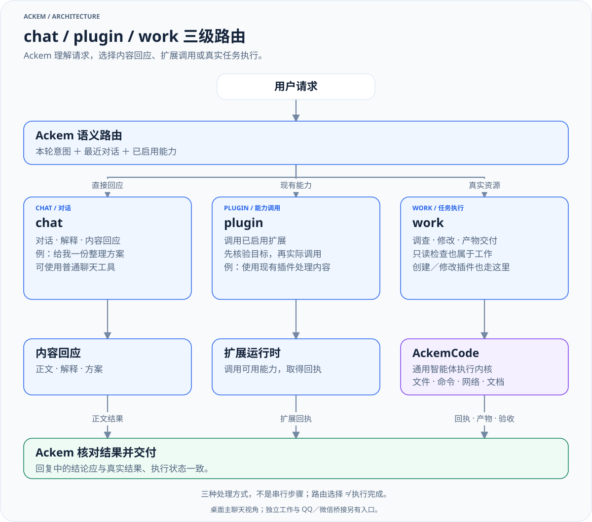

# 💫 Ackem

[](package.json) [](https://github.com/JasonLiu0826/ackem/releases) [](LICENSE)
[](docs/usage.zh.md#数据与隐私) [](docs/usage.zh.md#设置与模型) [](package.json)

[English](README.en.md) · [完整文档](docs/README.md)

**Ackem 是本地优先的 AI 伙伴与任务协调应用，AckemCode 是通用智能体执行内核。**

Ackem 负责持续对话、记忆、性格与情绪，理解请求并跟进任务；AckemCode 负责文件、命令、检索、文档和其他工具支持的真实操作，也提供独立 CLI 与 Web 界面。

**A.C.K.E.M — 保持情感记忆的自主伙伴**

*Autonomous Companion Keeping Emotional Memory*

> **源码**：[JasonLiu0826/ackem](https://github.com/JasonLiu0826/ackem)
>
> **下载**：[GitHub Releases](https://github.com/JasonLiu0826/ackem/releases) · **文档**：[中文导航](docs/README.md)
>
> **状态**：源码持续迭代；安装包功能与平台验证范围以对应 Release 说明为准。

## ✨ 一句话了解

| 能力 | 你可以做什么 |
|---|---|
| 💬 **对话与记忆** | 连续交流，检索相关事实，保留与纠正长期记忆 |
| 💞 **性格、情绪与时间** | 通过人格、关系状态和时间感知形成有连续性的陪伴 |
| 🛠️ **通用智能体内核** | 由 AckemCode 使用文件、命令、检索和文档等实际工具 |
| 🧩 **chat／plugin／work** | 按意图选择内容回应、已启用扩展或真实任务执行 |
| 🔒 **本地优先** | 在本机管理数据；云模型、渠道与联网工具的数据流见使用指南 |

---

## 🧭 chat／plugin／work 三级路由



[放大查看](docs/diagrams/request-routing-zh.light.svg) · [深色版本](docs/diagrams/request-routing-zh.dark.svg)

Ackem 按请求意图选择 **chat（对话与内容回应）／plugin（调用已启用扩展）／work（交给 AckemCode 操作真实资源）**。三者是处理方式，不是依次执行的三个步骤；只读检查本机状态也属于 work。

不需要先手动选通道。使用例子见[请求如何处理](docs/usage.zh.md#请求如何处理)，判断与执行链见[三级路由](docs/architecture.zh.md#三级路由)。

---

## 🚀 下载与安装

在[主仓库 Releases](https://github.com/JasonLiu0826/ackem/releases)选择适合平台的版本，按对应发行说明安装。Windows 便携版完整解压后启动 `Ackem.exe` 或随包启动脚本。安装包功能和验证范围以该版本说明为准；当前源码应用版本为 `2.0.0`。

首次启动，在设置中配置模型地址、密钥和模型名称，再发送一条普通消息。需要操作项目时，在聊天里明确委托任务，或进入工作页。权限、渠道和数据位置见[使用指南](docs/usage.zh.md)。

---

## 🎬 下载与操作演示

以下 GIF 沿用原 README 的演示素材，用于了解基本操作。画面中的版本、布局和旧电脑助手入口仅作历史参考；当前入口与权限说明见[使用指南](docs/usage.zh.md)。

### 下载、解压与启动


从 Releases 下载对应平台的完整发行包 → 解压 → 启动 Ackem → 等待初始化。实际包名与启动方式以对应发行说明为准。

### 配置后的日常对话


配置模型后自然交流；当前版本还可通过 work／AckemCode 委托真实任务，见上方路由图。

---

## 📷 参考界面

下面保留原 README 的六张截图，作为界面与功能参考。它们不是当前版本逐项验收截图；**图中的旧电脑助手已删除，现有执行入口为 work／AckemCode**。点击图片下方的“原图”可放大查看。

| 💬 对话主页 | 🧠 记忆与关联 |
|---|---|
|  |  |
| 对话与关系状态 · [原图](docs/images/02-home.png) | 记忆、时间线与关联 · [原图](docs/images/03-memory-graph.jpg) |

| ⚙️ 设置界面 | 🔌 模型与 API |
|---|---|
|  |  |
| 人格与应用配置 · [原图](docs/images/03-settings.png) | 模型连接配置 · [原图](docs/images/04-model-api.png) |

| ✨ 加载界面 | 🔒 首次运行确认 |
|---|---|
|  |  |
| 启动与资源准备 · [原图](docs/images/01-loading.png) | 内容、隐私与数据确认 · [原图](docs/images/05-compliance.png) |

---

## 💻 从源码快速启动

当前 CI 使用 Windows / Node.js 22。根应用与内核需要分别安装依赖：

```powershell
git clone https://github.com/JasonLiu0826/ackem.git
cd ackem
npm ci
npm --prefix parts/ackemcode ci
npm --prefix parts/ackemcode run build
npm run dev
```

应用依赖 Electron preload，请从 `npm run dev` 启动。环境排障、检查与打包命令统一见[开发指南](docs/development.zh.md)。

---

## 📚 文档与贡献

| 文档 | 解决的问题 |
|---|---|
| [使用指南](docs/usage.zh.md) | 安装、设置、渠道、工作执行、数据与隐私 |
| [架构说明](docs/architecture.zh.md) | Ackem / AckemCode 分工、三级路由、任务生命周期 |
| [开发指南](docs/development.zh.md) | 环境、扩展开发、验证、构建与发布 |
| [模块参考](docs/modules.zh.md) | 源码入口、内核接入、存储与接口 |
| [记忆、性格情绪与时间引擎](docs/companion-engines.zh.md) | 陪伴状态如何理解、记住并组织表达 |

[贡献](CONTRIBUTING.zh.md) · [问题反馈](https://github.com/JasonLiu0826/ackem/issues) · [变更记录](CHANGELOG.md) · [旧文档归档](docs/旧文档/README.md)

许可：[AGPL-3.0](LICENSE)；第三方说明：[NOTICE](NOTICE.md)。云模型、渠道与联网工具会按配置发送相关内容；使用前阅读[数据与隐私](docs/usage.zh.md#数据与隐私)。
