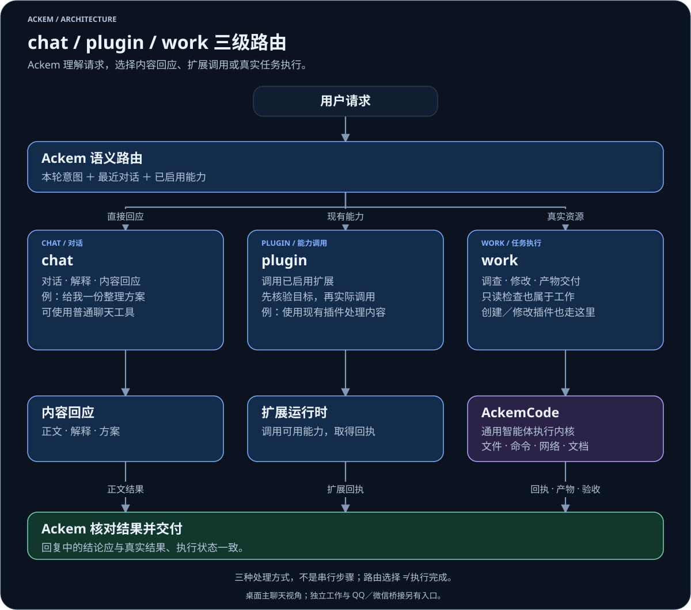

<div align="center">

# 💫 Ackem

### 陪伴你的日常，推进你的工作。

<p><strong>A</strong>utonomous <strong>C</strong>ompanion <strong>K</strong>eeping <strong>E</strong>motional <strong>M</strong>emory<br>
<sub>对话 · 记忆 · 性格与情绪 · 真实任务执行</sub></p>

<p>
<a href="package.json"></a>
<a href="https://github.com/JasonLiu0826/ackem/releases"></a>
<a href="LICENSE"></a>
<br>
<a href="docs/usage.zh.md#数据与隐私"></a>
<a href="docs/usage.zh.md#设置与模型"></a>
<a href="package.json"></a>
</p>

<p>
<a href="https://github.com/JasonLiu0826/ackem/releases"><strong>🚀 下载 Ackem</strong></a> ·
<a href="docs/usage.zh.md"><strong>📖 开始使用</strong></a> ·
<a href="docs/architecture.zh.md"><strong>🧭 了解架构</strong></a>
</p>

**简体中文** · [English](README.en.md) · [完整文档](docs/README.md)

**Ackem 是本地优先的 AI 伙伴与任务协调应用。
AckemCode 是通用智能体执行内核。**

<sub>源码持续迭代 · 安装包功能与平台验证范围以对应 Release 说明为准</sub>

</div>

---

<div align="center">

## ✨ 一句话了解

</div>

<table>
<tr>
<td width="50%" valign="top" align="center">
<h3>💬 Ackem · 陪伴与协调</h3>
<p>持续交流、回忆相关事实，保留与纠正长期记忆，理解请求并跟进任务。</p>
</td>
<td width="50%" valign="top" align="center">
<h3>🛠️ AckemCode · 通用执行内核</h3>
<p>通过文件、命令、检索与文档工具操作真实资源，也可独立使用 CLI 与 Web 界面。</p>
</td>
</tr>
<tr>
<td width="50%" valign="top" align="center">
<h3>🧠 让记忆形成关联</h3>
<p>组织经历与相关事实，在持续对话中检索需要的上下文。</p>
</td>
<td width="50%" valign="top" align="center">
<h3>💞 性格、情绪与时间</h3>
<p>结合人格、关系状态与时间感知，形成有连续性的陪伴。</p>
</td>
</tr>
<tr>
<td width="50%" valign="top" align="center">
<h3>🧩 一次表达，三种处理方式</h3>
<p>按意图进入 chat、已启用的 plugin，或由 AckemCode 执行的 work。</p>
</td>
<td width="50%" valign="top" align="center">
<h3>🔒 本地优先，数据有据可查</h3>
<p>在本机管理数据；云模型、渠道和联网工具的数据流可在使用指南中查看。</p>
</td>
</tr>
</table>

---

<div align="center">

## 🧭 chat／plugin／work 三级路由

</div>

<p align="center">
<a href="docs/diagrams/request-routing-zh.dark.svg"></a>
</p>

<div align="center">

[放大查看](docs/diagrams/request-routing-zh.dark.svg) · [浅色版本](docs/diagrams/request-routing-zh.light.svg)

</div>

Ackem 按请求意图选择 **chat（对话与内容回应）／plugin（调用已启用扩展）／work（交给 AckemCode 操作真实资源）**。三者是处理方式，不是依次执行的三个步骤；只读检查本机状态也属于 work。

不需要先手动选通道。使用例子见[请求如何处理](docs/usage.zh.md#请求如何处理)，判断与执行链见[三级路由](docs/architecture.zh.md#三级路由)。

---

<div align="center">

## 🚀 下载与安装

</div>

在[主仓库 Releases](https://github.com/JasonLiu0826/ackem/releases)选择适合平台的版本，按对应发行说明安装。Windows 便携版完整解压后启动 `Ackem.exe` 或随包启动脚本。安装包功能和验证范围以该版本说明为准；当前源码应用版本为 `2.0.0`。

首次启动，在设置中配置模型地址、密钥和模型名称，再发送一条普通消息。需要操作项目时，在聊天里明确委托任务，或进入工作页。权限、渠道和数据位置见[使用指南](docs/usage.zh.md)。

---

<div align="center">

## 🎬 下载与操作演示

</div>

以下 GIF 沿用原 README 的演示素材，用于了解基本操作。画面中的版本、布局和旧电脑助手入口仅作历史参考；当前入口与权限说明见[使用指南](docs/usage.zh.md)。

<div align="center">

### 下载、解压与启动

</div>

<p align="center">
<a href="docs/images/01-download-open.gif"></a>
</p>

从 Releases 下载对应平台的完整发行包 → 解压 → 启动 Ackem → 等待初始化。实际包名与启动方式以对应发行说明为准。

<div align="center">

### 配置后的日常对话

</div>

<p align="center">
<a href="docs/images/02-daily-chat.gif"></a>
</p>

配置模型后自然交流；当前版本还可通过 work／AckemCode 委托真实任务，见上方路由图。

---

<div align="center">

## 📷 参考界面

</div>

下面保留原 README 的六张截图，作为界面与功能参考。它们不是当前版本逐项验收截图；**图中的旧电脑助手已删除，现有执行入口为 work／AckemCode**。点击图片或“查看原图”可放大查看。

<table>
<tr>
<td width="50%" align="center" valign="top">
<h3>💬 对话主页</h3>
<a href="docs/images/02-home.png"></a>
<p><sub>对话与关系状态 · <a href="docs/images/02-home.png">查看原图</a></sub></p>
</td>
<td width="50%" align="center" valign="top">
<h3>🧠 记忆与关联</h3>
<a href="docs/images/03-memory-graph.jpg"></a>
<p><sub>记忆、时间线与关联 · <a href="docs/images/03-memory-graph.jpg">查看原图</a></sub></p>
</td>
</tr>
<tr>
<td width="50%" align="center" valign="top">
<h3>⚙️ 设置界面</h3>
<a href="docs/images/03-settings.png"></a>
<p><sub>人格与应用配置 · <a href="docs/images/03-settings.png">查看原图</a></sub></p>
</td>
<td width="50%" align="center" valign="top">
<h3>🔌 模型与 API</h3>
<a href="docs/images/04-model-api.png"></a>
<p><sub>模型连接配置 · <a href="docs/images/04-model-api.png">查看原图</a></sub></p>
</td>
</tr>
<tr>
<td width="50%" align="center" valign="top">
<h3>✨ 加载界面</h3>
<a href="docs/images/01-loading.png"></a>
<p><sub>启动与资源准备 · <a href="docs/images/01-loading.png">查看原图</a></sub></p>
</td>
<td width="50%" align="center" valign="top">
<h3>🔒 首次运行确认</h3>
<a href="docs/images/05-compliance.png"></a>
<p><sub>内容、隐私与数据确认 · <a href="docs/images/05-compliance.png">查看原图</a></sub></p>
</td>
</tr>
</table>

---

<div align="center">

## 💻 从源码快速启动

</div>

当前 CI 使用 Windows / Node.js 22。根应用与内核需要分别安装依赖：

```powershell
git clone https://github.com/JasonLiu0826/ackem.git
cd ackem
npm ci
npm --prefix parts/ackemcode ci
npm --prefix parts/ackemcode run build
npm run dev
```

应用依赖 Electron preload，请从 `npm run dev` 启动。环境排障、检查与打包命令统一见[开发指南](docs/development.zh.md)。

---

<div align="center">

## 📚 文档与贡献

</div>

| 文档 | 解决的问题 |
|---|---|
| [使用指南](docs/usage.zh.md) | 安装、设置、渠道、工作执行、数据与隐私 |
| [架构说明](docs/architecture.zh.md) | Ackem / AckemCode 分工、三级路由、任务生命周期 |
| [开发指南](docs/development.zh.md) | 环境、扩展开发、验证、构建与发布 |
| [模块参考](docs/modules.zh.md) | 源码入口、内核接入、存储与接口 |
| [记忆、性格情绪与时间引擎](docs/companion-engines.zh.md) | 陪伴状态如何理解、记住并组织表达 |

<div align="center">

[贡献](CONTRIBUTING.zh.md) · [问题反馈](https://github.com/JasonLiu0826/ackem/issues) · [变更记录](CHANGELOG.md) · [旧文档归档](docs/旧文档/README.md)

许可：[AGPL-3.0](LICENSE)；第三方说明：[NOTICE](NOTICE.md)。云模型、渠道与联网工具会按配置发送相关内容；使用前阅读[数据与隐私](docs/usage.zh.md#数据与隐私)。

</div>
