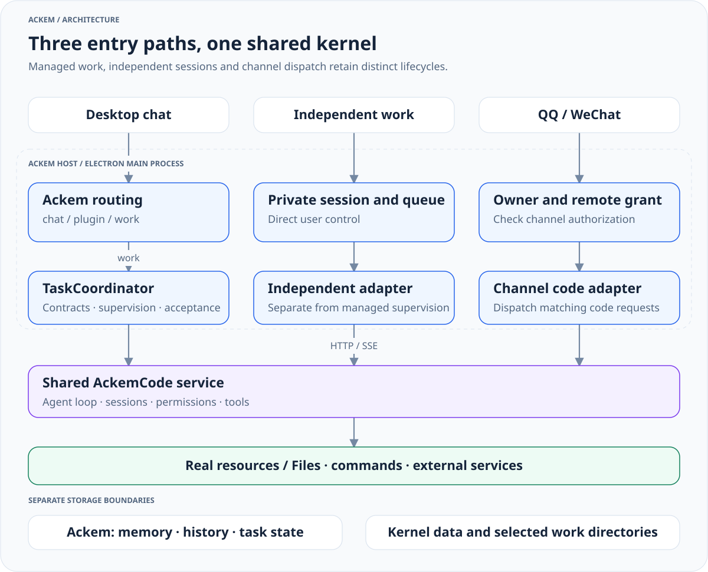
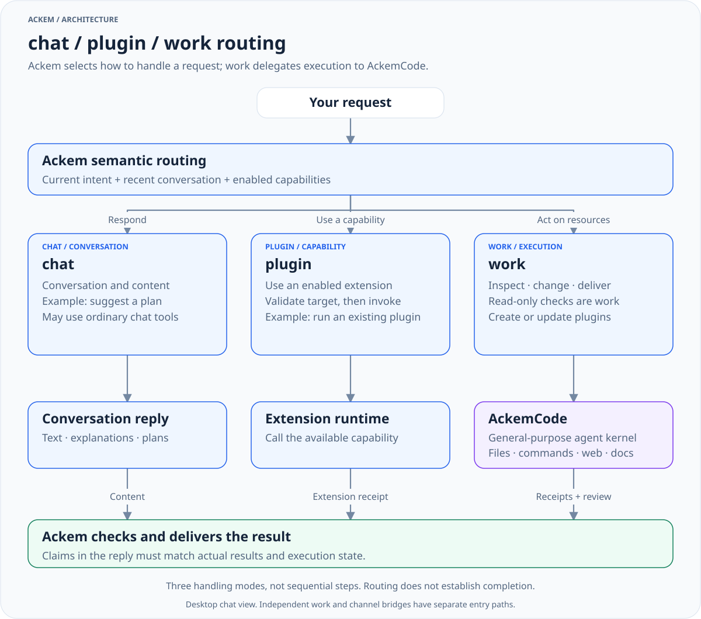
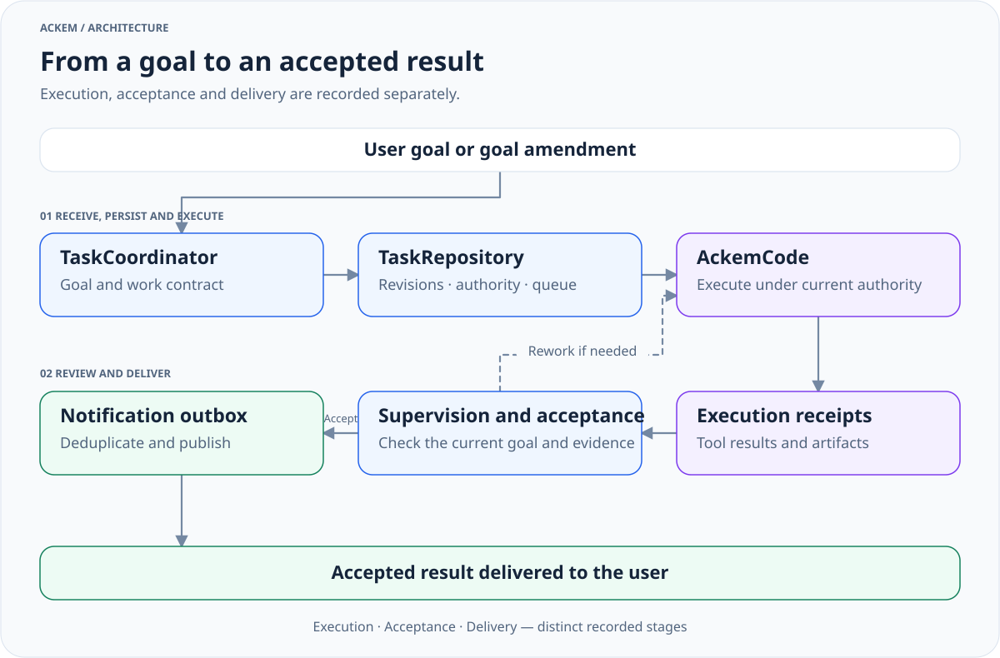

# Architecture

[中文](architecture.zh.md) · [Documentation](README.en.md)

## Ackem and AckemCode

Ackem hosts interaction, companionship and coordination. AckemCode is a general-purpose agent kernel connected through host adapters and HTTP / SSE. Companion event interpretation is not the project's global routing entry point.

[Full size](diagrams/runtime-architecture-en.light.svg) · [Dark](diagrams/runtime-architecture-en.dark.svg) · [Source](diagrams/sources/runtime-architecture-en.mmd)

| Layer | Responsibility |
|---|---|
| Renderer and preload | Input, presentation, work controls and event subscriptions |
| Ackem main process | Routing, conversation context, memory, personality, emotion and coordination |
| Extensions | Active Skill / Plugin catalog, lifecycle and permissions |
| Managed tasks | Goals, contracts, runs, supervision, acceptance, notifications and delivery |
| AckemCode | Sessions, agent loops, tools, permission interactions, plans and subagents |

Capabilities depend on tools, models, services and permissions; Code does not restrict the kernel to programming. Kernel tool tasks and subagents are distinct from host-managed task records.

## Routing

[channelPlan.ts](../src/shared/channelPlan.ts) defines `Channel = 'chat' | 'plugin' | 'work'`. These are handling modes rather than three mandatory sequential steps.

[Full size](diagrams/request-routing-en.light.svg) · [Dark](diagrams/request-routing-en.dark.svg) · [Source](diagrams/sources/request-routing-en.mmd)

| Route | Scope | Evidence |
|---|---|---|
| chat | Conversation, explanations and content, with ordinary chat tools where available | Current context, memory, personality and actual tools |
| plugin | Installed and enabled extension capabilities | Valid catalog and extension receipts |
| work | Real files, projects, commands and other resources, including extension creation / changes | Goals, authorization, tool results, receipts and acceptance |

### Choosing a route

1. Distinguish conversational content, an existing capability call and an actual resource-operation result. Read-only inspection of a project or machine also belongs to work; writing code or modifying a file is not required.
2. Semantic classification combines the turn, recent conversation and enabled catalog into a structured intent. [classifyIntent.ts](../src/main/channel/classifyIntent.ts) and [intentProtocol.ts](../src/shared/intentProtocol.ts) define this input and protocol. Words such as “search”, “file” or “plugin” do not decide the route alone.
3. Normalization validates targets. Using a capability needs an actual extension binding. Extension creation / changes use a work factory plan; ordinary resource operations use a work job plan. Multiple candidates or missing information can produce pending plans or clarification branches, with orchestration deciding how to continue.
4. Timeouts, invalid output or unconfirmed classification preserve the fact that dispatch has not happened. Missing capabilities cannot be reported as successful calls, and classification does not bypass permissions. Route selection, dispatch, execution and acceptance are verified separately.

Ordinary chat can use its tools. Plugin means a host extension call, distinct from plugins loaded inside AckemCode. Work covers general documents, research, files and projects rather than programming alone. See [user examples](usage.md#request-handling).

### From routing to execution

Desktop enters through [ipc/chat.ts](../src/main/ipc/chat.ts), [orchestrateChannelTurn.ts](../src/main/chat/orchestrateChannelTurn.ts) and [routeChannel.ts](../src/main/channel/routeChannel.ts). Orchestration first handles task references, amendments, stops and attachments. With an LLM client, routing uses semantic classification and [normalizeChannel.ts](../src/main/channel/normalizeChannel.ts) validates capability targets. Deterministic and learned paths remain.

Unconfirmed classification records that dispatch has not happened rather than inventing progress. Verdicts enter the memory ledger. Chat generates replies; plugin uses [executeChannel.ts](../src/main/channel/executeChannel.ts); managed work submits through [chatWorkDispatch.ts](../src/main/tasks/chatWorkDispatch.ts). Compatibility confirmation types do not imply every turn shows a card; current orchestration can complete and execute some pending plans.

## Tasks

[Full size](diagrams/managed-task-lifecycle-en.light.svg) · [Dark](diagrams/managed-task-lifecycle-en.dark.svg) · [Source](diagrams/sources/managed-task-lifecycle-en.mmd)

| Module | Responsibility |
|---|---|
| [coordinator](../src/main/tasks/coordinator.ts) | Idempotent inputs, association, amendments, queues and stopping |
| [repository](../src/main/tasks/repository.ts) | Contracts, revisions, authority, events and projections |
| [runtime](../src/main/tasks/runtime.ts) | Kernel driver, budgets, permissions and receipts |
| [workSupervisor](../src/main/ackemcode/workSupervisor.ts) | Managed supervision and result review |
| [communication](../src/main/tasks/communication.ts) | Notification outbox, deduplication, suppression and delivery |
| [Shared types](../src/shared/tasks.ts) | Contracts, snapshots and control state |

States include queued, running, waiting_user, cancelling, paused, reviewing, completed, failed and unknown. This is not a forward-only pipeline. `goalRevision` identifies the goal version; `controlEpoch`, fencing and `currentRunId` bind current authority and attempts. Late events from an old run must not settle a revised goal.

`TaskSnapshot` separates:

- `execution`: actual results, receipts and quiescence;
- `acceptance`: review readiness, rework and acceptance;
- `delivery`: pending, published, suppressed or failed publication.

Kernel done does not imply goal acceptance; a finished text stream does not establish completion; review-service unavailability does not mean execution is still running. A stop request differs from a matching stop receipt and quiescence. [longTerm.ts](../src/main/tasks/longTerm.ts) handles continuing goals and rule authorization; a model statement does not create authority.

## Independent work and channels

The work page uses [ipc/workbench.ts](../src/main/ipc/workbench.ts) and [standaloneWorkService.ts](../src/main/ackemcode/standaloneWorkService.ts) for private sessions and a persistent input queue. It does not reuse the complete managed-chat contract, supervision and delivery chain. Independent CLI / Web clients may also connect directly.

QQ / WeChat enter [companionTurn.ts](../src/main/channels/companionTurn.ts) after ownership confirmation. Turns without user images first try the [code bridge](../src/main/ackemcode/dispatch.ts), then conversation when unhandled. Image turns skip that bridge. Shared personality, memory and history do not imply desktop general semantic routing and managed tasks.

## Module relationships

Companion preparation supplies events, memory and psyche state; prompts organize expression. Tasks maintain verifiable runtime facts, and the kernel acts on actual resources. Memory can record action evidence without replacing task state or acceptance. User controls and data boundaries live in the [user guide](usage.md).

Legacy computer-assistant modes, `use_computer`, executors and associated IPC are removed. Only necessary remote-grant migration remains. See [module reference](modules.md) for adapters and source, and [companion engines](companion-engines.md) for internal memory, personality, emotion and time.
