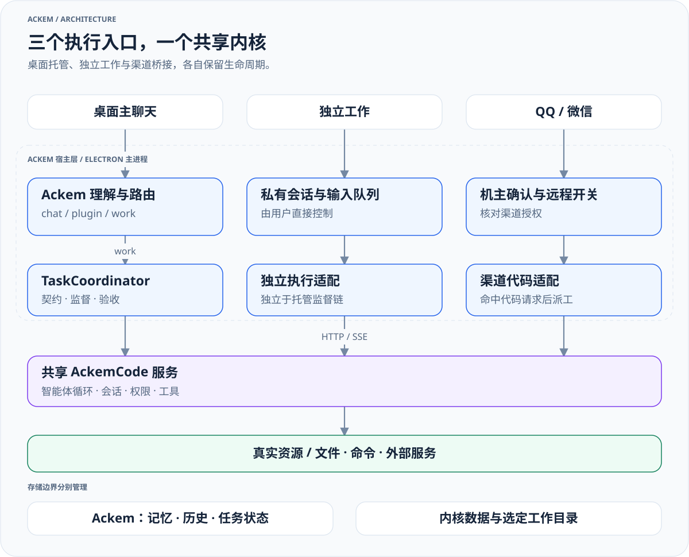
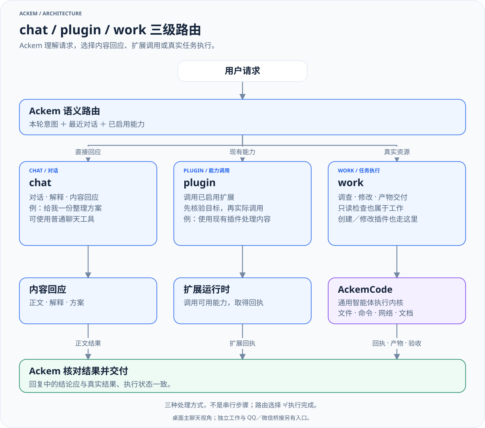
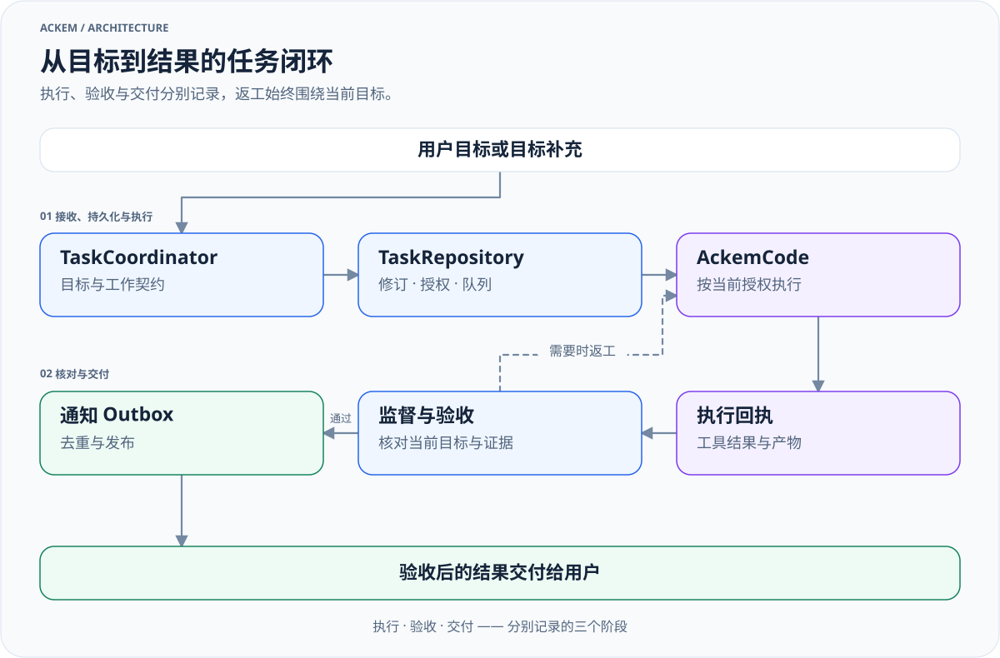

# 架构说明

[English](architecture.md) · [文档导航](README.md)

## Ackem 与 AckemCode

Ackem 是交互、陪伴与协调宿主；AckemCode 是通用智能体执行内核。两者通过宿主适配和 HTTP／SSE 连接。陪伴引擎中的事件解释并不是整个项目的路由入口。

[放大查看](diagrams/runtime-architecture-zh.light.svg) · [深色版本](diagrams/runtime-architecture-zh.dark.svg) · [图源](diagrams/sources/runtime-architecture-zh.mmd)

| 层 | 主要职责 |
|---|---|
| 渲染层与 preload | 输入、展示、工作控制和事件订阅 |
| Ackem 主进程 | 通道选择、对话上下文、记忆、性格情绪和任务协调 |
| 扩展系统 | 已启用 Skill／Plugin 的能力目录、生命周期与权限 |
| 托管任务系统 | 目标、契约、运行、监督、验收、通知与交付 |
| AckemCode | 会话、智能体循环、工具、权限交互、计划与子智能体 |

执行能力由工具、模型、服务和权限决定，Code 名称不将内核限制为代码编写。内核自己的工具任务与子智能体，不是宿主托管任务记录。

## 三级路由

`Channel = 'chat' | 'plugin' | 'work'` 定义在 [channelPlan.ts](../src/shared/channelPlan.ts)。三者是处理方式，不是每个请求依次经过的三个步骤。

[放大查看](diagrams/request-routing-zh.light.svg) · [深色版本](diagrams/request-routing-zh.dark.svg) · [图源](diagrams/sources/request-routing-zh.mmd)

| 路由 | 处理内容 | 依据 |
|---|---|---|
| chat | 交流、解释和内容回应，可使用普通聊天工具 | 当前上下文、记忆、性格与实际工具 |
| plugin | 使用已安装并启用的扩展 | 有效能力目录与扩展调用回执 |
| work | 操作真实文件、项目、命令和其他资源；创建或修改插件 | 目标、授权、工具结果、回执与验收 |

### 如何作出选择

1. 先判断用户要的是对话内容、现有能力调用，还是对真实资源的执行结果。只读检查、调查项目或本机状态也属于 work，不以“是否写代码”或“是否修改文件”为界。
2. 语义分类结合本轮、最近对话与已启用能力目录，输出结构化意图；[classifyIntent.ts](../src/main/channel/classifyIntent.ts) 和 [intentProtocol.ts](../src/shared/intentProtocol.ts) 定义该输入与协议。它不是单纯按“搜索／文件／插件”等词路由。
3. 归一化核验目标：使用现有能力需绑定实际扩展；创建／修改扩展进入 work 的 factory 计划，一般资源操作进入 work 的 job 计划。候选不唯一或信息缺失可形成待确认计划／澄清分支，如何继续由编排处理。
4. 分类超时、无效输出或无法确认时，保留未下派事实；缺失能力不能伪造调用，也不能仅凭分类成功越过运行权限。路由选择、派工、执行、验收分别核验。

普通聊天可调用其工具；plugin 指宿主扩展调用，不能与 AckemCode 自己加载的插件混为一谈。work 可以用于通用文档、资料、文件及项目任务，并非只为编程服务。面向用户的对比例子见[使用指南](usage.zh.md#请求如何处理)。

### 从路由到实际执行

桌面入口为 [ipc/chat.ts](../src/main/ipc/chat.ts) → [orchestrateChannelTurn.ts](../src/main/chat/orchestrateChannelTurn.ts) → [routeChannel.ts](../src/main/channel/routeChannel.ts)。编排先处理任务指代、补充、停止与附件等情况；提供 LLM 时，路由使用语义分类，再由 [normalizeChannel.ts](../src/main/channel/normalizeChannel.ts) 核验能力目标。确定性与学习路径仍存在。

分类未确认时明确记录“尚未下派”，不能编造检查或进展。路由裁决写入记忆账本；chat 继续生成回复，plugin 经 [executeChannel.ts](../src/main/channel/executeChannel.ts) 调扩展，托管 work 经 [chatWorkDispatch.ts](../src/main/tasks/chatWorkDispatch.ts) 提交任务。兼容确认类型的存在不代表每次都弹卡；部分待确认计划会在当前编排中补全执行。

## 任务生命周期

[放大查看](diagrams/managed-task-lifecycle-zh.light.svg) · [深色版本](diagrams/managed-task-lifecycle-zh.dark.svg) · [图源](diagrams/sources/managed-task-lifecycle-zh.mmd)

| 模块 | 职责 |
|---|---|
| [coordinator](../src/main/tasks/coordinator.ts) | 输入幂等、关联、目标补充、队列与停止 |
| [repository](../src/main/tasks/repository.ts) | 契约、修订、授权、事件与状态投影 |
| [runtime](../src/main/tasks/runtime.ts) | 内核驱动、预算、权限同步和回执 |
| [workSupervisor](../src/main/ackemcode/workSupervisor.ts) | 托管执行监督与结果审查 |
| [communication](../src/main/tasks/communication.ts) | 通知 Outbox、去重、抑制与交付 |
| [共享任务类型](../src/shared/tasks.ts) | 契约、任务快照与控制状态 |

状态包含 queued、running、waiting_user、cancelling、paused、reviewing、completed、failed、unknown；这不是只能向前的流水线。`goalRevision` 表示目标版本，`controlEpoch`、fencing 与 `currentRunId` 关联当前授权和尝试。新目标被接受后，旧轮次迟到的事件不能结算新目标。

`TaskSnapshot` 将三类状态分开：

- `execution`：实际执行结果、回执及是否静止；
- `acceptance`：可否审查、是否返工或已接受；
- `delivery`：是否等待发布、已发布、被抑制或失败。

内核 done 不等于目标验收通过；正文流结束不等于任务完成；审查服务不可用也不等于执行仍在运行。停止请求必须与匹配的停止回执和静止状态区分。持续目标和规则授权由 [longTerm.ts](../src/main/tasks/longTerm.ts) 管理，不能由模型一句话产生。

## 独立工作与渠道

工作页经 [ipc/workbench.ts](../src/main/ipc/workbench.ts) 与 [standaloneWorkService.ts](../src/main/ackemcode/standaloneWorkService.ts) 驱动私有会话和持久化输入队列，未复用聊天托管任务的完整契约、监督和交付链。独立 CLI／Web 也可直接连接内核。

QQ／微信在确认机主后进入 [companionTurn.ts](../src/main/channels/companionTurn.ts)。不含用户图片时先尝试 [代码桥接](../src/main/ackemcode/dispatch.ts)，未处理则继续陪伴对话。含图片轮次跳过桥接。共享人格、记忆与历史不表示它们已经使用桌面的通用语义路由和托管任务链。

## 模块关系

陪伴编排准备事件、记忆与心理状态，Prompt 层组织表达；任务系统维护可核验的运行事实，内核操作实际资源。记忆可保存行动证据，但不能替代任务状态或验收。用户操作和数据边界统一见[使用指南](usage.zh.md)。

旧电脑助手的模式、`use_computer`、执行器和对应 IPC 已删除；只保留必要的旧远程授权迁移。源码和适配细节见[模块参考](modules.zh.md)，陪伴内部机制见[记忆、性格情绪与时间引擎](companion-engines.zh.md)。
