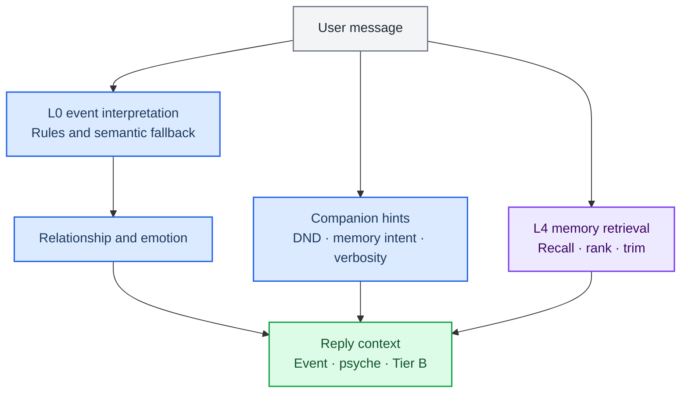
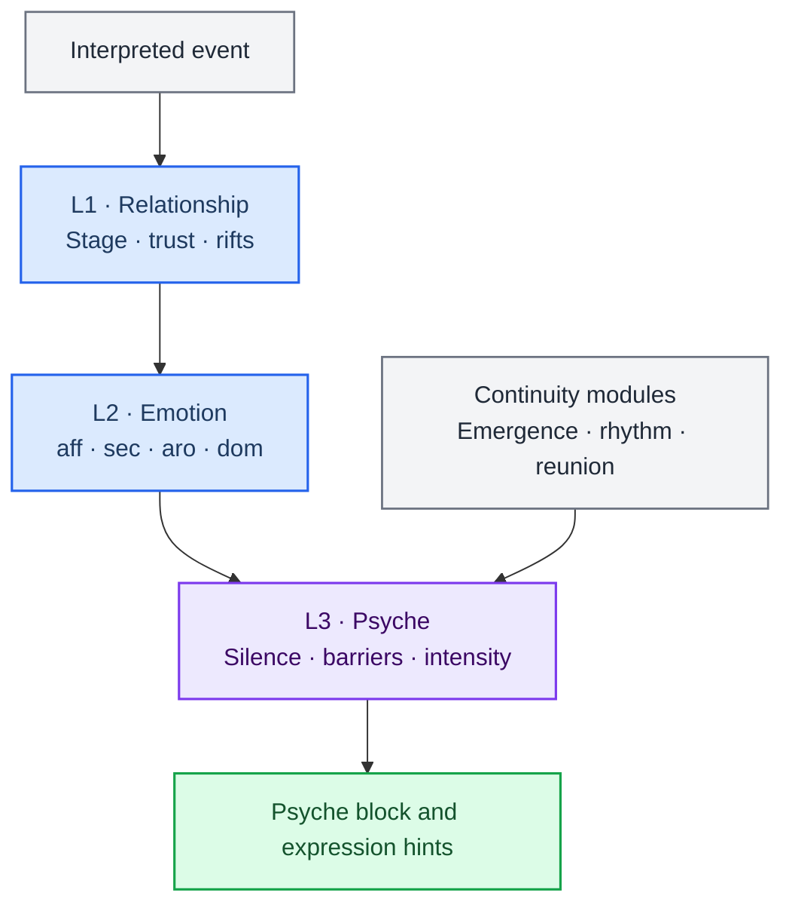
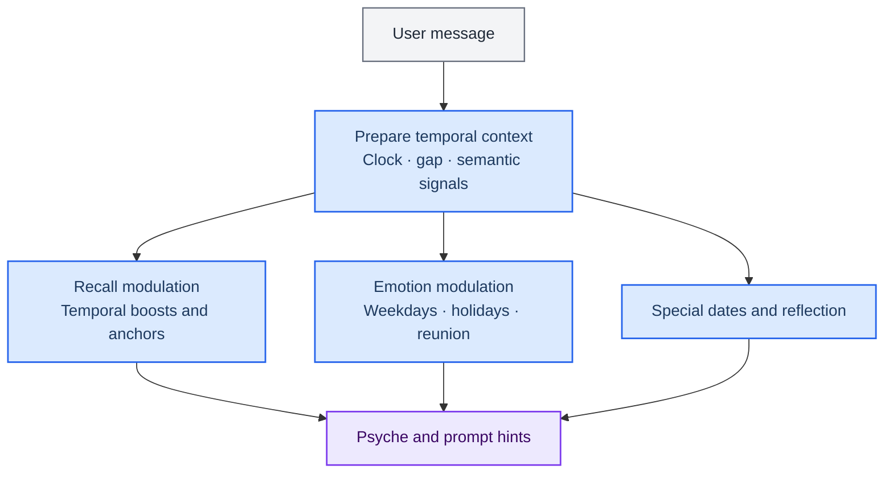

# Memory, personality, emotion and time

[中文](companion-engines.zh.md) · [Documentation](README.en.md)

These systems maintain companion continuity: memory supplies retrievable facts and action evidence, personality and emotion shape relationship state and expression, and time interprets intervals, dates and rhythm. They supply context to conversation and coordination; execution authority and acceptance belong to [tasks](architecture.md#tasks).

## Memory

### Retrieval, recording and control

[engine/orchestrator.ts](../src/main/engine/orchestrator.ts) prepares psyche and reply context through interpretation and retrieval. Companion rules in [interpreter.ts](../src/main/engine/interpreter.ts) differ from global semantic routing. A rule path without a model call does not establish a model-free application.

[factStore.ts](../src/main/memory/factStore.ts), [retriever.ts](../src/main/memory/retriever.ts) and [ingest.ts](../src/main/memory/ingest.ts) implement facts, recall and ingestion. Conversation injects selected relevant fragments rather than the entire fact store. Stable identity / Canon, Tier B and recent history have distinct roles. Policy, budgets and privacy levels constrain injection.

[MemorySystem](../src/main/memory/memorySystem.ts) combines chat and actions through [composeMemorySystem.ts](../src/main/memory/adapters/composeMemorySystem.ts):

| Interface | Purpose |
|---|---|
| `record` | Record chat, routing, plans and execution-receipt events |
| `recall` | Retrieve related events and facts |
| `control` | Correction, muting, forgetting, deletion and related controls |
| `recover` | Recover pending state from records and runtime snapshots |

The [action ledger](../src/main/memory/actions/actionRepository.ts) retains execution evidence. User statements, model inferences, plans and actual receipts have different evidentiary value. Recalling a discussed operation does not establish execution. Goal revisions and publication fences prevent old results from replacing current task state; see architecture for control semantics.

### Indexes and recovery

Retrieval can combine full-text / keywords, vectors, associations and temporal signals depending on the query and runtime state. [Embeddings](modules.md#embedding) are infrastructure rather than execution authority.

Rebuild derived indexes through supported application entry points. Rebuilding does not erase facts, recreate tasks or perform schema migrations. Do not delete tables while running or treat databases and artifacts as caches. Agent file processing and long-term memory ingestion serve different purposes; not every task resource needs memory import first.

Performance depends on fact count, document size, hardware, model and cold / warm startup. Record actual scale and latency rather than retaining old fixed-millisecond promises. Data locations and backup procedures live in the [user guide](usage.md#data-and-privacy).

## Personality and emotion

[relationship.ts](../src/main/engine/relationship.ts) updates relationship state and modulation. [emotion.ts](../src/main/engine/emotion.ts) combines events, existing state and memory echoes. [psyche.ts](../src/main/engine/psyche.ts) turns state into expressive hints.

[personalityPresets.ts](../src/main/personalityPresets.ts) contains presets; [personalityVoice.ts](../src/main/personalityVoice.ts) provides expression helpers. [state-persistence.ts](../src/main/engine/state-persistence.ts) persists state with orchestration. Source defines curves, thresholds, rhythm gates and activation; old formulas do not establish current behavior.

Personality and emotion shape tone, companion policy and psyche context, not evidence that files changed, commands succeeded or tasks passed acceptance. Across channels, check identity and session scope rather than assuming shared personality means identical state, execution and permissions.

Freya persona and corpus remain under [freya/](freya/README.md) as character material, separate from current execution architecture.

## Time

| Implementation | Responsibility |
|---|---|
| [clock.ts](../src/main/memory/temporal/clock.ts), [timezonePolicy.ts](../src/main/memory/temporal/timezonePolicy.ts) | Clock and timezone |
| [temporalParser.ts](../src/main/memory/temporal/temporalParser.ts) | Conversational dates, ranges and time expressions |
| [temporalContextModulator.ts](../src/main/memory/temporalContextModulator.ts) | Temporal modulation of recall and context |
| [specialDateDetector.ts](../src/main/engine/temporalAwareness/specialDateDetector.ts) | Birthday, anniversary and related hints |
| [temporalProactiveTrigger.ts](../src/main/engine/temporalAwareness/temporalProactiveTrigger.ts) | Temporal signals for companion policies |

Temporal anchors inform retrieval. Dates, relationship duration and reunion intervals may affect emotion, psyche and expression. Proactive output remains policy-gated. Check timezone, parsing window and the actual clock for ranges such as today, tomorrow and last week.

Companion time hints, [long-term goals](../src/main/tasks/longTerm.ts) and kernel scheduling tools have separate lifecycles. Mentioning a time does not authorize a background task or platform publication. Continuing execution still needs the relevant task, authorization and receipts.
