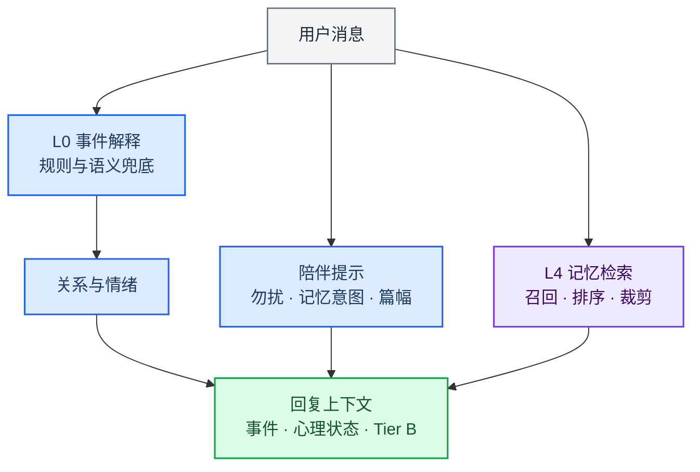
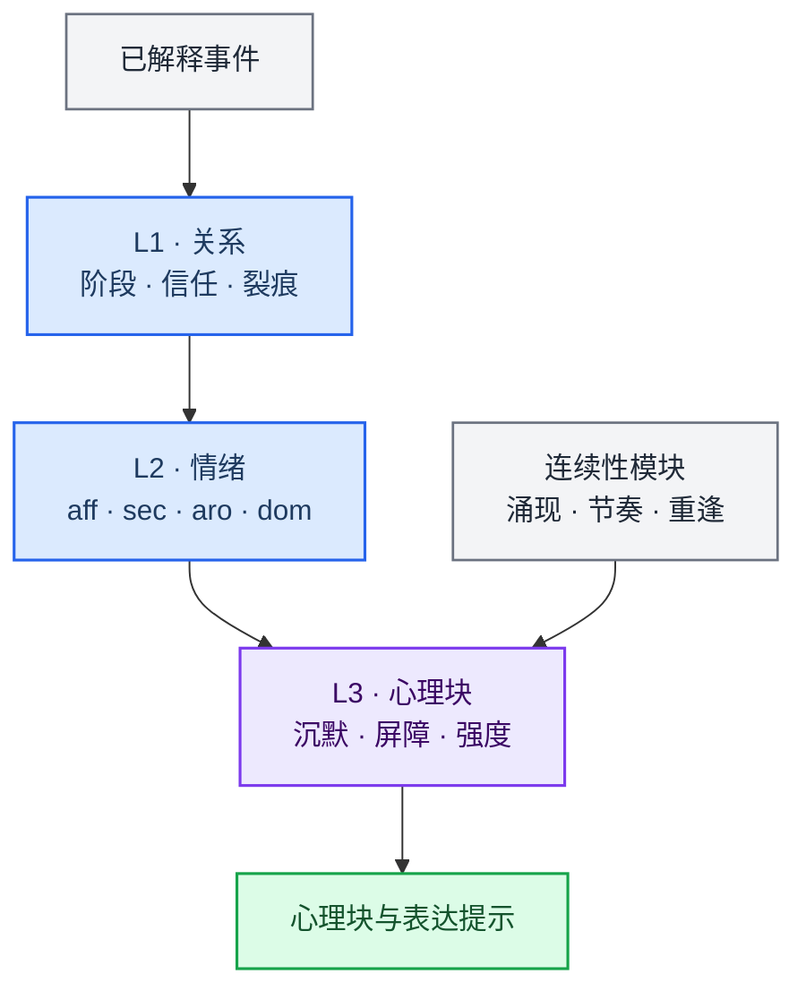
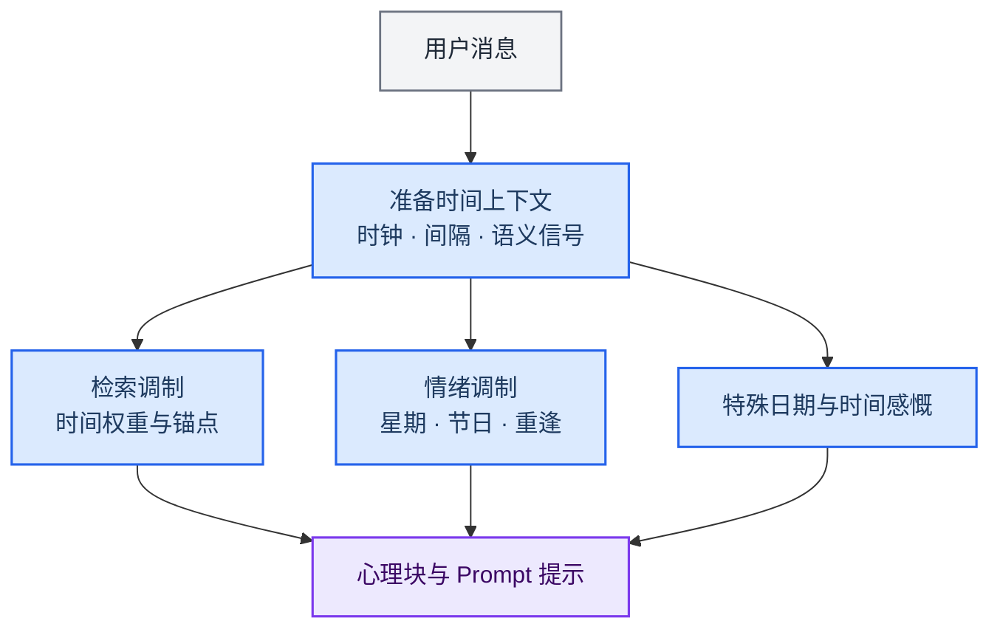

# 记忆引擎、性格情绪引擎与时间维度

[English](companion-engines.md) · [文档导航](README.md)

这三部分共同维持陪伴的连续性：记忆提供可召回事实与行动证据，性格情绪组织关系状态和表达，时间维度解释间隔、日期与节奏。它们为对话和任务协调提供上下文；执行授权与验收仍由[任务系统](architecture.zh.md#任务生命周期)负责。

## 记忆引擎

### 检索、记录与控制

[engine/orchestrator.ts](../src/main/engine/orchestrator.ts) 调用输入解释与记忆检索，准备心理块和回复上下文。[interpreter.ts](../src/main/engine/interpreter.ts) 的陪伴规则与全局语义路由不同，“局部规则不调用模型”不能推导为整个应用零 LLM。

[factStore.ts](../src/main/memory/factStore.ts)、[retriever.ts](../src/main/memory/retriever.ts) 和 [ingest.ts](../src/main/memory/ingest.ts) 维护事实、召回与写入。主对话选择相关片段注入，不把整个事实库放入每一轮；稳定身份／Canon、Tier B、近期历史各有用途。注入受策略、预算和隐私级别约束。

[MemorySystem](../src/main/memory/memorySystem.ts) 通过 [composeMemorySystem.ts](../src/main/memory/adapters/composeMemorySystem.ts) 整合聊天与行动记录：

| 接口 | 作用 |
|---|---|
| `record` | 记录聊天、路由、计划或执行回执等事件 |
| `recall` | 获取相关事件与事实 |
| `control` | 纠正、静音、遗忘、删除等控制 |
| `recover` | 根据记录与运行快照恢复待处理状态 |

[行动账本](../src/main/memory/actions/actionRepository.ts)保存执行证据。用户陈述、模型推断、计划和真实回执具有不同属性；记住曾讨论某项操作，不等于它已执行。目标修订与发布围栏防止旧结果替代新任务状态，具体控制见架构说明。

### 索引与恢复

检索可结合全文／关键词、向量、关联、时间等信号，具体组合以查询和运行状态为准。[Embedding](modules.zh.md#embedding) 是基础设施，不产生执行授权。

派生索引可按应用提供的入口重建；重建不等于清空事实、重建任务或完成 schema 迁移。不要在运行中手工删表，不把数据库和工作产物当缓存。大文件工具处理与长期记忆导入是不同用途，无需先把每份任务资源导入记忆。

性能受事实数量、文件尺寸、硬件、模型和冷／热启动影响；评估时记录真实规模与耗时，不沿用旧版固定毫秒数承诺。数据位置和备份统一见[使用指南](usage.zh.md#数据与隐私)。

## 性格与情绪引擎

[relationship.ts](../src/main/engine/relationship.ts) 更新关系状态与调制，[emotion.ts](../src/main/engine/emotion.ts) 结合事件、已有状态和记忆回声更新情绪，[psyche.ts](../src/main/engine/psyche.ts) 将状态组织为表达提示。

[personalityPresets.ts](../src/main/personalityPresets.ts) 保存人格预设，[personalityVoice.ts](../src/main/personalityVoice.ts) 提供表达辅助；[state-persistence.ts](../src/main/engine/state-persistence.ts) 配合编排保存状态。具体曲线、阈值、节奏门槛和启用状态由源码定义，不从旧公式推断当前行为。

性格与情绪影响语气、陪伴策略和心理块，不能成为文件已修改、命令成功或任务验收通过的证据。跨渠道还要核对身份与会话作用域，避免把共享人格理解为所有状态、执行和权限完全相同。

Freya 人格和语料属于角色资料，保留在 [freya/](freya/README.md)；它们不是当前执行架构的说明。

## 时间维度

| 实现 | 职责 |
|---|---|
| [clock.ts](../src/main/memory/temporal/clock.ts)、[timezonePolicy.ts](../src/main/memory/temporal/timezonePolicy.ts) | 时间来源与时区 |
| [temporalParser.ts](../src/main/memory/temporal/temporalParser.ts) | 对话中的日期、区间与时间表达 |
| [temporalContextModulator.ts](../src/main/memory/temporalContextModulator.ts) | 时间对召回与上下文的调制 |
| [specialDateDetector.ts](../src/main/engine/temporalAwareness/specialDateDetector.ts) | 生日、纪念日等提示 |
| [temporalProactiveTrigger.ts](../src/main/engine/temporalAwareness/temporalProactiveTrigger.ts) | 供陪伴策略使用的时间信号 |

时间锚点参与检索；日期、时间深度和重逢间隔可影响情绪、心理块与表达。是否主动发言仍受对应策略约束。“今天／明天／上周”等范围需同时核对时区、解析窗口和实际时钟。

陪伴时间提示、[长期目标](../src/main/tasks/longTerm.ts)和内核定时工具分别管理生命周期。普通对话提到一个时间，不会自行授权后台任务或平台发布；持续执行仍需相应任务、授权和回执。
