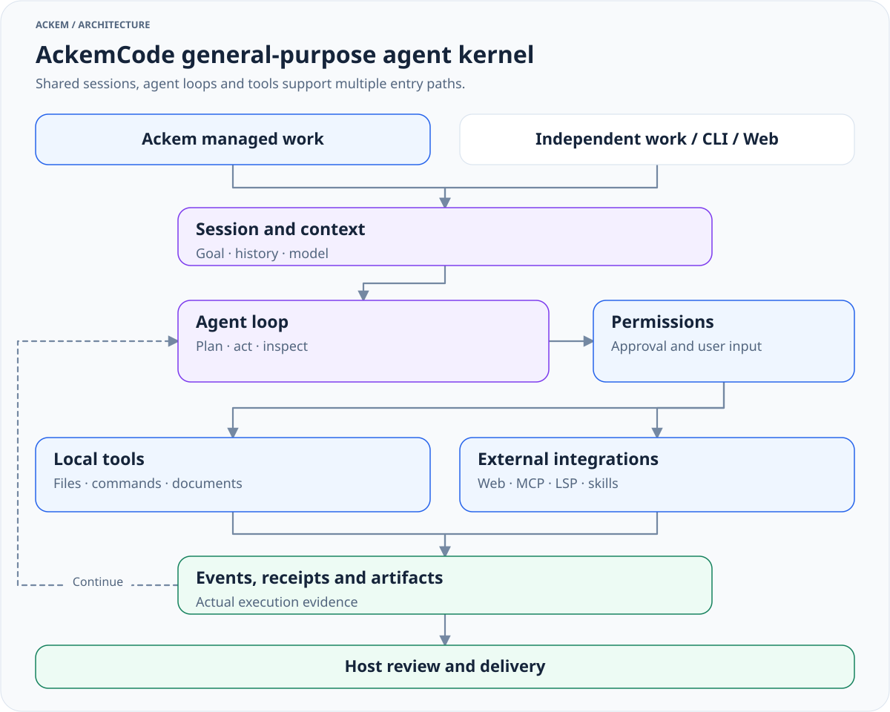

# Module reference

[中文](modules.zh.md) · [Documentation](README.en.md)

Use this page to locate implementation details. [Architecture](architecture.md) owns module relationships, the [user guide](usage.md) owns controls, and [development](development.md#extensions) owns extension development contracts.

## Source map

| Path | Responsibility |
|---|---|
| [src/main/index.ts](../src/main/index.ts), [ipc.ts](../src/main/ipc.ts) | Startup, IPC and runtime assembly |
| [channel/](../src/main/channel), [chat/](../src/main/chat) | Classification, orchestration, context consistency and replies |
| [tasks/](../src/main/tasks) | Managed contracts, coordination, persistence, notifications and continuing rules |
| [ackemcode/](../src/main/ackemcode) | Clients, startup adapters, supervision and independent work |
| [engine/](../src/main/engine), [memory/](../src/main/memory) | Companion state and memory; see [engines](companion-engines.md) |
| [extensions/](../src/main/extensions) | Built-in / user extensions and catalog |
| [channels/](../src/main/channels), [social/](../src/main/social) | QQ / WeChat, Qzone, identities, sessions and relationships |
| [db/](../src/main/db), [paths.ts](../src/main/paths.ts), [settings.ts](../src/main/settings.ts) | Database, data root and settings |
| [preload/](../src/preload), [shared/](../src/shared), [renderer/](../src/renderer) | Host bridge, shared contracts and React UI |
| [parts/ackemcode/](../parts/ackemcode) | Independent kernel package: server, CLI and Web UI |

## AckemCode

[Full size](diagrams/kernel-overview-en.light.svg) · [Dark](diagrams/kernel-overview-en.dark.svg) · [Source](diagrams/sources/kernel-overview-en.mmd)

| Kernel entry | Scope |
|---|---|
| [server/index.ts](../parts/ackemcode/src/server/index.ts) | HTTP API, sessions and SSE |
| [agent/loop.ts](../parts/ackemcode/src/server/agent/loop.ts) | Multi-turn model / tool loop |
| [tools/registry.ts](../parts/ackemcode/src/server/tools/registry.ts) | Registration, read-only detection and parallel-safety policy |
| [agent/permissions.ts](../parts/ackemcode/src/server/agent/permissions.ts) | Permissions, approvals, denial and interaction |
| [mcp/](../parts/ackemcode/src/server/mcp), [lsp/](../parts/ackemcode/src/server/lsp), [skills/](../parts/ackemcode/src/server/skills) | External tools, language services and skills |
| [sessionStore.ts](../parts/ackemcode/src/server/sessionStore.ts), [settingsStore.ts](../parts/ackemcode/src/server/settingsStore.ts) | Session and configuration persistence |
| [cli/main.tsx](../parts/ackemcode/src/cli/main.tsx) | Independent CLI |

Tools cover files, commands, networking, documents, planning, verification and subagents. Formats and availability depend on implementation, services, credentials and local programs. Kernel plugins are distinct from Ackem plugin-route extensions.

### Two startup adapters

| | Desktop managed / work page | QQ / WeChat code bridge |
|---|---|---|
| Startup | [ensureDaemon.ts](../src/main/ackemcode/ensureDaemon.ts) | [daemon.ts](../src/main/ackemcode/daemon.ts) |
| Server entry | `src/server/index.ts` through kernel tsx | `dist/server/index.js` |
| Model sync | [syncRuntimeLlm.ts](../src/main/ackemcode/syncRuntimeLlm.ts) | [llmSync.ts](../src/main/ackemcode/llmSync.ts) |
| Default kernel data | `<codeRoot>/data/` | `~/.ackemcode/` |
| Model selection | Valid dedicated AckemCode settings first, then app settings and implementation fallbacks | Sync valid app configuration, otherwise keep existing kernel settings |

Default port is `8787`. `ACKEMCODE_URL` reuses a service and `ACKEMCODE_PORT` overrides its port. Actual service configuration and data come from its launch path, not whichever file a caller prepared. Use an absolute `ACKEMCODE_DATA_DIR`; desktop synchronization rejects relative paths.

Channel sessions use [index.ts](../src/main/ackemcode/index.ts) / [chatClient.ts](../src/main/ackemcode/chatClient.ts). Mappings live in Electron userData's `ackemcode-sessions.json`; reuse checks directory and permissions.

Kernel modes include default, plan, acceptEdits, auto, bypassPermissions and dontAsk. Host task permissions and executionMode have separate enums in [shared/tasks.ts](../src/shared/tasks.ts). Managed sessions bind goal revision, epoch and fencing; do not bypass bindings to alter sessions manually. See [user controls](usage.md#work-and-permissions) for permissions and stopping.

Independent commands include `npm --prefix parts/ackemcode run cli`, `npm --prefix parts/ackemcode run dev:server` and built-server `npm --prefix parts/ackemcode start`, with `bin/ackem.mjs` also available. Existing commands do not establish configured models or working external tools.

Channel-only variables: `ACKEMCODE_DISABLE=1` disables the code bridge; `ACKEMCODE_REQUIRE_EXPLICIT=1` requires an explicit prefix. Neither globally disables desktop work.

## Prompt and models

[context.ts](../src/main/context.ts) combines history, retrieval, companion state, runtime architecture and task facts. [prompt/main-chat.ts](../src/main/prompt/main-chat.ts) and [runtime-architecture.ts](../src/main/prompt/runtime-architecture.ts) organize main-chat instructions. [chat.ts](../src/main/chat.ts) and [anthropicMessages.ts](../src/main/anthropicMessages.ts) adapt model calls.

[executeOpenAiTools.ts](../src/main/chat/executeOpenAiTools.ts) handles ordinary chat tools; work has a separate execution path. [contextPublicationFence.ts](../src/main/chat/contextPublicationFence.ts) prevents stale task context from becoming current delivery evidence. Routing, conversation, supervision and kernel execution have separate model inputs and budgets.

## Embedding

Vector interfaces and local ONNX implementations live under [memory/embedding/](../src/main/memory/embedding). See [modelManager.ts](../src/main/memory/embedding/modelManager.ts) and [bootstrapBundledModels.ts](../src/main/memory/embedding/bootstrapBundledModels.ts) for model management and bundled resources.

[embeddingReadiness.ts](../src/main/embedding/embeddingReadiness.ts) and [semanticFallback.ts](../src/main/embedding/semanticFallback.ts) manage readiness and fallback paths. Configuration and code define models, dimensions, resource paths and index compatibility. Missing embeddings can affect recall or readiness gates; it is not correct to promise all chat entry points are unaffected.

`npm run prepare:embedding-models` prepares application semantic resources separately from conversation LLM configuration and kernel builds. Retrieval and rebuilding semantics live in [memory](companion-engines.md#memory).

## Storage

[paths.ts](../src/main/paths.ts) selects the active data root; [layout.ts](../src/main/layout.ts) prepares directories. User-directory mode normally uses `%LOCALAPPDATA%/Ackem` on Windows or `~/Library/Application Support/Ackem` on macOS; check settings and actual source behavior.

`ackem.db` stores structured state, history, memory, actions and tasks. The base [schemaVersion.ts](../src/main/db/schemaVersion.ts) is currently `22`. Compatibility reconciliation and module initialization also shape the database; the version is not a full table inventory.

Common data-root entries include `memory/`, `companion/`, `diary/`, `imports/`, `openforu/`, `workspace/`, `_derived/`, `models/` and `logs/` as used. SQLite can contain full-text and vector data; not all indexes are `_derived/` files. Settings, kernel sessions and external artifacts have other locations. Backup procedures live only in the [user guide](usage.md#data-and-privacy).

## Interfaces

The renderer calls [ipc/](../src/main/ipc) through `window.ackem` / preload; shared contracts live in [shared/](../src/shared). Chat, managed tasks and independent work have different input and event types. UI wording does not replace snapshots.

[client.ts](../src/main/ackemcode/client.ts) and related adapters consume kernel HTTP / SSE. Disconnection, stopping, quiescence, acceptance and delivery are distinct events. Attachment interfaces such as `chat:captureAttachments` normalize actual inputs; an arbitrary path string is not a validated attachment.

## Extensions

Source-adjacent [extensions/README](../src/main/extensions/README.md), the [OpenForU protocol](../src/main/extensions/openforu/PROTOCOL.md) and local READMEs retain detailed interfaces and examples. Development rules have one home in [development](development.md#extensions). Dates and old test counts in catalogs do not establish current capability.

See [diagram reference](diagrams/README.en.md) for visual maintenance and [Freya](freya/README.md) for persona and design material.
