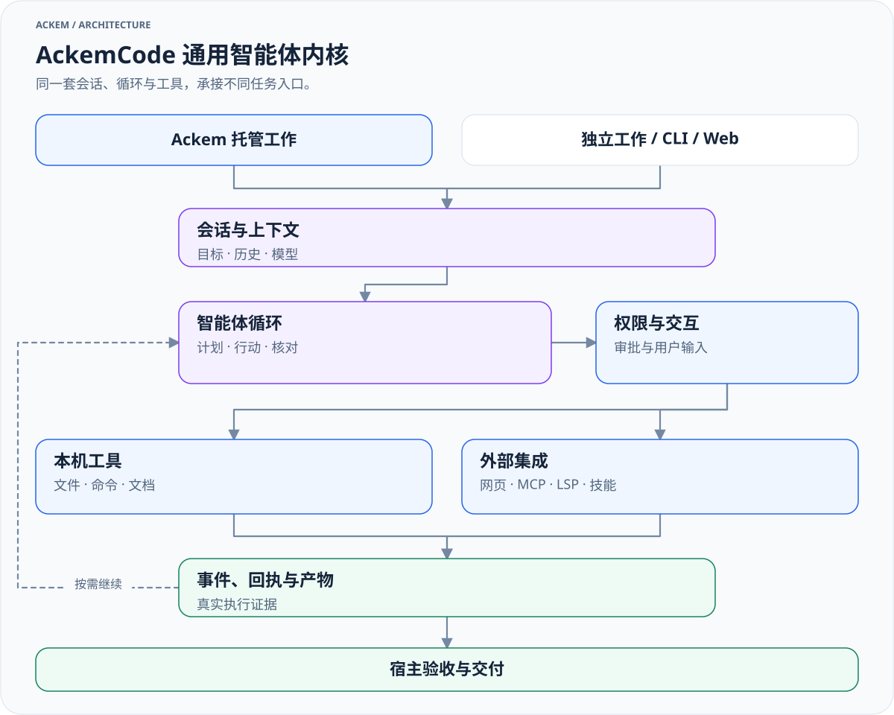

# 模块参考

[English](modules.md) · [文档导航](README.md)

本篇按源码入口查细节。模块关系在[架构说明](architecture.zh.md)维护；用户操作在[使用指南](usage.zh.md)维护，扩展开发契约在[开发指南](development.zh.md#扩展开发)维护。

## 源码地图

| 路径 | 职责 |
|---|---|
| [src/main/index.ts](../src/main/index.ts)、[ipc.ts](../src/main/ipc.ts) | 应用启动、IPC 与运行时组装 |
| [channel/](../src/main/channel)、[chat/](../src/main/chat) | 分类、编排、上下文一致性与回复 |
| [tasks/](../src/main/tasks) | 托管契约、协调、持久化、通知与持续规则 |
| [ackemcode/](../src/main/ackemcode) | 客户端、启动适配、监督与独立工作 |
| [engine/](../src/main/engine)、[memory/](../src/main/memory) | 陪伴状态与记忆，详见[引擎说明](companion-engines.zh.md) |
| [extensions/](../src/main/extensions) | 官方／用户扩展与能力目录 |
| [channels/](../src/main/channels)、[social/](../src/main/social) | QQ／微信、空间、身份、会话与关系 |
| [db/](../src/main/db)、[paths.ts](../src/main/paths.ts)、[settings.ts](../src/main/settings.ts) | 数据库、数据根与设置 |
| [preload/](../src/preload)、[shared/](../src/shared)、[renderer/](../src/renderer) | 宿主桥、共享协议与 React UI |
| [parts/ackemcode/](../parts/ackemcode) | 独立内核子包，服务、CLI 与 Web UI |

## AckemCode

[放大查看](diagrams/kernel-overview-zh.light.svg) · [深色版本](diagrams/kernel-overview-zh.dark.svg) · [图源](diagrams/sources/kernel-overview-zh.mmd)

| 内核入口 | 内容 |
|---|---|
| [server/index.ts](../parts/ackemcode/src/server/index.ts) | HTTP API、会话与 SSE |
| [agent/loop.ts](../parts/ackemcode/src/server/agent/loop.ts) | 模型与工具多轮循环 |
| [tools/registry.ts](../parts/ackemcode/src/server/tools/registry.ts) | 工具注册、只读判断及并发安全策略 |
| [agent/permissions.ts](../parts/ackemcode/src/server/agent/permissions.ts) | 权限、审批、拒绝和交互 |
| [mcp/](../parts/ackemcode/src/server/mcp)、[lsp/](../parts/ackemcode/src/server/lsp)、[skills/](../parts/ackemcode/src/server/skills) | 外部工具、语言服务与技能 |
| [sessionStore.ts](../parts/ackemcode/src/server/sessionStore.ts)、[settingsStore.ts](../parts/ackemcode/src/server/settingsStore.ts) | 会话与配置持久化 |
| [cli/main.tsx](../parts/ackemcode/src/cli/main.tsx) | 独立 CLI |

工具覆盖文件、命令、网络、文档、计划、验证及子智能体；可用格式与能力依赖具体实现、服务、凭据和本机程序。内核插件不是 Ackem 的 plugin 路由扩展。

### 两套宿主启动适配

| | 桌面托管／工作页 | QQ／微信代码桥接 |
|---|---|---|
| 启动 | [ensureDaemon.ts](../src/main/ackemcode/ensureDaemon.ts) | [daemon.ts](../src/main/ackemcode/daemon.ts) |
| 服务入口 | `src/server/index.ts`，通过内核 tsx | `dist/server/index.js` |
| 模型同步 | [syncRuntimeLlm.ts](../src/main/ackemcode/syncRuntimeLlm.ts) | [llmSync.ts](../src/main/ackemcode/llmSync.ts) |
| 默认内核数据 | `<codeRoot>/data/` | `~/.ackemcode/` |
| 模型选择 | 独立 AckemCode 配置有效时优先，否则主应用，再按实现回退 | 主应用配置有效时同步，否则沿用已有配置 |

默认端口 `8787`；`ACKEMCODE_URL` 可复用服务，`ACKEMCODE_PORT` 可覆盖端口。实际服务的模型和数据目录由其启动方式决定，不取决于调用方准备了哪个配置文件。`ACKEMCODE_DATA_DIR` 使用绝对路径，桌面同步拒绝相对路径。

渠道会话通过 [index.ts](../src/main/ackemcode/index.ts)／[chatClient.ts](../src/main/ackemcode/chatClient.ts) 适配，映射保存在 Electron userData 的 `ackemcode-sessions.json`，复用时核对工作目录与权限。

内核权限模式含 default、plan、acceptEdits、auto、bypassPermissions、dontAsk；宿主任务权限与 executionMode 另有枚举，以 [shared/tasks.ts](../src/shared/tasks.ts) 为准。托管会话绑定目标修订、epoch 与 fencing；不要绕开绑定手工修改。用户权限与停止语义见[使用指南](usage.zh.md#工作执行与权限)。

独立命令：`npm --prefix parts/ackemcode run cli`、`npm --prefix parts/ackemcode run dev:server` 或构建后的 `npm --prefix parts/ackemcode start`；也可使用包内 `bin/ackem.mjs`。这些命令存在不表示模型或外部工具已配置成功。

渠道专用变量：`ACKEMCODE_DISABLE=1` 禁用代码桥接，`ACKEMCODE_REQUIRE_EXPLICIT=1` 仅接受显式前缀；两者不是全局关闭桌面 work 的开关。

## Prompt 与模型

[context.ts](../src/main/context.ts) 组合历史、检索、性格情绪、运行架构和任务事实；[prompt/main-chat.ts](../src/main/prompt/main-chat.ts) 与 [runtime-architecture.ts](../src/main/prompt/runtime-architecture.ts) 组织主聊天指令。[chat.ts](../src/main/chat.ts) 和 [anthropicMessages.ts](../src/main/anthropicMessages.ts) 提供模型适配。

[executeOpenAiTools.ts](../src/main/chat/executeOpenAiTools.ts) 处理普通聊天工具，work 使用独立执行链。[contextPublicationFence.ts](../src/main/chat/contextPublicationFence.ts) 防止过时任务上下文成为当前交付依据。路由、主聊天、监督和内核有各自模型输入，不能把某一份 Prompt 的预算视为全局预算。

## Embedding

向量服务接口与本机 ONNX 实现在 [memory/embedding/](../src/main/memory/embedding)；模型管理见 [modelManager.ts](../src/main/memory/embedding/modelManager.ts)，捆绑资源准备见 [bootstrapBundledModels.ts](../src/main/memory/embedding/bootstrapBundledModels.ts)。

[embeddingReadiness.ts](../src/main/embedding/embeddingReadiness.ts) 与 [semanticFallback.ts](../src/main/embedding/semanticFallback.ts) 管理相关就绪和降级路径。模型、维度、资源位置和索引兼容性以配置与实现为准。向量不可用可影响召回或就绪门槛，不能笼统承诺所有入口聊天不受影响。

`npm run prepare:embedding-models` 准备根应用本地语义资源；这与配置对话 LLM、构建内核是不同步骤。检索与重建语义见[记忆引擎](companion-engines.zh.md#记忆引擎)。

## 存储

[paths.ts](../src/main/paths.ts) 选择活跃数据根，[layout.ts](../src/main/layout.ts) 准备基础目录。用户目录模式在 Windows 通常为 `%LOCALAPPDATA%/Ackem`，macOS 为 `~/Library/Application Support/Ackem`；实际路径以设置与代码为准。

`ackem.db` 存储结构化状态、历史、记忆、行动与任务。基础 [schemaVersion.ts](../src/main/db/schemaVersion.ts) 当前为 `22`；兼容补表和模块自己的初始化也参与实际结构，版本号不是完整表清单。

数据根中常见 `memory/`、`companion/`、`diary/`、`imports/`、`openforu/`、`workspace/`、`_derived/`、`models/`、`logs/` 等，按使用情况生成。SQLite 中也可能有全文和向量数据，不应把所有索引等同于 `_derived/` 文件。设置、内核会话与外部产物另有位置；备份只在[使用指南](usage.zh.md#数据与隐私)说明。

## 接口

渲染层经 `window.ackem`／preload 调用 [ipc/](../src/main/ipc) 宿主接口，协议类型位于 [shared/](../src/shared)。聊天、托管任务和独立工作具有各自的提交与事件类型，UI 文字不替代状态快照。

内核 HTTP／SSE 由 [client.ts](../src/main/ackemcode/client.ts) 等适配消费。断流、停止、静止、验收与交付不是同一事件。附件入口如 `chat:captureAttachments` 会做实际输入规范化，任意路径字符串不能等同于已验证附件。

## 扩展

源码旁的 [extensions/README](../src/main/extensions/README.md)、[OpenForU 协议](../src/main/extensions/openforu/PROTOCOL.md)及各模块小 README 保留局部协议和例子。开发规则统一见[开发指南](development.zh.md#扩展开发)，不要从历史 catalog 的日期或测试数量推断当前能力。

图表维护见[图表参考](diagrams/README.md)；人格语料与设计参考见 [Freya](freya/README.md)。
