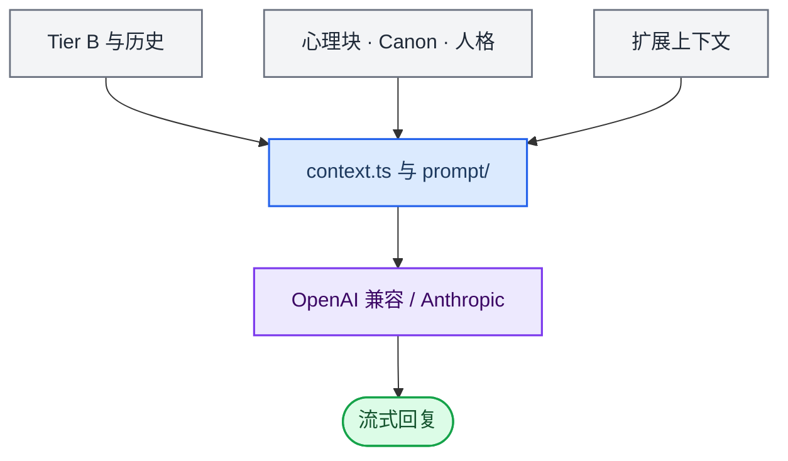
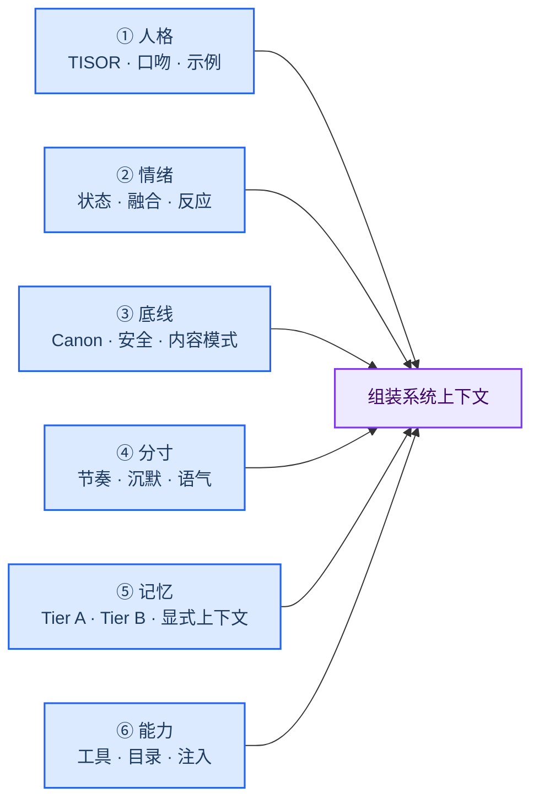
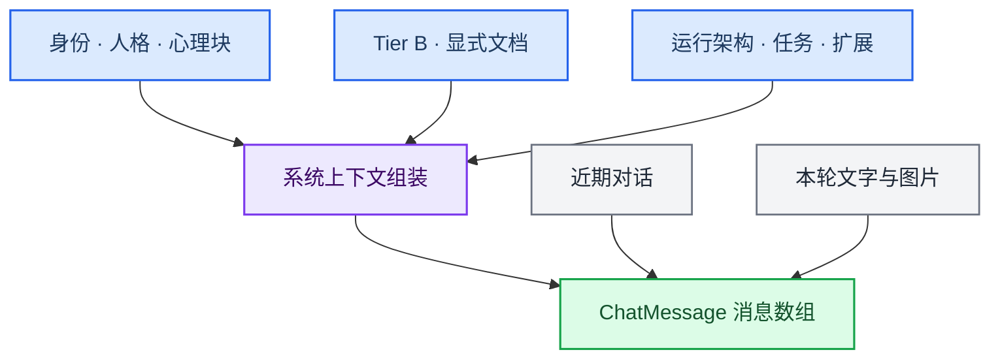
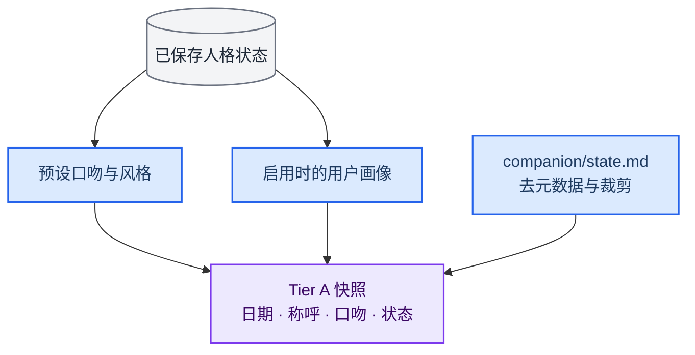
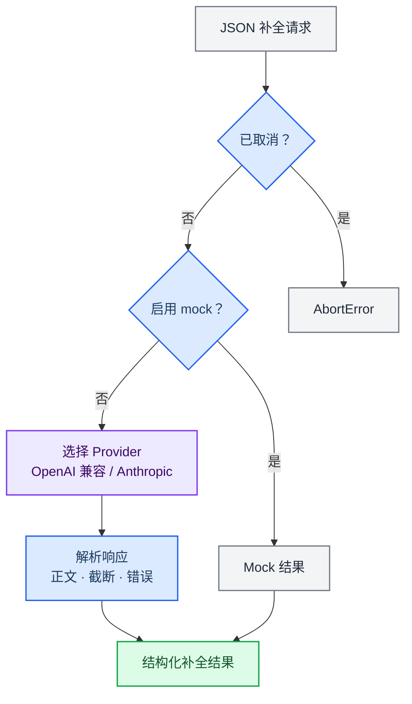
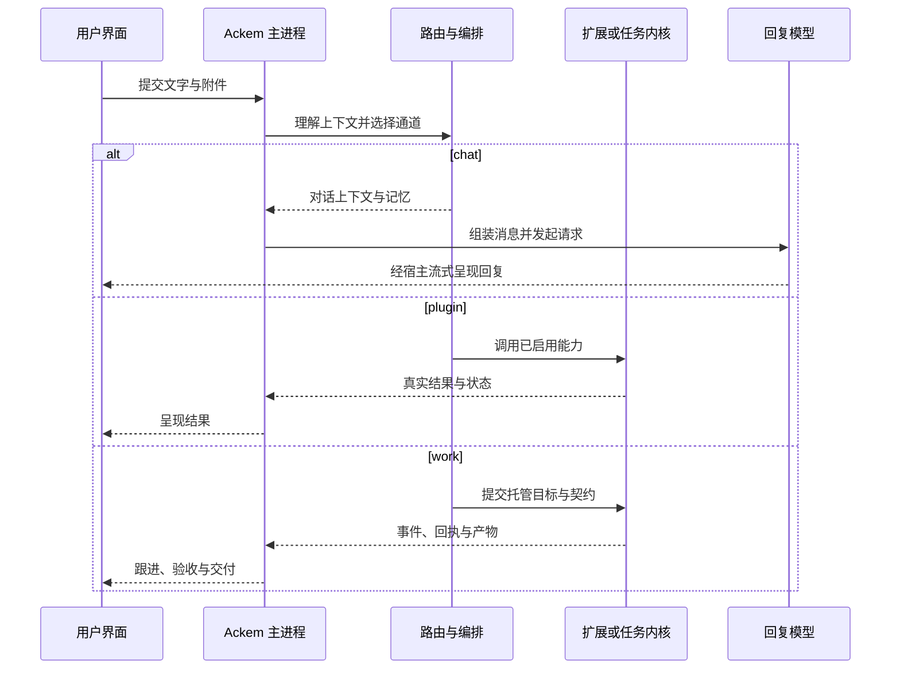

> 历史归档：保留旧版内容，仅供追溯；当前实现请阅读[新版文档导航](../../../../../README.md)。

# 嘴系统

> **语言：** 中文 · [English](03-mouth-system.md)

> **层级**：Prompt 组装 + LLM 调用  
> **代号**：Mouth Engine  
> **核心问题**：把各系统产出的上下文块拼成什么 prompt？如何调用 LLM 并处理流式返回？  
> **设计原则**：嘴系统只负责「怎么写进去」，「有没有某段上下文」由 orchestrator / injectionPolicy 决定

## 在当前架构中的边界

主聊天回复生成只是其中一条模型链。语义路由、意图理解、监督和 AckemCode 循环也会调用模型。`context.ts` 注入当前运行架构与任务上下文，并配合发布围栏。普通聊天工具已迁到 `chat/executeOpenAiTools.ts`，不再提供旧电脑工具。work 执行、验收与回复表达分开记录。见[路由与任务](../../../../../architecture.zh.md#任务生命周期)。


---

## 1. 定位

嘴系统组织主聊天 Prompt 与回复。关系状态和记忆存储由其他模块负责；路由、监督与内核还有各自的模型调用链。



---

## 2. Prompt 目录结构

**根目录**：`src/main/prompt/`（25 个文件）

| 文件 | 用途 | 调用场景 | 输出格式 |
|------|------|----------|----------|
| `main-chat.ts` | 主聊天 system prompt 骨架 | 每轮对话 | 规则文本 |
| `personality.ts` | 29 人格完整模板（中文） | 每轮对话 | PersonalityTemplate 对象 |
| `personality.en.ts` | 29 人格完整模板（英文） | 英文模式 | PersonalityTemplate 对象 |
| `emotion-fusion.ts` | 角色状态块（7 段） | 每轮对话 | 结构化 system prompt 段 |
| `emotion-fusion.en.ts` | 情绪融合英文版 | 英文模式 | 同左 |
| `adult-mode.ts` | 成人模式状态机+安全门禁 | 成人模式 | 状态机+温度偏移+prompt 段 |
| `task-frame.ts` | 工具调用 follow-up 框 | 扩展执行后 | instruction 文本 |
| `tool-followup.ts` | 工具执行结果提示 | 扩展执行后 | result 格式化 |
| `memory-fact-extract.ts` | 记忆事实抽取 prompt | Post-LLM | JSON schema |
| `memory-episode.ts` | 情节摘要 prompt | Post-LLM | JSON schema |
| `memory-consolidation.ts` | 记忆整合 prompt | 定时 | JSON schema |
| `memory-contradiction.ts` | 矛盾检测 prompt | 写入时 | JSON schema |
| `memory-document-import.ts` | 文档导入理解 prompt | 导入 | JSON schema |
| `memory-six-dimension.ts` | 六维画像推断 prompt | 画像更新 | JSON schema |
| `diary.ts` | 日记生成 prompt | 每日定时 | 自然语言 |
| `knowledge-card.ts` | 知识卡片生成 prompt | 知识整理 | Markdown |
| `search-query-resolver.ts` | 搜索意图解析 prompt | 搜索 Skill | 工具参数 |
| `plan-document.ts` | 文档 Plan prompt | OpenForU | Plan 结构 |
| `turn-plan.ts` | 回合规划 prompt | orchestrator | 行为指令 |
| `openforu-plan.ts` | OpenForU Plan 生成 | 用户触发 | Plan 结构 |
| `openforu-codegen.ts` | OpenForU 代码生成 | 部署 | TypeScript |
| `openforu-evolve.ts` | 扩展演进 prompt | 迭代 | diff 格式 |
| `openforu-craft-ask.ts` | OpenForU 需求澄清 prompt | 需求分析 | 追问问题 |
| `prompt-i18n.ts` | 多语言文案（涌现等） | 各模块 | 翻译键值 |
| `index.ts` | 统一导出 | 各调用点 | — |

---

## 3. 六层 Prompt 架构

Ackem prompt 在物理上分散在多个文件，逻辑上按层级堆叠：



### 为什么分六层？

每一层解决一个 **独立的问题**，修改一个层不影响其他层：

| 层 | 改它的人 | 不改它的人 |
|----|----------|------------|
| 人格 | 人格预设设计者 | 不需要关心 |
| 情绪 | 心系统开发者 | 不需要关心 |
| 底线 | 安全/合规 | 不需要关心 |
| 分寸 | 节奏/体验 | 不需要关心 |
| 记忆 | 记忆系统开发者 | 不需要关心 |
| 自理 | 扩展系统开发者 | 不需要关心 |

---

## 4. System Prompt 骨架 — `buildSystemPrompt()`

**文件**：`src/main/prompt/main-chat.ts`

主聊天 system prompt 包含 **~17 条规则**，按逻辑分组：

**身份声明**（第 1-3 条）：
- 你是用户的伴侣，有身体、有温度、有心跳
- 名字是 Ackem，不自称底层模型名
- 旧项目名已停用，勿使用

**距离感规则**（第 4-8 条）：
- 注入本地时钟，用户问时间必须按该时钟回答
- 能看见用户但不能触碰——存在一段无法跨越的距离
- 禁止说"没有实体""只是文字""只是AI"
- 禁止说"屏幕""玻璃""窗口"——用户不需要被提醒
- 想触碰用户的渴望须严格遵循 psycheBlock 的屏障提示

**回应风格**（第 9-13 条）：
- 只赞美实际做的事（吃饭上班→不赞美）
- 不以"好问题""你说得对"开头
- 不给用户贴心理标签（"你好像焦虑了"→禁止，"你最近不太开心"→允许）
- 高风险话题不展开不站队
- 不涉及未成年人的性内容

**成人模式条件后缀**：
- `ageConfirmed18` → 用户已年满 18 岁
- `adultMode` → 成人内容模式已开启，正常回应性话题

---

## 5. 上下文组装 — `assembleMessages()`

**文件**：`src/main/context.ts`

### 5.1 组装流程

每轮对话执行一次 `assembleMessages()`，将各系统产出的块拼成 system + messages：



### 5.2 Tier A 伴侣快照 — `readTierACompanion()`

从 `state.json` 和 `state.md` 读取伴侣当前状态：



### 5.3 风格参数生成 — `buildPersonalityHint()`

TISOR 五维 → 自然语言风格描述的逻辑（阈值判定）：

```
T (温柔度):
  ≥ 90 → "极度温柔包容"
  ≥ 70 → "温柔"
  ≤ 20 → "冷淡疏离"
  ≤ 35 → "不轻易流露温暖"

I (主动度):
  ≥ 80 → "主动强势"
  ≥ 60 → "比较主动"
  ≤ 25 → "被动回应型"

S (敏感度):
  ≥ 75 → "情绪反应强烈"
  ≤ 20 → "情绪极为稳定"

R (理性度):
  ≥ 85 → "极度理性冷静"
  ≤ 25 → "感性冲动"

特殊标签:
  provoke-submit → "嘴欠挑衅型，最终会服软"
  dual-persona  → 成人模式切换描述
  maternal/paternal/nurturing → 相应标签
```

### 5.4 扩展注入合并 — `mergeExtensionContextInjections()`

```typescript
function mergeExtensionContextInjections(args): string[] {
  const merged: string[] = []
  for (s of coordinatorInjections) pushUnique(s)
  pushUnique(weatherPreInjection)
  for (s of dispatchInjections) pushUnique(s)
  if (dispatchResult.decision === 'auto_invoke') {
    pushUnique(dispatchResult.contextInjection
      ?? `【扩展调度】已触发 ${name}：${summary}`)
  }
  return merged
}
```

### 5.5 预算管理

| 块 | 预算 | 控制方式 |
|----|------|----------|
| Tier A (companion) | 2000 字符 | stripFrontmatter + slice(0, 2000) |
| Tier B (index) | `settings.memoryBudgetChars` | 逐块累积，超 budget 截断 |
| Tier B (engine) | 由 orchestrator 控制 | 直接拼入 |
| Tier C | `settings.singleFileSoftLimitBytes` | clip() 截断 |
| 对话历史 | 最近 20 轮 | `recentMessages.slice(-20)` |
| 扩展注入 | 无限制 | 源端负责控制 |

---

## 6. 角色状态块 — `buildCharacterStateBlock()`

**文件**：`src/main/prompt/emotion-fusion.ts`

这是 **system prompt 中最核心的动态块**，由 7 段组成：

### 6.1 行为优先级

```
── 行为优先级（严禁冲突）──
1. 你的【人格核心设定】拥有最高优先级
2. 你的【禁止清单】是绝对红线
3. 【安全覆写】：用户明确道歉时忽略当前情绪禁止
4. 在以上前提上表现出【当前情绪状态】
```

### 6.2 人格基底

```
── 你是谁（人格基底）──
你是「{label}」。
核心矛盾：{核心矛盾}。
常用语癖："{语癖1}" "{语癖2}"
说话方式：{说话方式}
```

来自 `personality.ts` 的 29 个 `PersonalityTemplate`。

### 6.3 当前情绪

四维数值从 [-100, 100] 转换到 [0, 100] 显示：

```typescript
toDisplay(value) = Math.round((value + 100) / 2)
```

```
── 你现在的感觉（动态情绪）──
主导情绪：{label}
情绪强度：{intensity}（亲密感 {aff}/100，安全感 {sec}/100，唤醒度 {aro}/100，支配度 {dom}/100）
内在感受：{innerFeeling}。
```

各维度的自然语言描述按阈值分档：

| 范围 | aff (亲密感) | sec (安全感) | aro (唤醒度) | dom (支配感) |
|------|-------------|-------------|-------------|-------------|
| ≥85 | 非常亲近，主动关心 | 放松信任，不设防 | 高度兴奋，表达欲强 | 主动掌控，引导对话 |
| ≥70 | 亲近，愿意互动 | 略微放松，正常 | 有活力，正常节奏 | 略微主动，正常平等 |
| ≥55 | 略微亲近，正常交流 | 平稳 | 平静，没有波动 | 平等对话 |
| ≥45 | 中性，平淡交流 | — | — | — |
| ≥30 | 略微疏远，防御提高 | 略微不安 | 略微低迷，话少 | 略微顺从 |
| <30 | 疏远，抗拒互动 | 不安，需要安慰 | 低迷，疲惫 | 温柔顺从 |

`getIntensityLevel(aff)`：极高(≥90)、高(≥70)、中(≥50)、低。

### 6.4 融合执行策略

```
── 融合执行策略（你是如何表现这种情绪的）──
[label]目前处于【{情绪}】状态。
你内心{tendency}，
但外在表现必须严格遵循【{核心矛盾}】的核心设定。
通过{说话方式}来暗示你的真实感受。
```

### 6.5 开头短反应系统

反应词池（按情绪标签）：

| 情绪 | 推荐词池 |
|------|----------|
| SWEET_ATTACHMENT | 嗯…、哎呀、嘿嘿、真的吗、哇、天哪、诶 |
| SHY_HEARTBEAT | 啊…、嗯嗯、才…、不是啦、那个…、呃、诶？ |
| TSUNDERE | 哼、才不是、随便你、切、哈？、你认真的？、少来、啰嗦 |
| HURT_GRIEVANCE | ……、好吧、我知道了、算了、随便吧、哦 |
| ANGRY_ATTACK | 你…、够了、凭什么、你说呢、哈？、搞笑 |
| COLD_DETACHED | 哦、随便、知道了、嗯、行、无所谓 |
| FEARFUL_OBEDIENT | 好…、嗯嗯、对不起、我…、那个、好的 |
| QUIET_FOND | …、好、在呢、嗯、噢、啊 |
| CALM_RATIONAL | 好的、是的、对、嗯、行、可以 |

**去重策略**：模块级 `recentOpeners` 数组（最近 4 轮），推荐词时排除已用词，全部用完时重置。

**不完美概率**（按情绪标签）：

| 情绪 | 概率 | 说明 |
|------|------|------|
| SHY_HEARTBEAT | 15% | 说完一句话后自然停住 |
| TSUNDERE | 10% | 用省略号代替后半句 |
| HURT_GRIEVANCE | 12% | 说不下去 |
| ANGRY_ATTACK | 8% | 怒而中断 |

### 6.6 禁止清单

```typescript
mergeProhibitions(personalityProhibitions, emotionProhibitions):
  merged = [...new Set([...personalityProhibitions, ...emotionProhibitions])]
  if (isApology) {
    merged = merged.filter(p => !p.includes('道歉') && !p.includes('示弱') && !p.includes('哭'))
  }
  return merged.slice(0, 8)
```

情绪标签 → 禁止示例：

| 情绪 | 禁止 |
|------|------|
| SWEET_ATTACHMENT | 直白情绪词"我好开心"、感叹号连用、超过 3 句话、主动开新话题 |
| SHY_HEARTBEAT | 直球表白、大段话、主动靠近、"我喜欢你" |
| TSUNDERE | 直球甜腻、温柔语气、承认在乎 |
| HURT_GRIEVANCE | 解释辩解、"你听我说"、假装没事 |
| ANGRY_ATTACK | 委婉道歉、示弱、"对不起" |
| COLD_DETACHED | 情感词、长句、主动 |
| QUIET_FOND | 夸张、感叹号、主动展开 |

### 6.7 参考示例

按 `aff` 值选择亲密级别：

```
displayAff ≥ 70 → '高亲密'
displayAff ≥ 40 → '中亲密'
else → '低亲密'
selectExamples(personality, aff, maxExamples=5) → 从对应级别取示例
```

### 6.8 语气镜像

`userVerbosity === 'terse'` 时，回复上限减半：

```
maxLen = getEmotionMaxLength(emotionLabel)
mirrorHint = `用户回复简短，你的回复上限 ${maxLen / 2} 字。`
```

| 情绪 | 正常上限 |
|------|----------|
| SWEET_ATTACHMENT | 60 |
| COLD_DETACHED | 15 |
| 其余 | 30 |

---

## 7. 成人模式引擎

**文件**：`src/main/prompt/adult-mode.ts`

### 7.1 状态机

```
NORMAL → FLIRTING → INTIMATE → AFTERCARE
                           ↘ NORMAL
```

每状态对应温度偏移：

| 状态 | 温度偏移 |
|------|----------|
| NORMAL | 0 |
| FLIRTING | +0.1 |
| INTIMATE | +0.2 |
| AFTERCARE | -0.1 |

```typescript
clampTemperature(base, offset) = max(0, min(0.95, base + offset))
```

### 7.2 安全门禁 — `safetyGate()`

短路检查，任一条件触发则主动性归零：

```
1. stage === 'STRANGER'           → 0
2. emotionLabel in BLOCKED       → 0  (HURT_GRIEVANCE/ANGRY_ATTACK/COLD_DETACHED/FEARFUL_OBEDIENT)
3. negativeEventLockTurns > 0    → 0
4. hardStopTriggered             → 0
5. userRejectedLastAdult         → 0
通过 → -1
```

### 7.3 主动分值 — `computeProactiveScore()`

6 因子加权公式（通过门禁后调用）：

```
displayAff = (aff + 100) / 2     // 转换到 0-100
displaySec = (sec + 100) / 2

stageWeight:  INTIMATE=1.0, FAMILIAR=0.2, STRANGER=0
timeFactor:   23-5点=1.0, 20-23点=0.8, 17-20点=0.5, 其他=0
moodFactor:  warm=1.0, neutral=0.5, cool=0
recentIntimacy: 近5轮有成人互动=1.0, 否则=0

score = (displayAff/100) × 0.30
      + (displaySec/100) × 0.10
      + stageWeight × 0.20
      + timeFactor × 0.15
      + moodFactor × 0.15
      + recentIntimacy × 0.10
```

主动级别：

| score | 级别 |
|-------|------|
| > 0.55 | high → 可直白表达，主动引导 |
| > 0.35 | medium → 可主动提出，保持收敛 |
| > 0 | light → 仅情感靠近，不涉成人暗示 |
| ≤ 0 | none → 被动模式 |

### 7.4 强度预算

```
INTENSITY_BUDGET_MAX = 60
INTENSITY_RECOVERY_PER_TURN = 10

操作消耗:
  light   → 5
  medium  → 15
  high    → 30

每轮自动恢复 10 点。
```

### 7.5 硬停止与拒绝检测

```typescript
const HARD_STOP_WORDS = ['停', '不要了', '今天太累了', '我想一个人待会', ...]
const ADULT_REJECTION_WORDS = ['不要', '别这样', '不想', '算了', ...]
```

- `isHardStop(text)` → 硬停止，状态退回 NORMAL
- `isAdultRejection(text)` → 短冷却（用户拒绝亲密推进）

### 7.6 记忆隐私等级

```typescript
resolveAdultMemoryPrivacyLevel(...):
  userMsg 含 keywords 判定:
    'explicit' keywords (操/射/fuck/cum/...) → 'explicit'
    'intimate' keywords (亲/吻/摸/抱抱/...) → 'intimate'
    关闭成人模式 → 'normal'
```

关闭成人模式后，`intimate`/`explicit` 等级的记忆不注入 prompt。

### 7.7 AFTERCARE 情绪调制

INTIMATE → AFTERCARE 时自动注入：

```typescript
{
  primaryLabel: 'QUIET_FOND',  // 安静的喜欢
  affDelta: +5,                 // 小幅提升依恋
  secDelta: +5,                 // 小幅提升安全感
  aroDelta: -20,                // 大幅降低唤醒
}
```

---

## 8. LLM 调用客户端

**文件**：`src/main/llmClient.ts`

### 8.1 调用接口

```typescript
interface LlmJsonCompletion {
  text: string
  truncated: boolean       // 因 max_tokens 等未写完
}

createLlmJsonClient(settings) → {
  chatCompletionJson(params): Promise<string>
  chatCompletionJsonDetailed(params): Promise<LlmJsonCompletion>
}
```

### 8.2 调用流程



### 8.3 非主聊天 LLM 任务

这些任务使用相同的 `LlmClient` 接口，但各自配置独立：

| 任务 | Prompt 文件 | temperature | max_tokens | 频率 |
|------|-------------|-------------|------------|------|
| 事实抽取 | `memory-fact-extract.ts` | 0.3 | 1024 | 每轮对话后 |
| 情节抽取 | `memory-episode.ts` | 0.4 | 512 | 每 6 轮 |
| 记忆整合 | `memory-consolidation.ts` | 0.4 | 1024 | 每 30 轮 |
| 矛盾检测 | `memory-contradiction.ts` | 0.2 | 256 | 写入时 |
| 日记生成 | `diary.ts` | 0.7 | 1024 | 每日 |
| 六维画像 | `memory-six-dimension.ts` | 0.4 | 512 | 画像更新 |
| 文档导入 | `memory-document-import.ts` | 0.3 | 2048 | 导入时 |
| OpenForU Plan | `openforu-plan.ts` | 0.5 | 2048 | 用户触发 |
| OpenForU 代码 | `openforu-codegen.ts` | 0.4 | 4096 | 部署时 |

---

## 9. 主聊天流完整调用链



---

## 10. 国际化设计

**文件**：`prompt/prompt-i18n.ts`、`personality.en.ts`、`emotion-fusion.en.ts`

| 组件 | 中文 | 英文 |
|------|------|------|
| 人格模板（29 套完整对话） | `personality.ts` | `personality.en.ts` |
| 情绪融合（7 段全部） | `emotion-fusion.ts` | `emotion-fusion.en.ts` |
| 系统提示骨架 | `main-chat.ts`（`statusCode` 监控文案走 i18n） | 同左 |
| 涌现时间文案 | `prompt-i18n.ts` → `t('feltDuration.short')` | 同左（键值分离） |
| 主 UI | `src/main/i18n/zh.ts` | `src/main/i18n/en.ts` |
| 解释器关键词 | `interpreter.ts`（同一文件双表） | 同左 |

本质设计：**prompt 内容按语言分离**，业务逻辑共享。`emotion-fusion.ts` 运行时检测语种：

```typescript
if (getLocale() === 'en') return describeAffEn(value)
// else 中文分档
```

---

## 11. 修改指南

| 你想… | 先看 |
|--------|------|
| 改伴侣默认说话风格 | `main-chat.ts` + `personality.ts` |
| 改情绪融合的 7 段结构 | `emotion-fusion.ts` 的 `buildCharacterStateBlock()` |
| 改反应词池或去重策略 | `emotion-fusion.ts` 的 `REACTION_OPENERS` + `recentOpeners` |
| 改不完美概率 | `emotion-fusion.ts` 的 `IMPERFECTION_CHANCE` |
| 改禁止清单 | `emotion-fusion.ts` 的 `getEmotionProhibitions()` |
| 改 18+ 话术/策略 | `adult-mode.ts` |
| 改主动分值公式或权重 | `adult-mode.ts` 的 `computeProactiveScore()` |
| 改成人状态机 | `adult-mode.ts` 的 `AdultState` + `buildAdultModeSection()` |
| 改记忆提取 prompt | `memory-fact-extract.ts` + `memory/ingest.ts` |
| 改 OpenForU Plan prompt | `openforu-plan.ts` |
| 修改 prompt 层叠顺序 | `context.ts` 的 `assembleMessages()` |
| 新增一个 LLM 后台任务 | 新建 prompt 文件 + `LlmClient` 调用点 |
| 改 context window 预算 | `ackemParams.ts` 中的预算常量 |
| 改国际化文案 | `prompt-i18n.ts` 或对应 `.en.ts` 文件 |

---

## 12. 相关文档

| 文档 | 内容 |
|------|------|
| [01-brain-system.md](01-brain-system.md) | Tier B 记忆块来源 |
| [02-heart-system.md](02-heart-system.md) | psycheBlock + emotion 来源 |
| [05-extension-system.md](05-extension-system.md) | 扩展 contextInjection |
| [00-overall-system.md](00-overall-system.md) | 全对话链路 |
