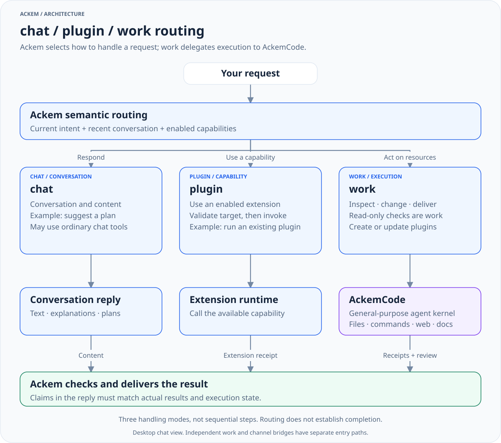

> 历史归档（六类收敛前）：保留当时说明，仅供追溯；当前入口见[文档导航](../../README.md)。

# 💫 Ackem

[中文](README.zh.md) · [Documentation](docs/OPEN-SOURCE-DOC-MAP.md) · [Architecture](docs/developer/architecture/00-overall-system.md)

**Ackem is a local-first AI companion and task coordination application. AckemCode is its general-purpose agent execution kernel.**

Ackem handles conversation, memory, personality and emotion, interprets requests, chooses an execution route, supervises tasks and delivers results. AckemCode performs file operations, research, project work, commands and tool calls. The kernel also offers an independent CLI and Web interface.

A.C.K.E.M — *Autonomous Companion Keeping Emotional Memory*. Companionship and emotional memory remain part of the product alongside plugins, managed tasks and independent work.

- **Repository**: [JasonLiu0826/ackem](https://github.com/JasonLiu0826/ackem)
- **Downloads**: [Releases](https://github.com/JasonLiu0826/ackem/releases). Features on the source branch may differ from published packages; read the matching release notes.
- **Contributing**: [Guide](../../../CONTRIBUTING.md) · [Issues](https://github.com/JasonLiu0826/ackem/issues)
- **License**: AGPL-3.0; see [LICENSE](../../../LICENSE) and [third-party notices](../../../NOTICE.md).

The application version in source is `2.0.0` and development is ongoing. The repository contains Windows packaging scripts and macOS build configuration. Installation steps and platform validation depend on the release.

## Ackem and AckemCode

| Layer | Responsibility | Implementation |
|---|---|---|
| Ackem interaction and coordination | Conversation, memory, personality, semantic routing, goals, supervision, acceptance and delivery | `src/main/`, `src/renderer/` |
| Ackem extensions | Enabled Skills / Plugins, lifecycle and extension permissions | `src/main/extensions/` |
| AckemCode execution kernel | Agent loop, tools, sessions, permissions, planning, subagents, MCP / LSP | `parts/ackemcode/` |

AckemCode retains its name, while its runtime supports general tasks beyond coding. Success depends on the model, available tools, external services, permissions and actual execution evidence.

## Three routes: chat / plugin / work

The routes represent three ways to handle a request. The protocol names are singular: `chat`, `plugin`, `work`.



[View full size](../../diagrams/request-routing-en.light.svg) · [Dark version](../../diagrams/request-routing-en.dark.svg) · [Diagram source](../../diagrams/sources/request-routing-en.mmd)

| Route | Typical requests | Behavior |
|---|---|---|
| `chat` | Conversation, explanations, advice, inline drafts and plans | Respond with memory and personality; use available search or content tools when applicable |
| `plugin` | Use an installed, enabled capability | Bind and invoke an available extension; report its actual outcome |
| `work` | Inspect real directories, edit files, run commands, work on projects, create artifacts or develop plugins | Submit or amend a task, delegate execution to AckemCode and follow its receipts and checks |

The desktop main path uses semantic classification and capability catalog validation. Failed classification leaves the request undispatched and reports that status. Deterministic and compatibility paths also remain in the code. **Choosing a route, acknowledging dispatch, executing and accepting the result are separate stages.**

The legacy desktop assistant, `use_computer`, its executors and IPC have been removed. Local execution uses work / AckemCode.

Read [routing and task lifecycle](docs/developer/architecture/09-routing-and-tasks.md).

## Working on tasks

Delegate through chat or use the work page. Chat delegation enters a persistent task coordinator with goals and state. Ackem can observe progress, handle routine approval decisions, request user input, check results and request rework. Users can take over, amend a goal or stop execution.

The work page also has an independent execution path using AckemCode sessions, with different supervision and delivery behavior from chat-managed tasks. Hiding the page does not stop execution; check the actual stop receipt.

The default workspace is `workspace/` under the active Ackem data root. Another directory can be selected. A working directory is a starting point; **it is not a global filesystem allowlist**. Permission mode and task constraints govern access. Bypass mode permits broader machine operations.

The kernel includes file operations and search, terminals, web search and fetch, document tools, planning and verification, subagents, MCP, LSP, skills and plugin loading. Additional integrations such as browser tools require their corresponding services and configuration.

Read [AckemCode kernel and integration](docs/ackemcode-kernel.md).

## Companion, memory and channels

- **Continuity and memory**: chat history, fact retrieval, events, action records, correction and forgetting controls.
- **Personality and emotion**: relationship state, emotion, time awareness, presets and Freya configuration.
- **Desktop**: React UI, tray, optional desktop pet, image/file attachments and work page.
- **QQ / WeChat**: owner confirmation, messages, shared history and channel-specific replies; QQ also supports voice, memes and optional Qzone interaction.
- **Extensions**: built-in `ackem/` and local OpenForU `u/`; the `community/` marketplace is currently disabled.

**Channel execution still differs**: QQ / WeChat currently use `maybeRunCodeTask` for `/code` and engineering requests. They do not yet share the entire desktop routing and managed-task pipeline. Shared personality, memory and history do not imply identical execution paths.

Confirm the channel owner on desktop, then enable remote dispatch under **Settings → Work execution**. Remote permission settings are separate from desktop work permissions. Existing remote grants migrate to the new setting.

[Channel integration](docs/ackem-code-bridge.md) · [Shared conversation](docs/cross-channel-conversation.md) · [QQ setup](docs/qq-onebot-setup.md)

## Run from source

The application and kernel have separate dependencies. Current CI uses Windows and Node.js 22.

```powershell
git clone https://github.com/JasonLiu0826/ackem.git
cd ackem
npm ci
npm --prefix parts/ackemcode ci
npm --prefix parts/ackemcode run build
npm run dev
```

Use Electron via `npm run dev`; the renderer requires the preload `window.ackem` bridge. Configure the model endpoint, key and model name in settings. Work execution can use a separate AckemCode model configuration or inherit the application's configuration.

The local kernel service defaults to `127.0.0.1:8787` and is started on demand. Desktop and channel integration currently have separate startup and configuration adapters; distinguish them when debugging. Independent CLI:

```powershell
npm --prefix parts/ackemcode run cli
```

[Developer setup](docs/developer/dev-setup.md) · [Paths and artifacts](docs/CODEBASE-PATHS.md)

## Check and build

```powershell
npm run typecheck
npx tsc --noEmit -p tsconfig.node.json
npm --prefix parts/ackemcode run typecheck
npm run build
```

Root `typecheck` covers the renderer and shared types. Main-process and kernel checks are separate. Compilation does not replace runtime acceptance of model calls, tools, task stopping and delivery. The public repository does not distribute the complete local test suite; a few tracked tests do not represent full regression coverage.

Windows packaging: `npm run dist:green` / `npm run dist:setup`. Prepare kernel dependencies and runtime for packaging separately; the root build does not build the kernel.

[Source verification](docs/developer/testing.md) · [Release checklist](docs/developer/release-checklist.md) · [Windows distribution](docs/distribution-windows.md)

## Data and permissions

Settings select Ackem's data root: usually a sibling `data/` for portable packages, the current directory's `data/` in portable development mode, or a platform-specific user directory. Settings and credentials use Electron userData. Kernel sessions, configuration and artifacts can also live in the kernel's data directory and the selected workspace.

Local-first describes storage and control. Cloud models, search, messaging channels and network tools send relevant context or tool data to their configured services. Tools can change files and run commands according to permissions. Back up application data, settings, kernel data and work artifacts as needed.

[Privacy](docs/privacy-and-data.md) · [Sensitive capabilities](docs/sensitive-capabilities.md) · [Data format](docs/memory-format.md) · [Security reports](../../../SECURITY.md)

## Suggested reading

1. [Overall architecture](docs/developer/architecture/00-overall-system.md): application, extensions, task coordination and kernel boundaries.
2. [Routing and tasks](docs/developer/architecture/09-routing-and-tasks.md): interpretation, execution and delivery.
3. [AckemCode kernel](docs/ackemcode-kernel.md): capabilities, permissions and independent use.
4. [Architecture index](docs/developer/architecture/README.md): memory, personality, prompts, extensions, data and IPC.
5. [Documentation map](docs/OPEN-SOURCE-DOC-MAP.md): user guides, developer guides and historical releases.
6. [Diagram gallery](../../diagrams/README.en.md): zoomable core figures, theme variants and maintenance.

[CHANGELOG](../../../CHANGELOG.md) records history. Documents under [Archived documents and release materials](../README.md) apply to their named releases rather than the current source branch.
