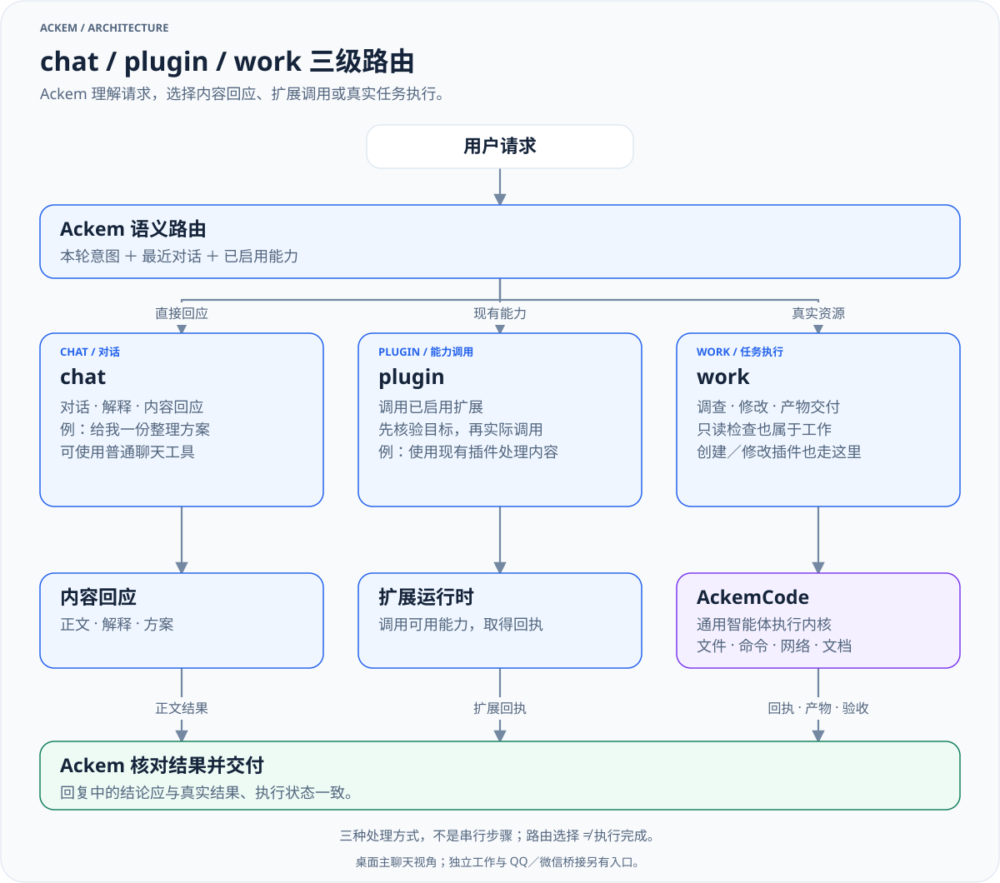

> 历史归档（六类收敛前）：保留当时说明，仅供追溯；当前入口见[文档导航](../../README.md)。

# 💫 Ackem

[English](README.md) · [文档导航](docs/OPEN-SOURCE-DOC-MAP.zh.md) · [架构总览](docs/developer/architecture/00-overall-system.zh.md)

**Ackem 是本地优先的 AI 伙伴与任务协调应用，AckemCode 是它使用的通用智能体执行内核。**

Ackem 负责理解需求、持续对话、记忆、人格与情绪，以及选择执行方式、跟进任务和交付结果。AckemCode 负责实际读取文件、检索资料、操作项目、运行命令和调用工具。它既能接受 Ackem 的委托，也提供独立 CLI 与 Web 界面。

A.C.K.E.M — *Autonomous Companion Keeping Emotional Memory*。陪伴与情感记忆仍是产品的一部分；当前项目也包含真实任务执行、插件调用和独立工作能力。

- **主仓库**：[JasonLiu0826/ackem](https://github.com/JasonLiu0826/ackem)
- **下载**：[主仓库 Releases](https://github.com/JasonLiu0826/ackem/releases)。源码功能与已发布安装包可能不同，以对应版本说明为准。
- **贡献**：[贡献指南](../../../CONTRIBUTING.zh.md) · [问题反馈](https://github.com/JasonLiu0826/ackem/issues)
- **许可**：AGPL-3.0，见 [LICENSE](../../../LICENSE)；第三方组件见 [NOTICE](../../../NOTICE.md)。

当前源码应用版本为 `2.0.0`，处于持续迭代中。仓库包含 Windows 打包脚本与 macOS 构建配置，具体平台的安装说明和验证范围以发行说明为准。

## Ackem 与 AckemCode 如何分工

| 层 | 职责 | 主要实现 |
|---|---|---|
| Ackem 交互与协调 | 对话、记忆、人格情绪、语义路由、任务目标、监督验收、结果交付 | `src/main/`、`src/renderer/` |
| Ackem 扩展 | 调用已启用的 Skill / Plugin，处理生命周期与扩展权限 | `src/main/extensions/` |
| AckemCode 执行内核 | 智能体循环、工具、会话、权限、计划、子智能体、MCP / LSP | `parts/ackemcode/` |

AckemCode 的名字保留了 Code，但当前工具和运行时已覆盖通用任务。能否完成某项任务，取决于模型、可用工具、外部服务、权限和实际执行结果。

## chat / plugin / work 三级路由

这是三种处理方式，同一条请求按意图和上下文选择其中一种；协议名称为单数 `chat`、`plugin`、`work`。



[放大查看](../../diagrams/request-routing-zh.light.svg) · [深色版本](../../diagrams/request-routing-zh.dark.svg) · [图源](../../diagrams/sources/request-routing-zh.mmd)

| 路由 | 适合的请求 | 行为 |
|---|---|---|
| `chat` | 日常交流、解释、建议、直接给出文章或方案 | 结合记忆与人格回应；按实际能力使用搜索、内容整理等工具 |
| `plugin` | 使用已安装并启用的具体能力 | 绑定可用扩展并调用，不把“尚未安装”描述成“已经执行” |
| `work` | 检查真实目录、修改文件、运行命令、处理项目、制作产物、创建或修改插件 | 创建或调整任务，交给 AckemCode 执行，再根据回执与检查结果跟进 |

桌面主链使用语义分类与能力目录核验；分类失败会说明尚未下派。代码仍保留确定性路由及兼容入口。**路由决定、派工确认、实际执行、验收通过是不同阶段。**

旧电脑助手的聊天模式、`use_computer`、执行器及对应 IPC 已删除。本机任务统一使用 work / AckemCode；不再需要开启旧助手通道。

详见 [路由与任务生命周期](docs/developer/architecture/09-routing-and-tasks.zh.md)。

## 工作如何推进

在聊天中委托任务，或进入工作页直接操作。聊天派工接入任务协调器，持久化目标与状态；Ackem 可以查看进度、处理普通操作审批、请求用户介入、检查结果和要求返工。用户可以接管、补充目标或停止执行。

工作页同时提供独立执行入口，直接使用 AckemCode 会话；它与聊天托管任务的监督和交付链不同。关闭或隐藏工作页不代表任务已停止。请查看任务的实际停止回执。

默认工作目录为当前 Ackem 数据根下的 `workspace/`，也可选择其他目录。工作目录是任务起点，**不代表全局文件访问白名单**。实际访问按权限模式及任务约束控制；完全放开模式允许更广泛的本机操作。

AckemCode 提供文件读写与检索、终端、网页搜索与抓取、文档工具、计划与验证、子智能体、MCP、LSP、技能和插件加载等能力。浏览器等额外集成需相应工具或服务已安装并可用。

详见 [AckemCode 内核与接入](docs/ackemcode-kernel.zh.md)。

## 陪伴、记忆与渠道

- **连续对话与记忆**：聊天历史、事实检索、事件与行动记录；纠正、遗忘等控制与派生检索并存。
- **人格与情绪**：关系、情绪、时间感知、人格预设及 Freya 配置，影响表达和陪伴体验。
- **桌面**：React 界面、系统托盘、可选桌宠、图片与文件附件、工作页。
- **QQ / 微信**：机主确认、消息与统一历史、按渠道回复。QQ 另有语音、表情包和可选空间互动。
- **扩展**：内置 `ackem/` 与本机 OpenForU `u/`；`community/` 市场当前关闭。

**渠道接入仍有差异**：QQ / 微信目前经 `maybeRunCodeTask` 处理 `/code` 和工程类自然语言派工，尚未全部接入桌面的三级路由与托管任务协调链。共享人格、记忆与历史不等于执行链完全一致。

远程派工需要先在桌面确认渠道机主，再到 **设置 → 工作执行** 开启。远程权限配置与桌面工作页权限分开；旧远程授权会迁移到新设置。

[渠道桥接](docs/ackem-code-bridge.zh.md) · [统一会话](docs/cross-channel-conversation.zh.md) · [QQ 配置](docs/qq-onebot-setup.md)

## 从源码运行

根应用与内核使用各自的依赖。当前 CI 使用 Windows 与 Node.js 22。

```powershell
git clone https://github.com/JasonLiu0826/ackem.git
cd ackem
npm ci
npm --prefix parts/ackemcode ci
npm --prefix parts/ackemcode run build
npm run dev
```

应用需要 Electron preload 的 `window.ackem`，请从 `npm run dev` 启动。在设置中配置模型地址、密钥与模型名称；工作执行可使用独立的 AckemCode 模型配置，或沿用主应用配置。

内核服务默认在本机 `127.0.0.1:8787`，由接入层按需启动。桌面和渠道当前保留两套启动与配置同步适配，排障时需区分。独立 CLI：

```powershell
npm --prefix parts/ackemcode run cli
```

[开发环境](docs/developer/dev-setup.zh.md) · [路径与产物](docs/CODEBASE-PATHS.zh.md)

## 验证与构建

```powershell
npm run typecheck
npx tsc --noEmit -p tsconfig.node.json
npm --prefix parts/ackemcode run typecheck
npm run build
```

根目录 `typecheck` 覆盖渲染层及共享类型；主进程和内核需要各自检查。类型检查和编译不能替代真实模型、工具、任务停止及交付的运行验收。公开仓库不分发完整本地测试套件，少量已跟踪用例不代表全套回归。

Windows 产物命令为 `npm run dist:green` / `npm run dist:setup`。内核依赖与运行时必须随包准备；根应用构建不会替代内核构建。

[源码验证](docs/developer/testing.zh.md) · [发布检查](docs/developer/release-checklist.zh.md) · [Windows 分发](docs/distribution-windows.zh.md)

## 数据与权限

Ackem 的数据根由设置决定：便携版通常在程序旁 `data/`，开发便携模式在工作目录 `data/`，用户目录模式按平台解析。设置与凭据位于 Electron userData。AckemCode 会话、配置和产物还可能位于独立内核数据目录及用户选择的工作目录。

本地优先说明存储与控制方式。使用云模型、搜索、QQ / 微信或联网工具时，相关上下文和工具内容会发送给对应服务；工具可能按权限执行文件与命令操作。备份应同时考虑 Ackem 数据、设置、内核数据和工作产物。

[隐私与数据](docs/privacy-and-data.zh.md) · [敏感能力](docs/sensitive-capabilities.zh.md) · [数据格式](docs/memory-format.zh.md) · [安全报告](../../../SECURITY.zh.md)

## 文档阅读顺序

1. [整体架构](docs/developer/architecture/00-overall-system.zh.md)：Ackem、扩展、任务协调和内核的边界。
2. [路由与任务](docs/developer/architecture/09-routing-and-tasks.zh.md)：一条请求如何被理解、执行与交付。
3. [AckemCode 内核](docs/ackemcode-kernel.zh.md)：通用能力、权限与独立运行。
4. [架构索引](docs/developer/architecture/README.zh.md)：记忆、人格、Prompt、扩展、数据和 IPC。
5. [文档地图](docs/OPEN-SOURCE-DOC-MAP.zh.md)：用户、开发者与历史发行资料。
6. [图表导航](../../diagrams/README.md)：可放大的核心图、深浅色版本与维护方式。

[变更记录](../../../CHANGELOG.md)记录版本历史；[旧版文档与发行材料](../README.md) 的安装包说明只适用于对应版本，不代表当前源码。
