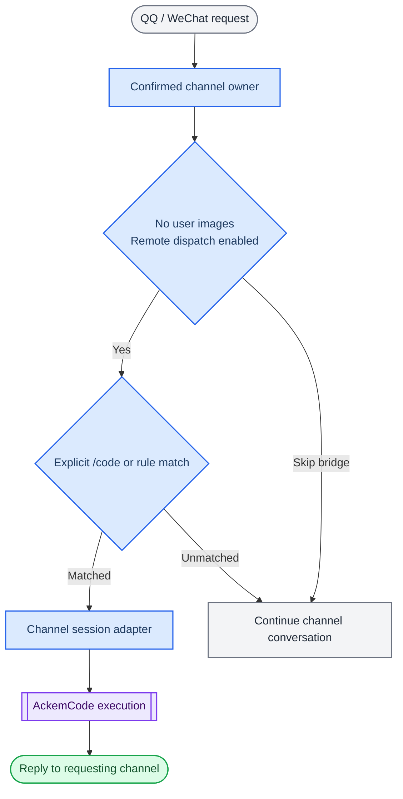

> 历史归档（六类收敛前）：保留当时说明，仅供追溯；当前入口见[文档导航](../../../README.md)。

# QQ / WeChat integration with AckemCode

[中文](ackem-code-bridge.zh.md) · [Kernel guide](ackemcode-kernel.md)

Desktop and channels use the same kernel through different host adapters. This page describes channel code dispatch; see [routing and tasks](developer/architecture/09-routing-and-tasks.md) for desktop work.

## Current path

Turns containing user images skip this code-dispatch check. Desktop chat uses orchestrateChannelTurn and managed task coordination instead.

| Source | Responsibility |
|---|---|
| [companionTurn.ts](../../../../src/main/channels/companionTurn.ts) | Channel turn and dispatch |
| [dispatch.ts](../../../../src/main/ackemcode/dispatch.ts) | Settings, intent, permissions and result |
| [intent.ts](../../../../src/main/ackemcode/intent.ts) | Explicit prefixes and engineering rules |
| [index.ts](../../../../src/main/ackemcode/index.ts) | Runtime readiness and session mapping |
| [chatClient.ts](../../../../src/main/ackemcode/chatClient.ts) | Channel HTTP / SSE client |
| [daemon.ts](../../../../src/main/ackemcode/daemon.ts) | Built-server startup and reuse |
| [llmSync.ts](../../../../src/main/ackemcode/llmSync.ts) | App model configuration sync |

## Usage

Confirm the channel owner under **Settings → Mobile**, then enable remote dispatch under **Settings → Work execution**. `workRemoteChannelsEnabled` defaults off. Old `desktopAgentRemoteChannelsEnabled` grants migrate; an explicit new value takes precedence.

Prefixes include `/code`, `#code`, `代码：` and `code:`. Automatic detection still uses action words and engineering/technical context, rather than the desktop general semantic classifier. Companion writing and questions without delegation are excluded by the rules.

| Variable | Scope in this adapter |
|---|---|
| `ACKEMCODE_DISABLE=1` | Disable this code bridge, not all desktop work |
| `ACKEMCODE_REQUIRE_EXPLICIT=1` | Require an explicit code prefix here |
| `ACKEMCODE_PERMISSION_MODE` | Remote permission priority: environment > setting > bypassPermissions |
| `ACKEMCODE_URL` / `ACKEMCODE_PORT` | Service address / port |
| `ACKEMCODE_DATA_DIR` | Kernel storage override |

Session reuse checks the directory and permission mode; a changed mode creates a new session. Tightening permissions does not undo operations already performed. Confirm stopping separately for running work.

## Sessions and storage

Channel mapping uses `ackemcode-sessions.json` in Electron userData. The bridge defaults kernel data to `~/.ackemcode/`; a reused service uses its actual startup data directory.

Replies return to the requesting channel. Shared desktop history can show their source. This direct code-turn path differs from desktop contracts, supervision, acceptance and notification delivery.

Disabled dispatch, unmatched intent or a missing built runtime returns unhandled and continues ordinary conversation. Execution failure after dispatch is a failed result.

## Acceptance checks

1. Remote dispatch cannot execute through this bridge while disabled.
2. Unconfirmed owners cannot enter the authorized channel flow.
3. With authorization, send an explicit read-only `/code` request and inspect actual tool output.
4. Check source markers in desktop history and no mirrored reply on the other messaging channel.
5. Change permission mode and inspect actual session/approval behavior.

The public source does not include a complete runnable bridge test suite. Live channel checks require local services and credentials.

The old desktop assistant is removed. New integration must use AckemCode rather than restoring its old switch, IPC or `use_computer`. See [kernel setup and storage](ackemcode-kernel.md).
