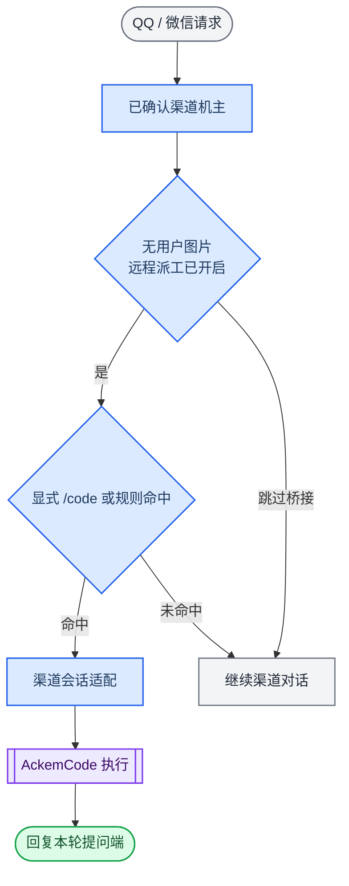

> 历史归档（六类收敛前）：保留当时说明，仅供追溯；当前入口见[文档导航](../../../README.md)。

# QQ / 微信与 AckemCode 接入

[English](ackem-code-bridge.md) · [内核说明](ackemcode-kernel.zh.md)

当前桌面与渠道使用同一个内核，但宿主入口不同。本页只描述现有渠道代码派工桥接；桌面主链见[路由与任务](developer/architecture/09-routing-and-tasks.zh.md)。

## 当前调用链

含用户图片的轮次不会进入这里的代码派工判断。桌面聊天通过 `orchestrateChannelTurn` 和托管任务协调器执行 work，不经本页的统一桥接入口。

| 文件 | 职责 |
|---|---|
| [companionTurn.ts](../../../../src/main/channels/companionTurn.ts) | 渠道一轮对话与派工分流 |
| [dispatch.ts](../../../../src/main/ackemcode/dispatch.ts) | 开关、意图、权限与执行结果 |
| [intent.ts](../../../../src/main/ackemcode/intent.ts) | 显式前缀与工程类规则判断 |
| [index.ts](../../../../src/main/ackemcode/index.ts) | 运行时准备、渠道会话映射与复用 |
| [chatClient.ts](../../../../src/main/ackemcode/chatClient.ts) | 渠道 HTTP / SSE 客户端 |
| [daemon.ts](../../../../src/main/ackemcode/daemon.ts) | 编译入口服务的启动与复用 |
| [llmSync.ts](../../../../src/main/ackemcode/llmSync.ts) | 主应用模型配置同步 |

## 使用

先在 **设置 → 移动端** 确认 QQ / 微信机主，再在 **设置 → 工作执行** 开启远程派工。`workRemoteChannelsEnabled` 默认关闭；旧 `desktopAgentRemoteChannelsEnabled` 授权会迁移，新值显式设置后优先。

显式请求可用 `/code`、`#code`、`代码：` 或 `code:`。自动判断仍是动作词与工程对象/技术语境规则，不是桌面的通用语义路由。例如“帮我修改 config.json”可命中；一般陪伴写作和无委托语气的问题会被排除。

| 变量 | 当前桥接中的用途 |
|---|---|
| `ACKEMCODE_DISABLE=1` | 禁用此代码派工桥接，不代表全局关闭桌面 work |
| `ACKEMCODE_REQUIRE_EXPLICIT=1` | 此桥接仅接受显式代码前缀 |
| `ACKEMCODE_PERMISSION_MODE` | 覆盖远程权限：环境变量 > 设置 > 默认 bypassPermissions |
| `ACKEMCODE_URL` / `ACKEMCODE_PORT` | 服务地址或端口 |
| `ACKEMCODE_DATA_DIR` | 内核数据目录覆盖 |

远程权限收紧后，会话复用逻辑核对权限，不一致时重新建会话；不能承诺撤销已经发生的操作。已运行中的任务应另行确认停止状态。

## 会话与数据

渠道会话映射保存在 Electron userData 的 `ackemcode-sessions.json`。复用会校验工作目录和权限模式。默认内核数据位于 `~/.ackemcode/`；已存在服务被复用时，以实际服务的数据目录为准。

结果发送给本轮提问端，统一聊天历史可在桌面看到来源。此处直接返回代码结果，与桌面 TaskCoordinator 的契约、监督、验收、通知链不同。

缺少编译运行时、桥接被禁用或未命中时返回未处理，继续普通对话；已经命中后的执行错误会作为失败返回，不应描述成任务成功。

## 核对方法

1. 远程开关关闭时，代码请求不能从此桥接执行。
2. 未确认机主不能进入授权渠道任务流程。
3. 开关打开后发送明确的 `/code` 只读目录查询，核对真实工具结果与提问端回复。
4. 确认桌面统一历史存在来源标记，另一个渠道没有收到镜像回复。
5. 改变权限模式后核对会话与实际审批；勿把配置显示值当作执行证据。

本页没有可供公开仓库直接运行的完整桥接测试套件承诺。真实模型和渠道验收需要本机服务与凭据。

旧电脑助手已删除；不要恢复旧助手开关、IPC 或 `use_computer` 来接入新功能。内核构建、服务冲突、数据与凭据说明见[AckemCode 内核](ackemcode-kernel.zh.md)。
