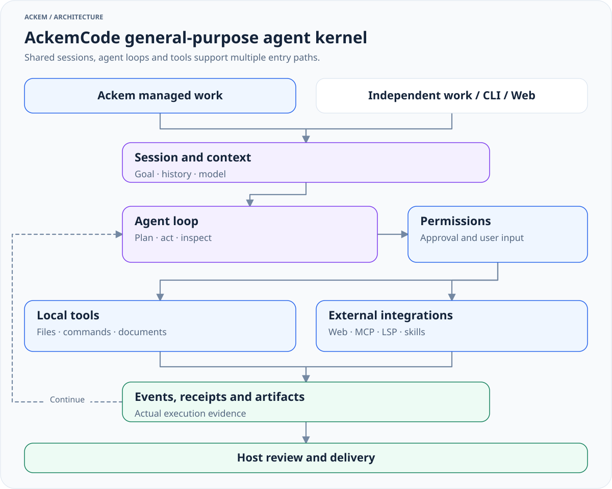

> 历史归档（六类收敛前）：保留当时说明，仅供追溯；当前入口见[文档导航](../../../README.md)。

# AckemCode: general-purpose agent kernel

[中文](ackemcode-kernel.zh.md) · [Architecture](developer/architecture/00-overall-system.md)

AckemCode lives in `parts/ackemcode/` with its own package, dependencies, CLI, server, Web UI and storage. The `ackem-code` package version is independent from the Ackem application version.

## Responsibilities



[View full size](../../../diagrams/kernel-overview-en.light.svg) · [Dark version](../../../diagrams/kernel-overview-en.dark.svg) · [Diagram source](../../../diagrams/sources/kernel-overview-en.mmd)

The kernel executes model-driven tasks through multiple tool rounds, permissions and user interactions, then returns events, receipts and results. Its tools support coding, file organization, research, document work and other machine tasks.

Ackem owns conversation, memory, personality and emotion, request interpretation, delegation, supervision, acceptance and user-facing delivery. Host-managed tasks are distinct from the kernel's internal task tools and subagents.

| Module | Entry | Responsibility |
|---|---|---|
| HTTP server and sessions | [server/index.ts](../../../../parts/ackemcode/src/server/index.ts) | APIs, sessions and SSE events |
| Agent loop | [agent/loop.ts](../../../../parts/ackemcode/src/server/agent/loop.ts) | Model requests and tool rounds |
| Tools | [tools/](../../../../parts/ackemcode/src/server/tools) | Files, commands, web, documents, plans and verification |
| Tool scheduling policy | [tools/registry.ts](../../../../parts/ackemcode/src/server/tools/registry.ts) | Input-aware read-only and concurrency policies |
| Permissions | [agent/permissions.ts](../../../../parts/ackemcode/src/server/agent/permissions.ts) | Approval, denial and interaction |
| Integrations | [mcp/](../../../../parts/ackemcode/src/server/mcp), [lsp/](../../../../parts/ackemcode/src/server/lsp), [skills/](../../../../parts/ackemcode/src/server/skills) | External tools, language services and skills |
| CLI | [cli/main.tsx](../../../../parts/ackemcode/src/cli/main.tsx) | Independent terminal interaction |
| Persistence | [sessionStore.ts](../../../../parts/ackemcode/src/server/sessionStore.ts), [settingsStore.ts](../../../../parts/ackemcode/src/server/settingsStore.ts) | Sessions and configuration |

## Capabilities and requirements

- File reading, writing, search and replacement, directory exploration, Git and worktree tools.
- PowerShell / Bash and terminal work, subject to the actual operating environment.
- Web search and fetch, document editing and conversion, with format-specific dependencies.
- Planning, todos, verification, subagents and background tasks.
- MCP, skills, plugins and LSP. A kernel plugin is not automatically an Ackem `plugin` route extension.

Tool definitions do not guarantee that every machine has the same services, credentials or executables. Model narration is not execution evidence.

## Integration paths

| Entry | Host adapter | Lifecycle |
|---|---|---|
| Ackem chat-managed task | `tasks/runtime.ts` → `ackemcode/client.ts` | Host contracts, goal revisions, supervision, acceptance and delivery |
| Independent work page | `ackemcode/standaloneWorkService.ts` → `client.ts` | Private input queue and session; separate from managed chat supervision |
| QQ / WeChat bridge | `channels/companionTurn.ts` → `dispatch.ts` → `index.ts` / `chatClient.ts` | Channel intent checks, session mapping and results returned to the requesting channel |

The independent CLI and Web UI can use the kernel without Ackem's personality, memory or task coordinator.

## Two current startup adapters

| | Desktop managed / independent work | QQ / WeChat bridge |
|---|---|---|
| Startup | `src/main/ackemcode/ensureDaemon.ts` | `src/main/ackemcode/daemon.ts` |
| Local server entry | `src/server/index.ts` through the kernel's tsx dependency | `dist/server/index.js` |
| Configuration sync | `syncRuntimeLlm.ts` | `llmSync.ts` |
| Default data directory | `<codeRoot>/data/` | `~/.ackemcode/` |
| Model source | Valid separate AckemCode configuration, otherwise app configuration, then implementation fallbacks | Valid app configuration, otherwise existing kernel configuration |

Both default to port `8787` and can reuse a service through `ACKEMCODE_URL`. A reused service retains the configuration and data directory from its actual startup. Preparing a configuration file in another directory does not reconfigure that running service. Confirm process, model and data directory when debugging.

`ACKEMCODE_DATA_DIR` overrides kernel storage; use an absolute path. Desktop configuration sync rejects relative paths. The work directory is a separate concept: Ackem defaults it to `<Ackem dataRoot>/workspace/`.

## Permissions and receipts

Kernel modes include `default`, `plan`, `acceptEdits`, `auto`, `bypassPermissions` and `dontAsk`. The host task interface has its own supported permission options and a separate `executionMode`; these enums are not interchangeable.

The working directory is not a filesystem allowlist. Permission rules, read-only and excluded-resource constraints, and host inspection scope govern execution. Bypass mode allows broader machine access; scoped host inspection remains explicitly read-only.

Managed execution carries task binding, goal revision, control epoch and fencing metadata. The host and kernel use these at tool and stop boundaries to reject stale work and settle execution, acceptance and delivery. Do not bypass these bindings when operating managed sessions.

Hiding a page, disconnecting SSE, requesting stop, confirming execution quiescence and accepting a result are separate states. See [task lifecycle](developer/architecture/09-routing-and-tasks.md).

## Development and independent use

```powershell
npm --prefix parts/ackemcode ci
npm --prefix parts/ackemcode run typecheck
npm --prefix parts/ackemcode run build
npm --prefix parts/ackemcode run cli
```

Service development: `npm --prefix parts/ackemcode run dev:server`. Built server: `npm --prefix parts/ackemcode start`. The package also exposes `bin/ackem.mjs`. Model and external tool configuration are required for actual execution.

Build application and kernel separately. Packaging must satisfy both the desktop source/tsx entry and the channel compiled entry. See [after-pack hook](../../../../scripts/after-pack.cjs) and [builder configuration](../../../../electron-builder.yml).

## Storage and credentials

The kernel persists sessions, configuration and task/tool state. Model synchronization writes usable credentials to `settings.standalone.json`; do not assume it uses the application's operating-system encryption.

Backup and deletion can involve Ackem's data root, Electron userData, the actual kernel data directory and selected work directories. Stop tasks and services before migration. See [privacy and data](privacy-and-data.md).
