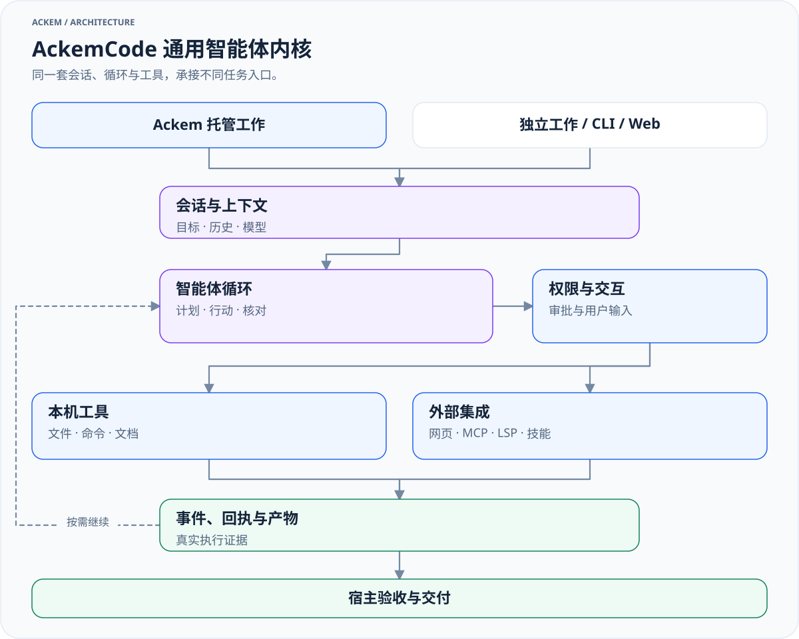

> 历史归档（六类收敛前）：保留当时说明，仅供追溯；当前入口见[文档导航](../../../README.md)。

# AckemCode：通用智能体内核

[English](ackemcode-kernel.md) · [整体架构](developer/architecture/00-overall-system.zh.md)

本文根据当前源码整理。AckemCode 位于 `parts/ackemcode/`，有独立的 package、依赖、CLI、服务端、Web UI 和数据存储。应用版本与内核包版本各自维护；包名 `ackem-code` 的版本不等于 Ackem 应用版本。

## 定位与职责



[放大查看](../../../diagrams/kernel-overview-zh.light.svg) · [深色版本](../../../diagrams/kernel-overview-zh.dark.svg) · [图源](../../../diagrams/sources/kernel-overview-zh.mmd)

AckemCode 执行模型驱动的多轮任务：接收目标和上下文，调用工具，处理权限与交互，继续推进，再返回事件、回执和结果。它能处理代码，也能完成文件整理、资料检索、文档处理及其他有工具支持的本机任务。

Ackem 负责对话、记忆、人格与情绪，以及用户目标的理解、任务委派、监督验收和对用户交付。宿主的托管任务系统与内核自己的工具任务、子智能体不是同一套任务记录。

| 模块 | 入口 | 职责 |
|---|---|---|
| HTTP 服务与会话 | [server/index.ts](../../../../parts/ackemcode/src/server/index.ts) | 服务启动、API、会话与 SSE 事件 |
| 智能体循环 | [agent/loop.ts](../../../../parts/ackemcode/src/server/agent/loop.ts) | 模型请求、工具回合及后续推进 |
| 工具 | [tools/](../../../../parts/ackemcode/src/server/tools) | 文件、命令、网络、文档、计划和验证 |
| 工具调度策略 | [tools/registry.ts](../../../../parts/ackemcode/src/server/tools/registry.ts) | 按输入判断只读与并发安全性 |
| 权限与交互 | [agent/permissions.ts](../../../../parts/ackemcode/src/server/agent/permissions.ts) | 审批、拒绝、策略及用户交互 |
| 扩展集成 | [mcp/](../../../../parts/ackemcode/src/server/mcp)、[lsp/](../../../../parts/ackemcode/src/server/lsp)、[skills/](../../../../parts/ackemcode/src/server/skills) | 外部工具、语言服务和技能 |
| CLI | [cli/main.tsx](../../../../parts/ackemcode/src/cli/main.tsx) | 独立终端交互 |
| 持久化 | [sessionStore.ts](../../../../parts/ackemcode/src/server/sessionStore.ts)、[settingsStore.ts](../../../../parts/ackemcode/src/server/settingsStore.ts) | 会话和配置 |

## 能力与条件

- 文件与项目：读写、搜索、替换、目录浏览、Git 信息与工作树相关工具。
- 命令：PowerShell / Bash、进程及终端任务；依赖实际系统环境。
- 资料与产物：网页搜索、抓取、文档编辑或转换；具体格式依赖相应实现和外部依赖。
- 推进复杂任务：计划、待办、验证、子智能体与后台任务。
- 可扩展工具：MCP、技能、插件、LSP。加载了内核插件，不代表它已成为 Ackem 的 `plugin` 路由扩展。

内核有工具定义，不代表所有机器上都具备相同的服务、凭据或程序。没有执行回执时，不应把模型的描述当作完成证据。

## 三种接入

| 入口 | 宿主适配 | 生命周期 |
|---|---|---|
| Ackem 聊天托管任务 | `tasks/runtime.ts` → `ackemcode/client.ts` | 宿主持久化契约、目标修订、监督、验收、交付 |
| 工作页独立任务 | `ackemcode/standaloneWorkService.ts` → `client.ts` | 独立输入队列和会话，不复用聊天托管监督链 |
| QQ / 微信代码桥接 | `channels/companionTurn.ts` → `dispatch.ts` → `index.ts` / `chatClient.ts` | 渠道意图判定、会话映射、流式结果回到提问端 |

独立 CLI / Web UI 可直接连接内核，不要求经过 Ackem 的人格、记忆或任务协调器。

## 当前两套启动适配

桌面与渠道共用内核，但仍保留两套宿主适配：

| | 桌面托管 / 工作页 | QQ / 微信桥接 |
|---|---|---|
| 启动模块 | `src/main/ackemcode/ensureDaemon.ts` | `src/main/ackemcode/daemon.ts` |
| 本地启动入口 | `src/server/index.ts`，通过内核依赖中的 tsx | `dist/server/index.js` |
| 配置同步 | `syncRuntimeLlm.ts` | `llmSync.ts` |
| 未覆盖时的数据目录 | `<codeRoot>/data/` | `~/.ackemcode/` |
| 模型选择 | 单独 AckemCode 配置有效时优先，否则主应用配置，再按实现回退 | 主应用配置有效时同步，否则沿用已有内核配置 |

共同默认端口为 `8787`，也可通过 `ACKEMCODE_URL` 复用已有服务。复用时，实际运行中的服务配置和数据目录由其启动方式决定，不能只看调用方准备了哪个配置文件。建议排障时先确认服务进程、模型和数据目录，避免混用。

`ACKEMCODE_DATA_DIR` 可覆盖内核数据目录，建议使用绝对路径；桌面同步代码会拒绝相对路径。默认工作目录则由 Ackem 的 `ensureDefaultWorkDirectory` 创建在 `<Ackem dataRoot>/workspace/`，它与内核会话目录不同。

## 权限、约束与回执

内核协议含 `default`、`plan`、`acceptEdits`、`auto`、`bypassPermissions`、`dontAsk` 等模式。宿主任务接口另有自身支持的权限选项与 `executionMode`；两者不能按名称直接当成同一枚举。

工作目录不是文件访问边界。权限规则、任务中的只读或排除约束，以及宿主检查模式共同影响执行。普通工作在完全放开模式下可访问工作目录之外的资源；宿主限定调查使用明确的只读范围。

托管执行携带任务绑定、目标修订、控制 epoch 和 fencing 信息。工具与停止边界会核验当前授权；宿主依据回执处理旧轮次、停止结算、验收与交付。不要绕开这些绑定自行修改托管会话。

关闭页面、断开 SSE、发送停止请求、执行已静止、验收通过是不同状态。详见[任务生命周期](developer/architecture/09-routing-and-tasks.zh.md)。

## 开发与独立运行

```powershell
npm --prefix parts/ackemcode ci
npm --prefix parts/ackemcode run typecheck
npm --prefix parts/ackemcode run build
npm --prefix parts/ackemcode run cli
```

服务开发入口：`npm --prefix parts/ackemcode run dev:server`；已构建服务：`npm --prefix parts/ackemcode start`。CLI 也可通过包内 `bin/ackem.mjs` 使用。模型与外部工具需先配置，命令存在不等于已能调用真实模型。

根应用与内核分别构建。打包时需要源码入口及其运行依赖满足桌面启动方式，也需要编译产物满足渠道启动方式。参见 [scripts/after-pack.cjs](../../../../scripts/after-pack.cjs) 和 [electron-builder.yml](../../../../electron-builder.yml)。

## 数据与凭据

内核会保存会话、配置、工具与任务状态。模型配置同步会把可用凭据写入 `settings.standalone.json`；不能因为 Ackem 设置使用系统加密，就假定这份内核配置也使用同样的加密。

备份与删除需分别考虑 Ackem 数据根、Electron userData、内核实际数据目录，以及用户选择的工作目录。迁移前停止运行中的任务和服务。见[隐私与数据](privacy-and-data.zh.md)。
