> 历史归档（六类收敛前）：保留当时说明，仅供追溯；当前入口见[文档导航](../../../README.md)。

# Adult Mode & Safety Policy

> **Language:** English · [中文](adult-and-safety-policy.zh.md)

> **Audience:** Users, platform reviewers, contributors  
> **Code:** `engine/interpreter.ts`, `engine/types.ts`, `prompt/adult-mode.ts`, schema V10 `privacy_level`

## Execution boundary

Companion content/adult-mode policy does not grant file, terminal, external-service or standing authority. See [task lifecycle](developer/architecture/09-routing-and-tasks.md) and [capabilities](sensitive-capabilities.md).


---

## 1. Overview

Ackem offers optional **Adult Mode**, **off by default**. When enabled, the companion may engage with adult topics in conversation. The mode is intended for **adults (18+)** and includes multiple safety mechanisms.

---

## 2. Enabling Adult Mode

| Item | Description |
|------|-------------|
| Default | **Off** |
| Enable | **Settings → Adult mode** with explicit confirmation |
| Disable | Anytime in Settings, or refuse in conversation |
| Minors | Ackem is **not for minors**; Adult Mode must not be enabled by minors |

### Confirmation dialog

On first enable, the app asks the user to confirm they are 18+, understand adult content may appear, and know they can disable the mode anytime.

---

## 3. Adult content categories

The L0 interpreter (`interpreter.ts`) classifies adult input into four levels:

| Category | Tag | Examples |
|----------|-----|----------|
| Flirtation | `adult_flirt` | Mild innuendo, teasing tone |
| Dominant | `adult_dominant` | Commands/control in sexual context |
| Submissive | `adult_submissive` | Submission/requests in sexual context |
| Explicit | `adult_explicit` | Explicit sexual expression |

Categories affect response strategy and emotion model updates.

---

## 4. Safety mechanisms

### 4.1 Trust threshold

Adult content handling only activates when **trust** is high enough. With low trust, explicit content may be ignored or gently declined even if Adult Mode is on.

### 4.2 Intensity budget

```
adultIntensityBudget: 0-60
```

Each adult turn consumes budget; budget recovers over time to avoid dense adult content in a single session.

### 4.3 State machine

```mermaid
stateDiagram-v2
    accTitle: Companion Content State Cycle
    accDescr: Content-policy states move from normal through flirting, intimacy and aftercare back to normal; they do not grant tool authority.
    direction LR
    state "NORMAL" as Normal
    state "FLIRTING" as Flirting
    state "INTIMATE" as Intimate
    state "AFTERCARE" as Aftercare
    Normal --> Flirting
    Flirting --> Intimate
    Intimate --> Aftercare
    Aftercare --> Normal
    classDef neutral fill:#f3f4f6,stroke:#6b7280,stroke-width:1.4px,color:#1f2937
    classDef primary fill:#dbeafe,stroke:#2563eb,stroke-width:1.6px,color:#1e3a5f
    classDef accent fill:#ede9fe,stroke:#7c3aed,stroke-width:1.6px,color:#3b0764
    class Normal neutral
    class Flirting,Aftercare primary
    class Intimate accent
```



Transitions depend on trust, history, and user mood. Stages cannot be skipped arbitrarily.

### 4.4 Negative-event lock

```
adultNegativeLockTurns
```

If the user resists (refusal, ignore, negative emotion), the system cools down and stops initiating or responding with adult content.

### 4.5 Rejection respect

```
adultLastRejectedTurn
```

After explicit refusal, the system records the turn and does not push intimacy again immediately.

---

## 5. Privacy levels (`privacy_level`)

**Since:** V10 · **Field:** `memory_facts.privacy_level`

| Level | Default injection | Notes |
|-------|-------------------|-------|
| `normal` | ✅ | Always eligible for context |
| `intimate` | ⚠️ Adult Mode only | Skipped when Adult Mode is off |
| `explicit` | ❌ Never auto-inject | Stored for retrieval only |

This is a **code-enforced** boundary — retrieved memories still respect privacy level before entering tier B context.

---

## 6. Hard restrictions

Zero tolerance in **all** modes:

| Category | Behavior |
|----------|----------|
| CSAM | Any sexual content involving minors → immediate cutoff |
| Non-consensual violence | Glorification or instruction of violence |
| Illegal activity | Detailed instructions for illegal acts |

Ackem cannot perfectly detect all violations. Users are responsible for lawful use.

---

## 7. LLM-side policies

Ackem does not override your LLM’s own safety policy:

| Case | Behavior |
|------|----------|
| LLM refuses adult content | Ackem shows the model’s refusal; no hidden retry |
| Empty/refusal response | Shown as returned |
| Unrestricted model | User’s chosen endpoint is trusted |

Content safety ultimately depends on the model you configure.

---

## 8. Minors

Ackem is **not designed for minors**:

- Adult Mode off by default  
- No age collection (privacy-first)  
- Parents/guardians decide whether minors may use the app at all  

---

## 9. Related docs

| Doc | Topic |
|-----|-------|
| [sensitive-capabilities.md](sensitive-capabilities.md) | Sensitive capabilities list |
| [privacy-and-data.md](privacy-and-data.md) | Data handling |
| [ai-context-and-retrieval-policy.md](ai-context-and-retrieval-policy.md) | Memory injection & `privacy_level` |
| [developer/architecture/07-data-layer.md](developer/architecture/07-data-layer.md) | V10 schema |
