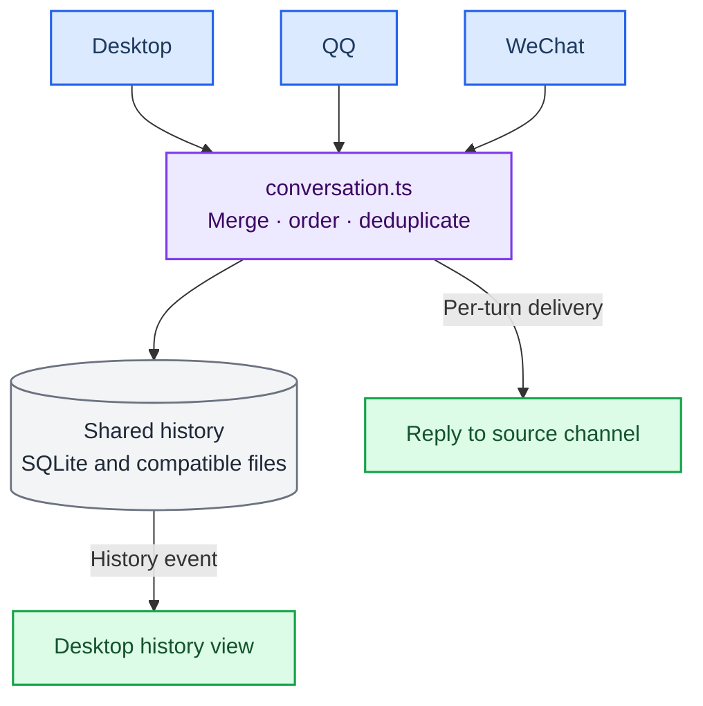

> 历史归档（六类收敛前）：保留当时说明，仅供追溯；当前入口见[文档导航](../../../README.md)。

# One Conversation Across Desktop, QQ and WeChat

> Goal: whichever surface you talk to her on, it is the **same conversation** and the same her.
> She still **replies only to the surface you asked from** — no cross-posting replies to the other two.
>
> Implementation: `src/main/channels/conversation.ts`.

## Shared history and execution

Desktop uses semantic routing and managed tasks; QQ / WeChat retain `maybeRunCodeTask`. Shared personality/history does not imply identical supervision, acceptance or permissions. See [channel integration](ackem-code-bridge.md).


---

## 1. Why the three surfaces did not share anything

Each channel used to own a separate `chat_history` session:

| Surface | Old session id |
|---|---|
| Desktop app | `default` (or the active `activeSessionId`) |
| QQ | `qq:<qq-number>` |
| WeChat | `wechat:<wxid>` |

Consequences:

1. She could not see what you said on another surface — QQ's `recentMessages` only came from `qq:*`.
2. The desktop chat pane only rendered its own messages; QQ/WeChat messages were never pushed to it.
3. Writes overwrote each other: the renderer saved its whole `chatRows` array, wiping anything a
   channel had appended in the meantime.

Personality state (emotion / relationship) had already been collapsed into `default`; conversation
history had not — so there were still "three different hers".

---

## 2. Current design



### One session

`resolveConversationSessionId(settings.activeSessionId)`, falling back to `default`. All three
surfaces write to it, and switching the desktop session switches all three together.

### Origin metadata on every row

```json
{
  "kind": "message",
  "role": "user",
  "content": "you there?",
  "at": "2026-11-01T10:00:00.000Z",
  "channel": "qq",
  "peerId": "10001"
}
```

`at` drives ordering and de-duplication, `channel` powers the "From QQ / From WeChat" label in the
desktop pane, and `peerId` is diagnostic only.

### Channel appends vs. desktop saves

**Channel writes** (`mergeConversationRows`, called at the end of every QQ / WeChat turn):

- every existing row is kept; new rows are inserted by `at`;
- a row is matched by `kind|role|at`, with a content fingerprint as fallback for legacy rows;
- a streamed reply that grows is updated in place, never duplicated.

**Desktop writes** (`replaceDesktopConversationRows`, called when the renderer saves its whole
`chatRows`):

- UI rows follow the renderer array (replaced as a group), so search / plan cards never accumulate;
- message rows whose `channel` is `qq` or `weixin` are always preserved, and never duplicated when the
  array already contains them;
- rows older than the earliest message in the incoming array are also kept — the renderer may save
  before it finished loading history;
- a stale renderer save therefore cannot drop channel messages or older desktop history.

Both modes sort by `at` and cap the history at 2000 rows.

### Legacy migration

The first read merges `qq:*` / `wechat:*` histories (SQLite + `companion/chat-history-*.json`) into
the unified session, tagging each row with its origin. One `kv_store` flag per data root makes it run
once; old rows stay where they are as a backup, and a failed migration never blocks chat.

### Reply routing stays per-origin

| You ask from | Reply goes to | Other surfaces |
|---|---|---|
| Desktop | Desktop pane | history only |
| QQ | That QQ DM | history only, desktop shows "From QQ" |
| WeChat | That WeChat DM | history only, desktop shows "From WeChat" |

Proactive messages follow the same rule: delivered to one channel, recorded in the shared history,
and mirrored to the desktop pane.

---

## 3. How to verify

1. On desktop: "remember the phrase: blue whale". Then ask her on QQ what she was told to remember —
   she should answer "blue whale".
2. Send "long day" on WeChat, return to desktop: the line appears with a "From WeChat" label.
3. Ask something on QQ: the desktop pane shows the exchange live ("From QQ"); WeChat receives nothing.
4. Restart Ackem: order is preserved and all three surfaces still line up.

Tests: `src/main/channels/conversation.test.ts`.

---

## 4. Boundaries

- **QQ / WeChat clients are not ours**: their own chat logs will not show what you said on desktop or
  the other surface. The unified view lives in the Ackem desktop app. Mirroring messages into
  QQ/WeChat would contradict "reply only where asked", so it is intentionally not implemented.
- **Concurrent turns**: persistence is serialized, but two surfaces asking at the same moment produce
  two parallel generations that may not see each other yet.
- **Multiple sessions**: the unified conversation follows the desktop's active session.
