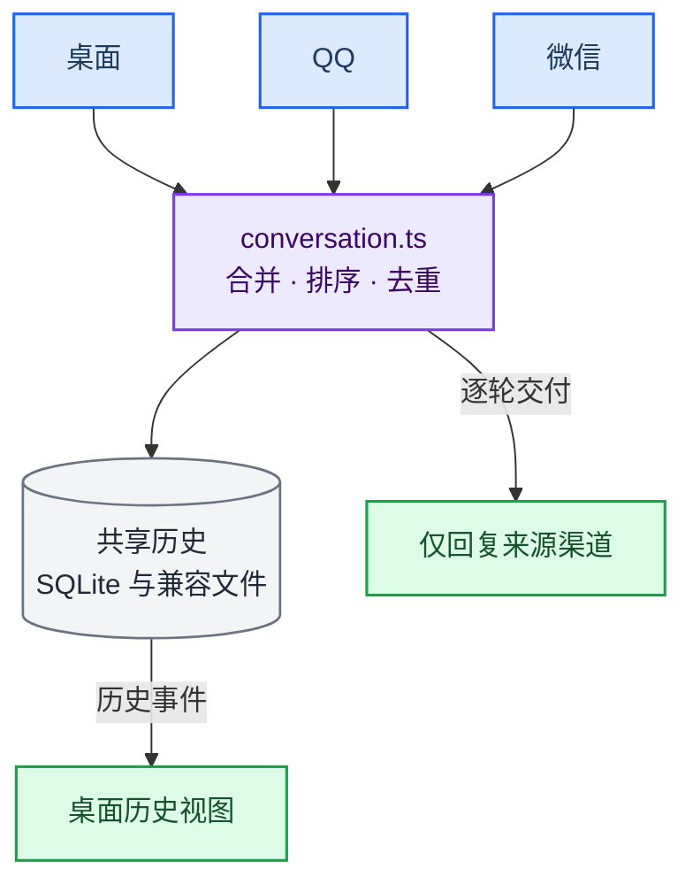

> 历史归档（六类收敛前）：保留当时说明，仅供追溯；当前入口见[文档导航](../../../README.md)。

# 三端统一会话（桌面 / QQ / 微信）

> 目标：不管你在哪个端跟她说话，都是**同一段对话**、同一个她；
> 但她**只把回复发回你提问的那一端**，不会把回复同时刷到另外两个端。
>
> 实现位置：`src/main/channels/conversation.ts`。

## 共享历史不等于统一执行

本页描述渠道历史合并与显示。桌面使用语义三级路由与托管任务；QQ / 微信仍经 `maybeRunCodeTask` 桥接。共享人格和历史不表示监督、验收和权限完全相同。见[渠道接入](ackem-code-bridge.zh.md)。


---

## 一、之前为什么不互通

旧实现里每个渠道各占一个 `chat_history` 会话：

| 端 | 旧会话 id |
|---|---|
| 桌面客户端 | `default`（或当前 `activeSessionId`） |
| QQ | `qq:<QQ号>` |
| 微信 | `wechat:<wxid>` |

于是出现三个问题：

1. **她看不到你在别的端说过什么**：QQ 的 `recentMessages` 只来自 `qq:` 那一支。
2. **桌面对话框只显示桌面自己说过的话**：QQ/微信的消息从不推给渲染层。
3. **回写会互相覆盖**：桌面渲染层每次 `saveChatHistory(整个数组)` 都是覆盖写，
   渠道刚写进去的消息会被旧数组盖掉。

人格状态（情绪 / 关系）此前已经统一收敛到 `default`，但对话历史没有——所以仍然是「三个不同的她」。

---

## 二、现在的做法



### 1. 一个会话

- 会话 id 由 `resolveConversationSessionId(settings.activeSessionId)` 决定，缺省 `default`。
- 三端都往这一份历史里写；换桌面会话时三端一起切到新会话。

### 2. 每一行都带来源

```json
{
  "kind": "message",
  "role": "user",
  "content": "在吗",
  "at": "2026-11-01T10:00:00.000Z",
  "channel": "qq",        // ui | qq | weixin
  "peerId": "10001"
}
```

- `at`：跨端排序与去重的事实依据。
- `channel`：桌面对话框会在气泡上方显示「来自 QQ / 来自微信」。
- `peerId`：只用于排障，不参与会话划分。

### 3. 渠道只追加，桌面 UI 行以界面为准

**渠道落库**（`mergeConversationRows`，QQ / 微信每轮结束时调用）：

- 已有行**永远保留**，新行按 `at` 插入时间线；
- 同一行按 `kind|role|at` 认出，没有 `at` 的旧数据则按内容指纹兜底；
- 流式回复内容变长时**原地更新**，不会新增第二条。

**桌面回写**（`replaceDesktopConversationRows`，渲染层保存整个 `chatRows` 时调用）：

- UI 行以渲染层数组为准（整组替换），搜索卡 / 计划卡不会越存越多；
- 但 `channel` 为 `qq` / `weixin` 的消息行**永远保留**，已出现在数组里的不重复追加；
- 比本次数组里最早一条消息更早的行也保留——渲染层可能还没把历史读完就回写了；
- 因此桌面拿一份「陈旧数组」回写，也抹不掉渠道消息或更早的桌面历史。

两种模式都按 `at` 排序，上限 2000 行，与原来的存储上限一致。

### 4. 旧数据自动迁移

第一次读取统一会话时，会把 `qq:*` / `wechat:*` 的历史（SQLite + `companion/chat-history-*.json`）
按时间并入统一会话，打上来源标记；用 `kv_store` 的一条 `conversation.migrated:v1` 标记保证整个数据目录只跑一次。
旧行会保留在原处作为备份，迁移失败也不会阻塞聊天。

### 5. 回复路由不变

| 你在哪里问 | 她的回复发往 | 其他端 |
|---|---|---|
| 桌面客户端 | 桌面对话框 | 只写入历史，不推送消息 |
| QQ | 那个 QQ 私聊 | 只写入历史，桌面显示「来自 QQ」 |
| 微信 | 那个微信私聊 | 只写入历史，桌面显示「来自微信」 |

主动搭话（QQ / 微信的 `proactive`）也只发往目标渠道，但同样会写进统一历史并推给桌面。

---

## 三、验证方法

1. 桌面发一句「记住这个词：蓝色鲸鱼」，然后去 QQ 私聊她「我刚让你记住什么？」——
   她应该能答出「蓝色鲸鱼」。
2. 在微信里发「今天好累」，回到桌面：对话流里应出现这条消息，气泡上方标注「来自微信」。
3. 在 QQ 里问一个问题：桌面对话框会实时出现这一问一答（标注「来自 QQ」），
   但微信不会收到任何消息。
4. 重启 Ackem：历史顺序不变，三端仍然接得上。

单测：`src/main/channels/conversation.test.ts`。

---

## 四、边界

- **QQ / 微信客户端本身不是我们控制的窗口**：它们的聊天记录里不会出现你在桌面/另一端说的话。
  统一视图在 Ackem 桌面客户端里；如果你确实想让消息也出现在 QQ/微信，需要额外做「镜像发送」，
  那会与「只回提问端」冲突，默认不做。
- **并发轮次**：渠道落库已经串行化，但「两个端同时各问一句」会并行生成两条回复，
  上下文可能互相看不到对方这一轮；需要绝对串行时可在渠道层加全局队列。
- **多会话**：统一会话跟随桌面当前选中的会话；切换会话会同时切换三端的上下文。
