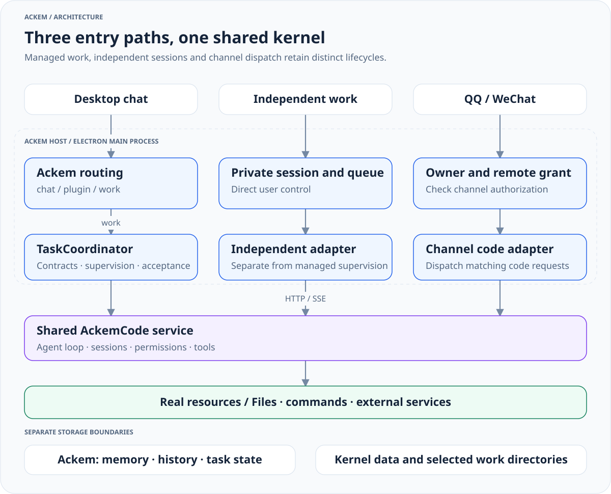

> 历史归档（六类收敛前）：保留当时说明，仅供追溯；当前入口见[文档导航](../../../../../README.md)。

# Ackem overall architecture

[中文](00-overall-system.zh.md) · [Architecture index](README.md)

The system comprises **Ackem interaction and coordination, extensions, managed task coordination, and the AckemCode general-purpose agent kernel**. Companion state, personality, memory and time awareness support ongoing interaction.

## Processes and responsibilities

[View full size](../../../../../diagrams/runtime-architecture-en.light.svg) · [Dark version](../../../../../diagrams/runtime-architecture-en.dark.svg) · [Diagram source](../../../../../diagrams/sources/runtime-architecture-en.mmd)

| Boundary | Owns | Distinction |
|---|---|---|
| Renderer and preload | Display, input, controls and event subscription | UI text is not execution evidence |
| Ackem main process | Routing, conversation, memory, personality and coordination | Companion event interpretation is separate from channel classification |
| Extensions | Enabled Skill / Plugin capabilities and lifecycle | Ackem extensions and kernel plugins have different interfaces |
| Managed tasks | Contracts, revisions, authority, supervision, acceptance and delivery | Kernel done is not task acceptance |
| AckemCode | Sessions, model/tool loop, permissions, plans and subagents | The Code name does not limit it to programming |

## Actual execution paths

- **Desktop chat**: `ipc/chat.ts` → `chat/orchestrateChannelTurn.ts` → `channel/routeChannel.ts`. chat generates replies, plugin invokes extensions, and managed work enters `tasks/`.
- **Independent work**: `ipc/workbench.ts` → `ackemcode/standaloneWorkService.ts` → kernel, with a private input queue and session.
- **QQ / WeChat**: after channel owner checks, `channels/companionTurn.ts` tries code dispatch through `ackemcode/dispatch.ts` for turns without user images, continuing conversation when unhandled. Image turns skip the code bridge. This path is not fully unified with desktop semantic routing and managed tasks.

See [routing and lifecycle](09-routing-and-tasks.md) for state/control boundaries and [kernel integration](../../ackemcode-kernel.md) for startup, configuration and capabilities.

## Source map

| Path | Responsibility |
|---|---|
| `src/main/index.ts`, `ipc.ts` | Startup, IPC registration and runtime composition |
| `src/main/ipc/` | Host interfaces for chat, work, tasks, settings and extensions |
| `src/main/channel/`, `chat/` | Routing, orchestration, context consistency, replies and history |
| `src/main/tasks/` | Managed contracts, persistence, scheduling, notifications and standing rules |
| `src/main/ackemcode/` | Clients, startup adapters, supervision, independent work and channel code bridge |
| `parts/ackemcode/src/server/` | Kernel service, agent, tools, permissions, MCP, LSP and persistence |
| `parts/ackemcode/src/cli/` | Independent CLI |
| `src/main/engine/`, `prompt/`, `context.ts` | Companion state, expression policy and model context |
| `src/main/memory/` | Facts, retrieval, event/action ledger, controls and recovery |
| `src/main/extensions/` | Built-in/user extensions, dispatch and catalog |
| `src/main/channels/` | QQ, WeChat, Qzone and cross-channel conversation |
| `src/main/social/` | Social members, identities, sessions and relationships |
| `src/main/db/`, `paths.ts`, `settings.ts` | SQLite, data roots and settings |
| `src/preload/`, `src/shared/`, `src/renderer/` | IPC bridge, shared contracts and React UI |

## Context and evidence

`engine/orchestrator.ts` prepares companion state and memory; `context.ts` and `prompt/` construct model input. `prompt/runtime-architecture.ts` describes runtime responsibilities. Task context and publication fences protect replies from stale state.

Memory includes both retrieval/fact pipelines and the `record / recall / control / recover` facade with action events. Conversation bodies, extension results and execution receipts retain distinct origins and status. Model intent is not execution evidence.

## Data and permissions

SQLite migrations currently extend through V22. Community QQ / Qzone compatibility tables are reconciled idempotently. Task modules also initialize their own persistence, so the schema version is not an exhaustive static table inventory.

Ackem data roots, Electron userData, kernel data and work directories are separate. Extension sandbox restrictions and memory write allowlists apply to those subsystems; work permissions are governed by the task and kernel policies.

The legacy desktop assistant has been removed. Only necessary migration of old remote grants remains in settings; historical records do not indicate an active legacy channel.

## Reading and maintenance

Start here, then read routing, kernel and the relevant subsystems. Changes to routing, task state, kernel contracts, storage or permissions require corresponding documentation and language updates. Documents under `docs/旧文档/公开文档/docs/releases/` describe historical packages.
