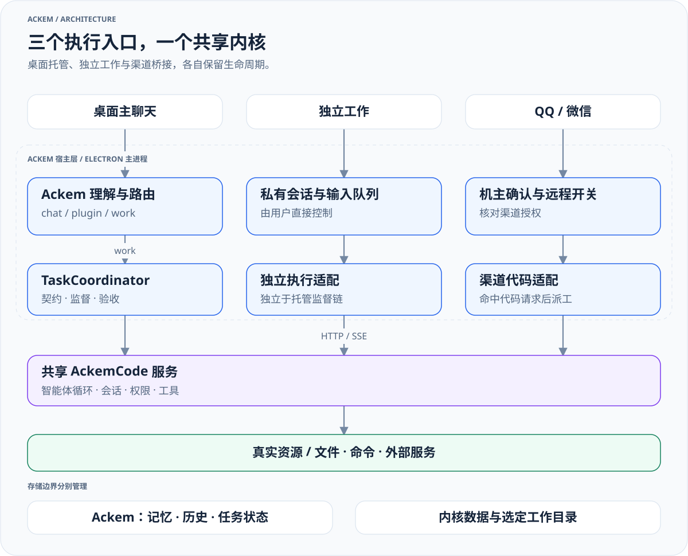

> 历史归档（六类收敛前）：保留当时说明，仅供追溯；当前入口见[文档导航](../../../../../README.md)。

# Ackem 整体架构

[English](00-overall-system.md) · [架构索引](README.zh.md)

当前系统由 **Ackem 交互与协调层、扩展系统、任务协调层、AckemCode 通用智能体内核**构成。陪伴引擎、人格、记忆和时间感知继续支持长期交互。

## 进程与职责

[放大查看](../../../../../diagrams/runtime-architecture-zh.light.svg) · [深色版本](../../../../../diagrams/runtime-architecture-zh.dark.svg) · [图源](../../../../../diagrams/sources/runtime-architecture-zh.mmd)

| 边界 | 负责 | 不应混淆 |
|---|---|---|
| 渲染层与 preload | 展示、输入、任务控制与事件订阅 | UI 文字不能代替执行状态 |
| Ackem 主进程 | 路由、对话、记忆、人格与协调 | 陪伴引擎事件解释器不等于通道分类器 |
| 扩展系统 | 已启用 Skill / Plugin 的能力与生命周期 | Ackem 扩展与内核插件是不同接口 |
| 托管任务 | 契约、目标修订、授权、监督、验收和交付 | 不能把内核 done 直接当成任务完成 |
| AckemCode | 会话、模型循环、工具、权限、计划和子智能体 | Code 名称不限制为代码编写 |

## 三条实际执行路径

- **桌面聊天**：`ipc/chat.ts` → `chat/orchestrateChannelTurn.ts` → `channel/routeChannel.ts`。chat 生成回应，plugin 调用扩展，托管 work 进入 `tasks/`。
- **工作页独立执行**：`ipc/workbench.ts` → `ackemcode/standaloneWorkService.ts` → 内核，使用独立输入队列和会话。
- **QQ / 微信**：渠道机主校验后进入 `channels/companionTurn.ts`；不含用户图片的轮次先尝试 `ackemcode/dispatch.ts` 代码派工，未处理时继续渠道对话。含图片轮次跳过代码桥接。该路径尚未完全使用桌面的语义路由与任务协调。

[路由与任务生命周期](09-routing-and-tasks.zh.md)详细说明状态与控制边界；[AckemCode 内核](../../ackemcode-kernel.zh.md)说明启动、配置和能力。

## 核心代码地图

| 路径 | 职责 |
|---|---|
| `src/main/index.ts`、`ipc.ts` | 应用启动、IPC 注册和运行时组装 |
| `src/main/ipc/` | 聊天、工作页、任务、设置和扩展的宿主接口 |
| `src/main/channel/`、`chat/` | 路由、编排、上下文一致性、回复与历史 |
| `src/main/tasks/` | 托管契约、任务持久化、协调、通知和持续规则 |
| `src/main/ackemcode/` | 内核客户端、两套启动适配、监督、独立工作与渠道代码桥接 |
| `parts/ackemcode/src/server/` | 内核服务、智能体、工具、权限、MCP、LSP 和持久化 |
| `parts/ackemcode/src/cli/` | 独立 CLI |
| `src/main/engine/`、`prompt/`、`context.ts` | 陪伴状态、表达策略和模型上下文 |
| `src/main/memory/` | 事实检索、写入、事件行动账本、控制与恢复 |
| `src/main/extensions/` | 官方与用户扩展、调度、能力目录 |
| `src/main/channels/` | QQ、微信、空间和跨端会话 |
| `src/main/social/` | 社会成员、身份、会话和关系相关能力 |
| `src/main/db/`、`paths.ts`、`settings.ts` | SQLite、数据根和设置 |
| `src/preload/`、`src/shared/`、`src/renderer/` | IPC 桥、共享协议和 React UI |

## 上下文与事实

`engine/orchestrator.ts` 准备陪伴状态与记忆，`context.ts` 和 `prompt/` 组装模型输入。`prompt/runtime-architecture.ts` 提供当前运行职责提示；任务上下文与发布围栏避免旧状态进入新的回应。

记忆既包含原有检索和事实管线，也有 `record / recall / control / recover` 门面及行动事件。聊天正文、插件结果、执行回执应保持来源与状态的区分。模型意图不能替代执行事实。

## 数据与权限

SQLite 当前迁移版本为 V22；社区 QQ / 空间兼容表通过幂等补表整合。任务等模块也有自身持久化初始化，不能把版本号当成全部表的静态清单。

Ackem 数据根、Electron userData、内核数据与工作目录分别管理。扩展沙箱或记忆写白名单只适用于对应模块；work 的权限由任务与内核执行策略决定。

旧电脑助手实现已删除。设置中仅保留必要的旧远程授权迁移逻辑，历史记录不表示旧通道仍可运行。

## 阅读与维护

先读本页，再读路由、内核与相关子系统。修改路由、任务状态、内核协议、存储或权限时，同步对应文档及中英文版本。历史发布材料位于 `docs/旧文档/公开文档/docs/releases/`，不作为当前架构说明。
