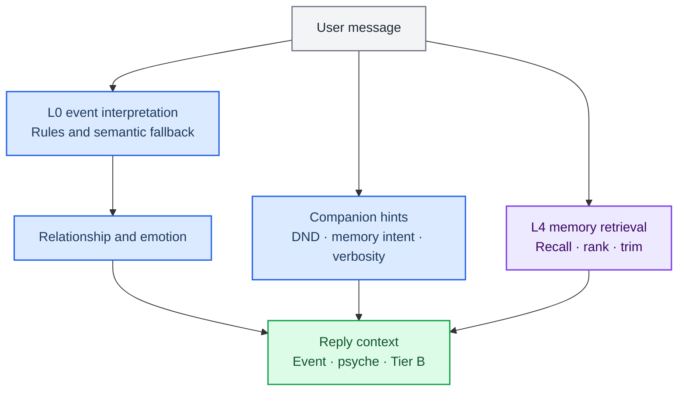

> 历史归档（六类收敛前）：保留当时说明，仅供追溯；当前入口见[文档导航](../../../../../README.md)。

# Understanding and memory

[中文](01-brain-system.zh.md) · [Architecture index](README.md)

Companion event interpretation and memory provide context for replies and task coordination. The channel router selects chat / plugin / work; a rule-based interpreter path does not mean the whole application avoids model calls.

## Main implementation

| Module | Entry point | Responsibility |
|---|---|---|
| Companion preparation | [engine/orchestrator.ts](../../../../../../src/main/engine/orchestrator.ts) | Interpret input, update companion state and prepare psyche and retrieval context |
| Input interpretation | [engine/interpreter.ts](../../../../../../src/main/engine/interpreter.ts) | Rule interpretation and semantic assistance when available |
| Fact retrieval and ingestion | [memory/retriever.ts](../../../../../../src/main/memory/retriever.ts) | Recall, score and trim; ingestion is implemented separately in ingest.ts |
| Memory interface | [memory/adapters/composeMemorySystem.ts](../../../../../../src/main/memory/adapters/composeMemorySystem.ts) | record / recall / control / recover across chat and action receipts |
| Action ledger | [memory/actions/actionRepository.ts](../../../../../../src/main/memory/actions/actionRepository.ts) | Persist action records for recovery and evidence tracing |

## Boundaries to preserve

- Facts, chat history and action evidence serve different purposes. Recalling a discussed plan does not establish that it ran.
- The task coordinator maintains managed goals, runs and acceptance. Memory provides context and action records rather than replacing task state.
- Delivery claims should match actual receipts, artifacts and acceptance. Old execution results must not override the current task revision.

[Context and retrieval policy](../../ai-context-and-retrieval-policy.md) · [Memory format](../../memory-format.md)

[Archived detailed chapter](../../../../公开文档/docs/developer/architecture/01-brain-system.md) is retained for historical reference. Use this chapter, the routing guide and actual source for current responsibilities.
