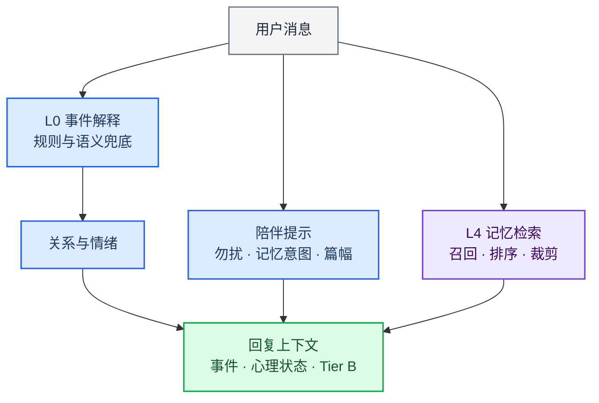

> 历史归档（六类收敛前）：保留当时说明，仅供追溯；当前入口见[文档导航](../../../../../README.md)。

# 理解与记忆

[English](01-brain-system.md) · [架构导航](README.zh.md)

陪伴事件解释与记忆为回复和任务协调提供上下文。全局请求的 chat / plugin / work 选择由通道路由处理；局部解释器的规则路径不能代表整个应用不调用模型。

## 主要实现

| 模块 | 代码入口 | 职责 |
|---|---|---|
| 陪伴编排 | [engine/orchestrator.ts](../../../../../../src/main/engine/orchestrator.ts) | 解释输入、更新陪伴状态并准备心理块与检索上下文 |
| 输入解释 | [engine/interpreter.ts](../../../../../../src/main/engine/interpreter.ts) | 规则解释及可用时的语义辅助 |
| 事实检索与写入 | [memory/retriever.ts](../../../../../../src/main/memory/retriever.ts) | 召回、评分与裁剪；写入流程另见 ingest.ts |
| 统一记忆接口 | [memory/adapters/composeMemorySystem.ts](../../../../../../src/main/memory/adapters/composeMemorySystem.ts) | record / recall / control / recover，整合聊天与行动回执 |
| 行动账本 | [memory/actions/actionRepository.ts](../../../../../../src/main/memory/actions/actionRepository.ts) | 持久化行动记录，支持恢复与证据追溯 |

## 阅读时需要区分

- 事实、聊天记录和行动证据各有用途。检索到曾经讨论的计划，不代表该计划已执行。
- 托管任务仍由任务协调器维护目标、运行状态和验收；记忆接口提供上下文及行动记录，不能替代任务状态。
- 正文中的结果陈述应与实际回执、产物和验收一致；旧执行结果不能覆盖当前任务修订。

[上下文与检索策略](../../ai-context-and-retrieval-policy.zh.md) · [记忆格式](../../memory-format.zh.md)

[旧版长篇说明](../../../../公开文档/docs/developer/architecture/01-brain-system.zh.md)仅供历史追溯，当前职责以本篇、路由文档与实际源码为准。
