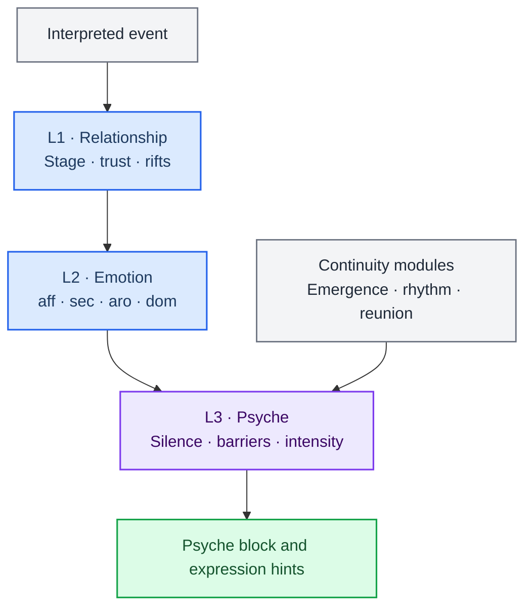

> 历史归档（六类收敛前）：保留当时说明，仅供追溯；当前入口见[文档导航](../../../../../README.md)。

# Personality, relationships and emotion

[中文](02-heart-system.zh.md) · [Architecture index](README.md)

This layer maintains companion relationships and expressive state, supplying personality, emotion and rhythm hints for replies. File operations, commands and task acceptance are handled by the work / AckemCode path.

## Main implementation

| Module | Entry point | Responsibility |
|---|---|---|
| Relationship state | [engine/relationship.ts](../../../../../../src/main/engine/relationship.ts) | Update relationships and modulation from interactions and existing state |
| Emotion state | [engine/emotion.ts](../../../../../../src/main/engine/emotion.ts) | Update emotion from events and memory echoes |
| Psyche context | [engine/psyche.ts](../../../../../../src/main/engine/psyche.ts) | Turn state into expressive hints for prompts |
| Presets and expression | [personalityPresets.ts](../../../../../../src/main/personalityPresets.ts) | Personality presets; expression helpers live in personalityVoice.ts |
| Orchestration and persistence | [engine/orchestrator.ts](../../../../../../src/main/engine/orchestrator.ts) | Prepare next-state drafts and persist through state-persistence.ts |

## Boundaries to preserve

- Personality and emotion affect expression; they do not establish task completion. Use task records and kernel receipts for execution state.
- Relationship updates, emotion and proactive policies contribute to the companion experience. Source code defines parameters, gates and activation.
- Cross-channel state depends on user identity and session scope. Check how callers select the user and session when reading state logic.

[Cross-channel conversation](../../cross-channel-conversation.md) · [Perception layer](../../perception-layer.md)

[Archived detailed chapter](../../../../公开文档/docs/developer/architecture/02-heart-system.md) is retained for historical reference. Use this chapter, the routing guide and actual source for current responsibilities.
