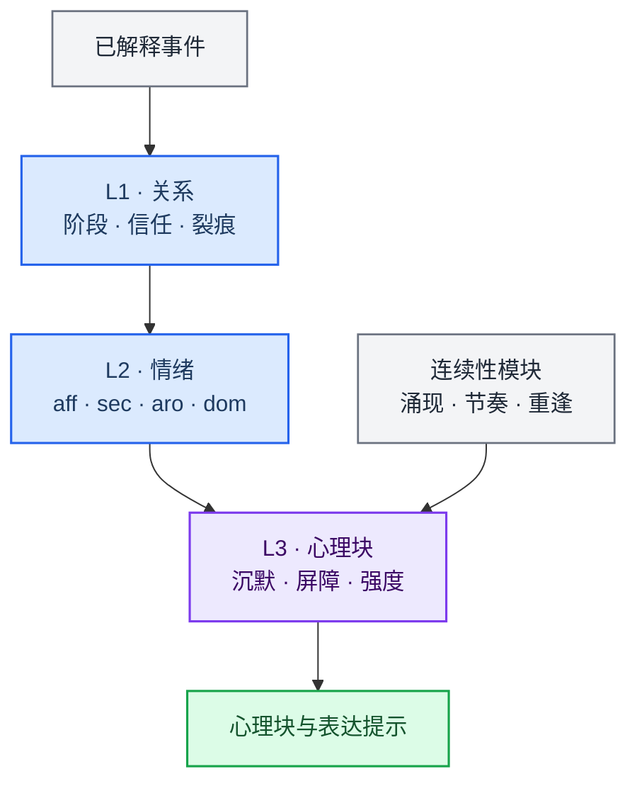

> 历史归档（六类收敛前）：保留当时说明，仅供追溯；当前入口见[文档导航](../../../../../README.md)。

# 人格、关系与情绪

[English](02-heart-system.md) · [架构导航](README.zh.md)

这一层维护陪伴关系和表达状态，为回复提供人格、情绪与节奏提示。实际文件操作、命令执行和任务验收继续由 work / AckemCode 链路处理。

## 主要实现

| 模块 | 代码入口 | 职责 |
|---|---|---|
| 关系更新 | [engine/relationship.ts](../../../../../../src/main/engine/relationship.ts) | 根据交互与已有状态更新关系及调制参数 |
| 情绪更新 | [engine/emotion.ts](../../../../../../src/main/engine/emotion.ts) | 结合事件和记忆回声更新情绪 |
| 心理块 | [engine/psyche.ts](../../../../../../src/main/engine/psyche.ts) | 将状态转换为供 Prompt 使用的表达提示 |
| 预设与表达 | [personalityPresets.ts](../../../../../../src/main/personalityPresets.ts) | 人格预设；表达辅助见 personalityVoice.ts |
| 编排与落盘 | [engine/orchestrator.ts](../../../../../../src/main/engine/orchestrator.ts) | 准备下一状态草稿，配合 state-persistence.ts 保存 |

## 阅读时需要区分

- 人格与情绪影响表达，不应成为“任务已经完成”的证据。执行状态以任务记录和内核回执为准。
- 关系更新、情绪表达和主动策略共同参与陪伴体验；具体参数、门槛及启用状态以源码为准。
- 跨渠道交互涉及用户身份和会话作用域，阅读状态逻辑时应同时检查调用方如何选择用户与会话。

[跨渠道对话](../../cross-channel-conversation.zh.md) · [感知层](../../perception-layer.zh.md)

[旧版长篇说明](../../../../公开文档/docs/developer/architecture/02-heart-system.zh.md)仅供历史追溯，当前职责以本篇、路由文档与实际源码为准。
