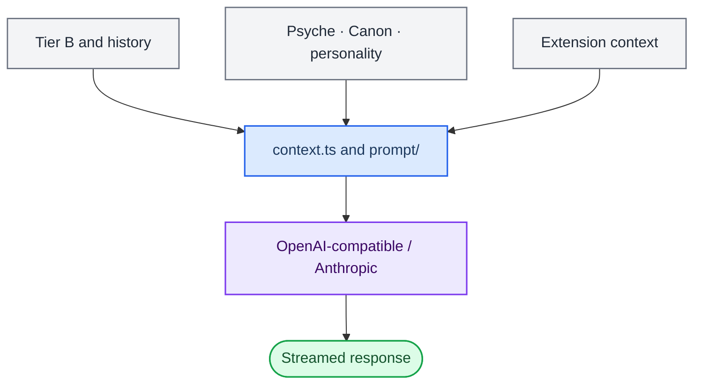

> 历史归档（六类收敛前）：保留当时说明，仅供追溯；当前入口见[文档导航](../../../../../README.md)。

# Prompts and replies

[中文](03-mouth-system.zh.md) · [Architecture index](README.md)

Main-chat generation assembles memory, companion state, runtime architecture and task context into model messages, then handles streaming and ordinary tool calls. Semantic routing, task supervision and AckemCode also have their own model calls.

## Main implementation

| Module | Entry point | Responsibility |
|---|---|---|
| Context assembly | [context.ts](../../../../../../src/main/context.ts) | Assemble context and task information for the current request |
| Main-chat prompt | [prompt/main-chat.ts](../../../../../../src/main/prompt/main-chat.ts) | Organize main-chat instructions and expression requirements |
| Runtime architecture hints | [prompt/runtime-architecture.ts](../../../../../../src/main/prompt/runtime-architecture.ts) | Describe actual routing and execution boundaries to the model |
| Publication fence | [chat/contextPublicationFence.ts](../../../../../../src/main/chat/contextPublicationFence.ts) | Prevent stale context from becoming current delivery evidence |
| Ordinary chat tools | [chat/executeOpenAiTools.ts](../../../../../../src/main/chat/executeOpenAiTools.ts) | Run registered ordinary tools and return results |
| Model adapters | [chat.ts](../../../../../../src/main/chat.ts) | Main-chat calls; the Anthropic path is in anthropicMessages.ts |

## Boundaries to preserve

- Ordinary chat tools and work execution use different entry paths. Legacy computer-assistant tools have been removed.
- Execution, acceptance and user-visible delivery are recorded separately. A completed text stream or a model completion claim does not replace execution and acceptance.
- Prompt changes should account for context sources, budgets, history and publication conditions so stale task state is not injected.

[Routing and tasks](09-routing-and-tasks.md) · [Context policy](../../ai-context-and-retrieval-policy.md)

[Archived detailed chapter](../../../../公开文档/docs/developer/architecture/03-mouth-system.md) is retained for historical reference. Use this chapter, the routing guide and actual source for current responsibilities.
