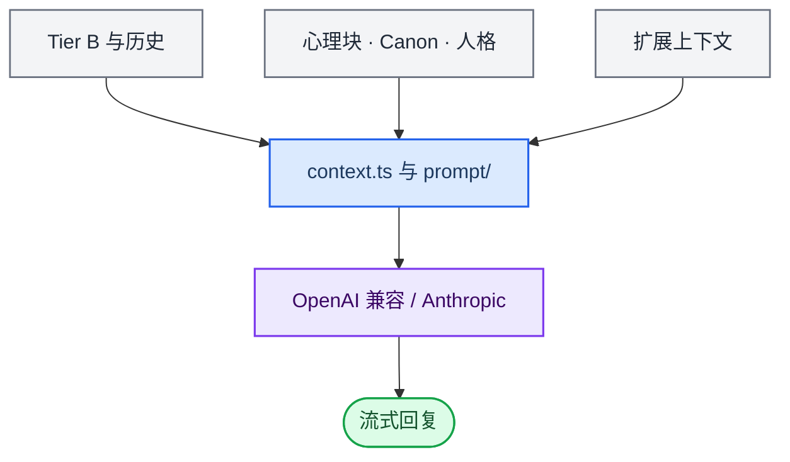

> 历史归档（六类收敛前）：保留当时说明，仅供追溯；当前入口见[文档导航](../../../../../README.md)。

# Prompt 与回复

[English](03-mouth-system.md) · [架构导航](README.zh.md)

主聊天回复将记忆、陪伴状态、当前运行架构和任务上下文组装成模型消息，再处理流式输出与普通工具调用。语义路由、任务监督和 AckemCode 还包含各自的模型调用链。

## 主要实现

| 模块 | 代码入口 | 职责 |
|---|---|---|
| 上下文组装 | [context.ts](../../../../../../src/main/context.ts) | 整合当前请求所需的上下文与任务信息 |
| 主聊天 Prompt | [prompt/main-chat.ts](../../../../../../src/main/prompt/main-chat.ts) | 组织主聊天指令与表达要求 |
| 架构说明 | [prompt/runtime-architecture.ts](../../../../../../src/main/prompt/runtime-architecture.ts) | 让模型了解实际路由与执行边界 |
| 发布围栏 | [chat/contextPublicationFence.ts](../../../../../../src/main/chat/contextPublicationFence.ts) | 避免过时上下文成为当前交付依据 |
| 普通聊天工具 | [chat/executeOpenAiTools.ts](../../../../../../src/main/chat/executeOpenAiTools.ts) | 执行已注册的普通工具并返回结果 |
| 模型适配 | [chat.ts](../../../../../../src/main/chat.ts) | 主聊天调用；Anthropic 路径见 anthropicMessages.ts |

## 阅读时需要区分

- 普通聊天工具与 work 执行不是同一个入口；旧电脑助手工具已移除。
- 任务执行、验收与用户可见交付分别记录。正文流结束或模型声称完成，都不能代替真实执行与验收。
- 修改 Prompt 时同时检查上下文来源、预算、历史消息和发布条件，避免注入陈旧任务状态。

[路由与任务](09-routing-and-tasks.zh.md) · [上下文策略](../../ai-context-and-retrieval-policy.zh.md)

[旧版长篇说明](../../../../公开文档/docs/developer/architecture/03-mouth-system.zh.md)仅供历史追溯，当前职责以本篇、路由文档与实际源码为准。
