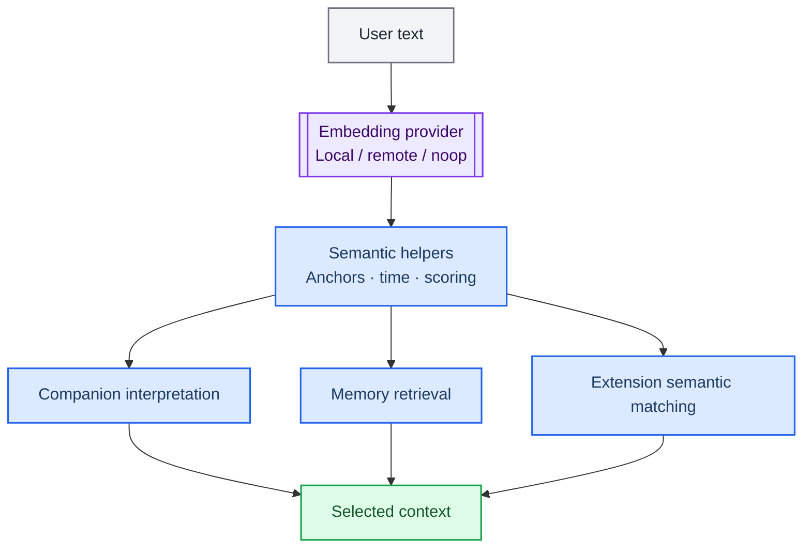

> 历史归档（六类收敛前）：保留当时说明，仅供追溯；当前入口见[文档导航](../../../../../README.md)。

# Embeddings and semantic assistance

[中文](04-neural-system.zh.md) · [Architecture index](README.md)

Embeddings turn text into vectors for memory retrieval and companion semantic assistance. This is separate from model classification for chat / plugin / work; vector similarity does not grant execution authority or prove completion.

## Main implementation

| Module | Entry point | Responsibility |
|---|---|---|
| Provider interface | [memory/embedding/provider.ts](../../../../../../src/main/memory/embedding/provider.ts) | Define how vector generation services are used |
| Models and local inference | [memory/embedding/modelManager.ts](../../../../../../src/main/memory/embedding/modelManager.ts) | Manage models; ONNX execution lives in onnxProvider.ts |
| Startup preparation | [memory/embedding/bootstrapBundledModels.ts](../../../../../../src/main/memory/embedding/bootstrapBundledModels.ts) | Prepare bundled model resources |
| Readiness | [embedding/embeddingReadiness.ts](../../../../../../src/main/embedding/embeddingReadiness.ts) | Track semantic infrastructure readiness |
| Semantic fallback | [embedding/semanticFallback.ts](../../../../../../src/main/embedding/semanticFallback.ts) | Provide fallback behavior for semantic helper paths |
| Retrieval consumer | [memory/retriever.ts](../../../../../../src/main/memory/retriever.ts) | Combine retrieval signals into context |

## Boundaries to preserve

- Current configuration and code define providers, models, dimensions, budgets and availability. Missing embeddings may alter retrieval quality or its path.
- Diagnose cold start, model resources and index compatibility separately. Embedding readiness does not mean all agent tools are available.
- Model or index-format changes require checking existing vectors, rebuilding and fallback behavior; see the indexing guide.

[Indexing and scale](../../indexing-and-scale.md) · [Windows local models](../../local-models-windows.md)

[Archived detailed chapter](../../../../公开文档/docs/developer/architecture/04-neural-system.md) is retained for historical reference. Use this chapter, the routing guide and actual source for current responsibilities.
