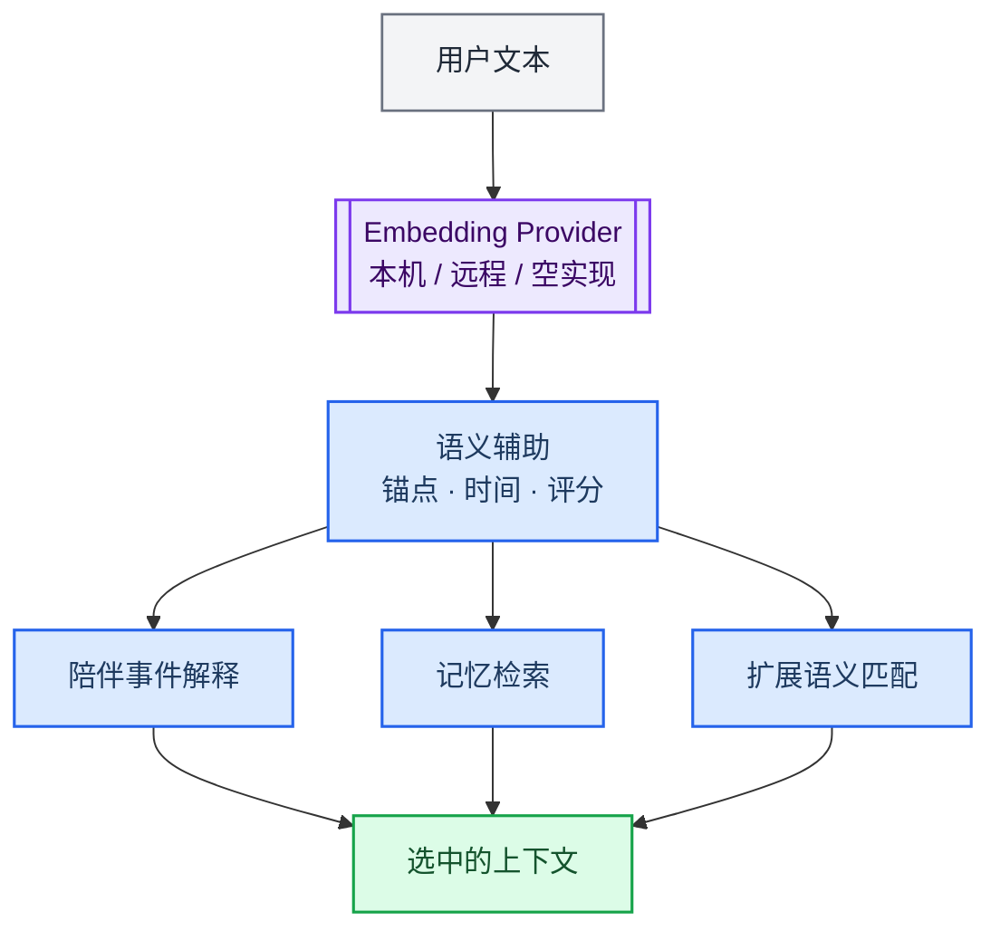

> 历史归档（六类收敛前）：保留当时说明，仅供追溯；当前入口见[文档导航](../../../../../README.md)。

# Embedding 与语义辅助

[English](04-neural-system.md) · [架构导航](README.zh.md)

Embedding 将文本转为向量，支持记忆检索与陪伴语义辅助。它与 chat / plugin / work 的模型分类链分开；向量相似度不能产生执行授权或完成证明。

## 主要实现

| 模块 | 代码入口 | 职责 |
|---|---|---|
| Provider 接口 | [memory/embedding/provider.ts](../../../../../../src/main/memory/embedding/provider.ts) | 定义向量生成服务的接口与使用方式 |
| 模型与本机运行 | [memory/embedding/modelManager.ts](../../../../../../src/main/memory/embedding/modelManager.ts) | 模型管理；ONNX 运行见 onnxProvider.ts |
| 启动准备 | [memory/embedding/bootstrapBundledModels.ts](../../../../../../src/main/memory/embedding/bootstrapBundledModels.ts) | 准备随应用提供的模型资源 |
| 就绪状态 | [embedding/embeddingReadiness.ts](../../../../../../src/main/embedding/embeddingReadiness.ts) | 跟踪语义基础设施就绪条件 |
| 语义降级 | [embedding/semanticFallback.ts](../../../../../../src/main/embedding/semanticFallback.ts) | 为语义辅助路径提供降级处理 |
| 检索消费方 | [memory/retriever.ts](../../../../../../src/main/memory/retriever.ts) | 组合检索信号并生成上下文 |

## 阅读时需要区分

- 具体 Provider、模型、维度、预算与可用性以当前配置和代码为准。缺少向量能力时，检索质量或路径可能变化。
- 冷启动、模型资源和索引兼容性应分别排查；不要将“向量服务就绪”等同于所有智能体工具可用。
- 修改模型或索引格式时，应检查旧向量、重建流程和降级行为，见索引说明。

[索引与规模](../../indexing-and-scale.zh.md) · [Windows 本地模型](../../local-models-windows.zh.md)

[旧版长篇说明](../../../../公开文档/docs/developer/architecture/04-neural-system.zh.md)仅供历史追溯，当前职责以本篇、路由文档与实际源码为准。
