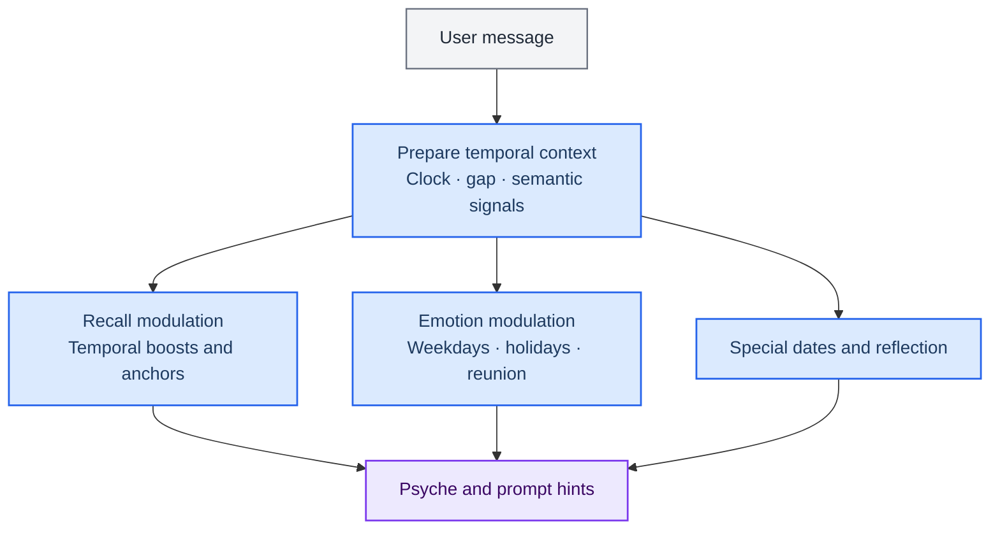

> 历史归档（六类收敛前）：保留当时说明，仅供追溯；当前入口见[文档导航](../../../../../README.md)。

# Time awareness and companion rhythm

[中文](06-time-system.zh.md) · [Architecture index](README.md)

Time awareness spans clocks, temporal parsing, memory modulation and companion policies. Long-term task supervision and kernel scheduling tools have separate lifecycles; temporal hints in conversation do not themselves create scheduled tasks.

## Main implementation

| Module | Entry point | Responsibility |
|---|---|---|
| Clock and timezone | [memory/temporal/clock.ts](../../../../../../src/main/memory/temporal/clock.ts) | Read time consistently; timezone rules live in timezonePolicy.ts |
| Temporal parsing | [memory/temporal/temporalParser.ts](../../../../../../src/main/memory/temporal/temporalParser.ts) | Parse time ranges and expressions in conversation |
| Retrieval modulation | [memory/temporalContextModulator.ts](../../../../../../src/main/memory/temporalContextModulator.ts) | Apply temporal signals to memory context |
| Special dates | [engine/temporalAwareness/specialDateDetector.ts](../../../../../../src/main/engine/temporalAwareness/specialDateDetector.ts) | Detect hints for birthdays, anniversaries and related dates |
| Proactive temporal hints | [engine/temporalAwareness/temporalProactiveTrigger.ts](../../../../../../src/main/engine/temporalAwareness/temporalProactiveTrigger.ts) | Produce temporal signals for companion policies |
| Long-term work | [tasks/longTerm.ts](../../../../../../src/main/tasks/longTerm.ts) | Handle managed long-term goals separately from companion time hints |

## Boundaries to preserve

- Temporal anchors inform recall; special dates and time depth inform psyche and expression. Proactive output remains subject to its policies and state.
- For ranges such as today, tomorrow and last week, check the user timezone, parsing window and actual clock source.
- Verify continuing rules, long-term goals, scheduling tools and user authorization in their own execution paths. A temporal reflection is not a background task.

[Task lifecycle](09-routing-and-tasks.md) · [AckemCode kernel](../../ackemcode-kernel.md)

[Archived detailed chapter](../../../../公开文档/docs/developer/architecture/06-time-system.md) is retained for historical reference. Use this chapter, the routing guide and actual source for current responsibilities.
