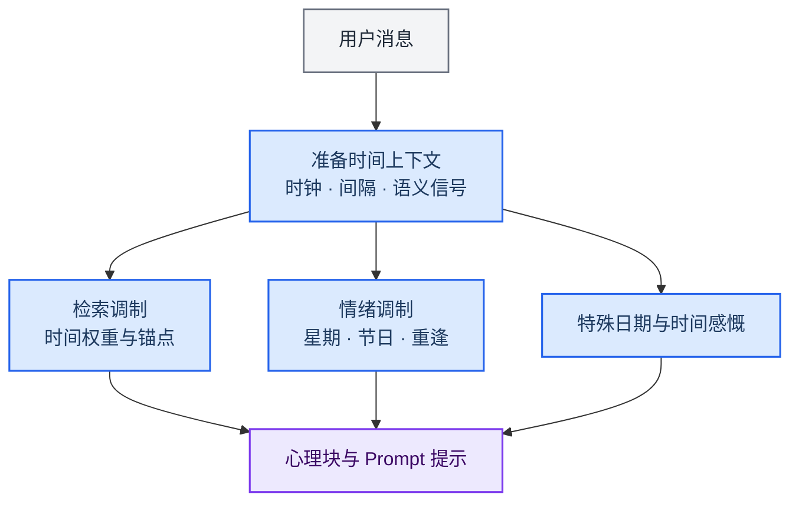

> 历史归档（六类收敛前）：保留当时说明，仅供追溯；当前入口见[文档导航](../../../../../README.md)。

# 时间感知与陪伴节奏

[English](06-time-system.md) · [架构导航](README.zh.md)

时间能力分布在时钟、时间语义解析、记忆调制和陪伴策略中。长期任务监督与内核定时工具有独立的生命周期；普通对话中的时间提示本身不会创建定时任务。

## 主要实现

| 模块 | 代码入口 | 职责 |
|---|---|---|
| 时钟与时区 | [memory/temporal/clock.ts](../../../../../../src/main/memory/temporal/clock.ts) | 统一时间读取；时区规则见 timezonePolicy.ts |
| 时间语义 | [memory/temporal/temporalParser.ts](../../../../../../src/main/memory/temporal/temporalParser.ts) | 解析对话中的时间范围与表达 |
| 检索调制 | [memory/temporalContextModulator.ts](../../../../../../src/main/memory/temporalContextModulator.ts) | 将时间信号纳入记忆上下文 |
| 特殊日期 | [engine/temporalAwareness/specialDateDetector.ts](../../../../../../src/main/engine/temporalAwareness/specialDateDetector.ts) | 检测生日、纪念日等时间提示 |
| 主动时间提示 | [engine/temporalAwareness/temporalProactiveTrigger.ts](../../../../../../src/main/engine/temporalAwareness/temporalProactiveTrigger.ts) | 产生供陪伴策略使用的时间信号 |
| 长期工作 | [tasks/longTerm.ts](../../../../../../src/main/tasks/longTerm.ts) | 处理托管长期目标，与陪伴时间提示分开 |

## 阅读时需要区分

- 时间锚点参与记忆召回；特殊日期和时间深度参与心理块与表达。是否主动发言仍受对应策略和状态限制。
- 涉及“今天、明天、上周”等范围时，应同时核对用户时区、解析窗口和实际时间来源。
- 持续规则、长期目标、定时工具和用户授权需在各自执行链中核验，不能从一段时间感慨推导出后台任务。

[任务生命周期](09-routing-and-tasks.zh.md) · [AckemCode 内核](../../ackemcode-kernel.zh.md)

[旧版长篇说明](../../../../公开文档/docs/developer/architecture/06-time-system.zh.md)仅供历史追溯，当前职责以本篇、路由文档与实际源码为准。
