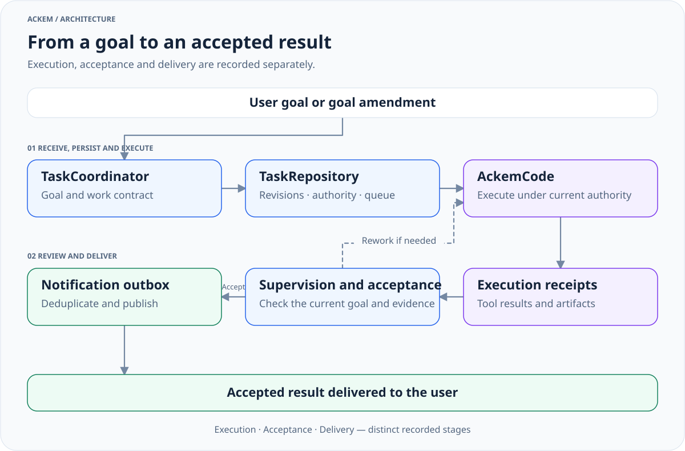

> 历史归档（六类收敛前）：保留当时说明，仅供追溯；当前入口见[文档导航](../../../../../README.md)。

# Routing and task lifecycle

[中文](09-routing-and-tasks.zh.md) · [Architecture index](README.md)

## Routes select responsibility

[channelPlan.ts](../../../../../../src/shared/channelPlan.ts) defines `Channel = 'chat' | 'plugin' | 'work'`. These are alternative handling responsibilities, rather than three execution steps for every request.

| Route | Responsibility | Evidence |
|---|---|---|
| chat | Conversation, explanations, inline content and paper delivery | Context, memory, personality and available chat tools |
| plugin | Use an existing extension capability | Enabled catalog target and actual extension result |
| work | Tool-driven operations on real resources | Task goal, authority, runtime state, receipts and artifacts |

## Desktop entry

1. [ipc/chat.ts](../../../../../../src/main/ipc/chat.ts) receives input and prepares history, attachments, context and the capability catalog.
2. [orchestrateChannelTurn.ts](../../../../../../src/main/chat/orchestrateChannelTurn.ts) first handles references to existing tasks, amendments and stops, then coordinates routing. Attachment paths can also enter work dispatch directly.
3. With an LLM, [routeChannel.ts](../../../../../../src/main/channel/routeChannel.ts) primarily uses semantic classification with recent conversation and the catalog. [normalizeChannel.ts](../../../../../../src/main/channel/normalizeChannel.ts) validates and normalizes the decision. Deterministic and learned paths remain for other entry conditions.
4. Unconfirmed classification leaves the task undispatched. [routeVerdict.ts](../../../../../../src/main/chat/routeVerdict.ts) records routing evidence in the memory ledger.
5. chat continues into prompt construction and reply generation; plugin invokes [executeChannel.ts](../../../../../../src/main/channel/executeChannel.ts) and extension dispatch; managed work submits through [chatWorkDispatch.ts](../../../../../../src/main/tasks/chatWorkDispatch.ts).

Creating or modifying a plugin is work. Availability comes from the actual catalog. Confirmation types and compatibility paths remain, but their presence does not mean every current desktop request displays a card. Some pending plans are completed and run autonomously by the orchestrator; runtime permissions still apply.

## Managed tasks

[View full size](../../../../../diagrams/managed-task-lifecycle-en.light.svg) · [Dark version](../../../../../diagrams/managed-task-lifecycle-en.dark.svg) · [Diagram source](../../../../../diagrams/sources/managed-task-lifecycle-en.mmd)

| Source | Responsibility |
|---|---|
| [tasks/coordinator.ts](../../../../../../src/main/tasks/coordinator.ts) | Idempotent input, task association, amendments, scheduling and stopping |
| [tasks/repository.ts](../../../../../../src/main/tasks/repository.ts) | Contracts, revisions, authority, events and state projections |
| [tasks/runtime.ts](../../../../../../src/main/tasks/runtime.ts) | Kernel driver, budgets, permission synchronization and receipts |
| [workSupervisor.ts](../../../../../../src/main/ackemcode/workSupervisor.ts) | Managed execution supervision, approval and result review |
| [tasks/communication.ts](../../../../../../src/main/tasks/communication.ts) | Notification outbox, deduplication, suppression and pacing |
| [shared/tasks.ts](../../../../../../src/shared/tasks.ts) | Task state, contracts, execution, acceptance and delivery types |

Task states include queued, running, waiting_user, cancelling, paused, reviewing, completed, failed and unknown. Consult the types; this is not a strictly forward-only pipeline.

`goalRevision` identifies the current goal. `controlEpoch` and fencing metadata isolate stale execution. `currentRunId`, receipts and the contract bind the current attempt. A late receipt from an older attempt must not settle a newer goal.

## Execution, acceptance and delivery

`TaskSnapshot` records these separately:

- `execution`: actual execution outcome and quiescence;
- `acceptance`: readiness for review, rework and acceptance;
- `delivery`: pending, published, suppressed or failed delivery.

A kernel done event does not establish goal acceptance. An unavailable review service does not imply the kernel is still running. Partial/final result bodies are stored separately from control status. A stop request requires quiescence and matching receipts before being described as fully stopped.

Permissions depend on entry and user configuration. The default directory is a starting point, while read-only paths, exclusions and inspection scope impose additional constraints. Standing goals and rules are handled by [tasks/longTerm.ts](../../../../../../src/main/tasks/longTerm.ts); model narration cannot create authority.

## Independent work and channels

[standaloneWorkService.ts](../../../../../../src/main/ackemcode/standaloneWorkService.ts) drives private sessions and a durable input queue for independent work. This path does not use the complete chat-managed contract, supervision and delivery pipeline.

QQ / WeChat test code requests through `maybeRunCodeTask` on turns without user images and use their session bridge when handled. Image turns skip this check. Shared personality, history and memory do not mean they use the full desktop managed routing chain. See [channel integration](../../ackem-code-bridge.md).

The legacy desktop assistant has been removed. Deleted `desktop-agent/`, `use_computer`, machine maps and legacy task plans are not current execution entry points.
