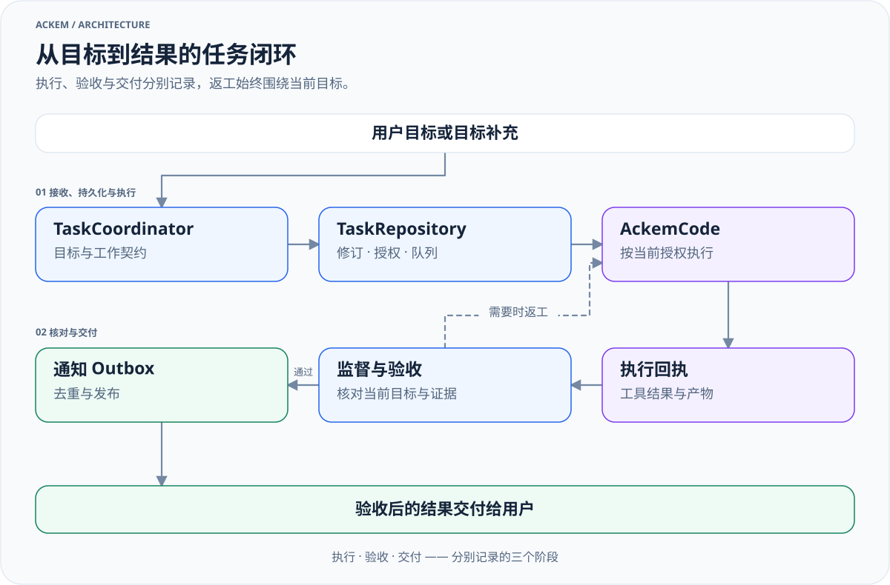

> 历史归档（六类收敛前）：保留当时说明，仅供追溯；当前入口见[文档导航](../../../../../README.md)。

# 路由与任务生命周期

[English](09-routing-and-tasks.md) · [架构索引](README.zh.md)

## 路由决定处理方式

协议定义在 [channelPlan.ts](../../../../../../src/shared/channelPlan.ts)：`Channel = 'chat' | 'plugin' | 'work'`。三级路由是三类处理职责，不是每个请求依次经过三层执行。

| 通道 | 职责 | 执行依据 |
|---|---|---|
| chat | 交流、解释、内容回应、纸面交付 | 当前上下文、记忆、人格、可用聊天工具 |
| plugin | 使用现有扩展能力 | 当前有效目录中的已启用目标与实际扩展回执 |
| work | 对真实资源进行工具驱动的任务执行 | 任务目标、授权、内核状态、执行回执与产物 |

## 桌面入口

1. [ipc/chat.ts](../../../../../../src/main/ipc/chat.ts) 接收聊天输入，准备历史、附件、上下文与能力目录。
2. [orchestrateChannelTurn.ts](../../../../../../src/main/chat/orchestrateChannelTurn.ts) 先处理任务指代、补充、停止等输入，再组织路由。当前附件路径也可直接进入 work 派工分支。
3. [routeChannel.ts](../../../../../../src/main/channel/routeChannel.ts) 在提供 LLM 时使用语义分类为主路径，结合最近对话与目录；[normalizeChannel.ts](../../../../../../src/main/channel/normalizeChannel.ts) 核验和归一化。确定性规则与学习路径仍作为其他入口保留。
4. 不能确认分类时，返回“尚未下派”的上下文，不编造进展。路由裁决通过 [routeVerdict.ts](../../../../../../src/main/chat/routeVerdict.ts) 写入记忆账本。
5. chat 继续组装 Prompt 并生成回复；plugin 调用 [executeChannel.ts](../../../../../../src/main/channel/executeChannel.ts) 和扩展调度；托管 work 通过 [chatWorkDispatch.ts](../../../../../../src/main/tasks/chatWorkDispatch.ts) 提交任务。

插件创建与修改也属于 work；插件是否可用必须以真实目录为准。确认卡类型和兼容路径仍存在，不能仅凭类型名称认定当前桌面一定弹卡。当前编排中部分待确认计划会自主补全并执行；运行权限仍由任务和内核控制。

## 托管任务

[放大查看](../../../../../diagrams/managed-task-lifecycle-zh.light.svg) · [深色版本](../../../../../diagrams/managed-task-lifecycle-zh.dark.svg) · [图源](../../../../../diagrams/sources/managed-task-lifecycle-zh.mmd)

| 代码 | 职责 |
|---|---|
| [tasks/coordinator.ts](../../../../../../src/main/tasks/coordinator.ts) | 输入幂等、任务关联、补充目标、队列与停止协调 |
| [tasks/repository.ts](../../../../../../src/main/tasks/repository.ts) | 契约、修订、授权、状态投影与事件持久化 |
| [tasks/runtime.ts](../../../../../../src/main/tasks/runtime.ts) | 内核驱动、预算、权限同步、事件与回执处理 |
| [workSupervisor.ts](../../../../../../src/main/ackemcode/workSupervisor.ts) | 托管执行监督、审批与结果审查 |
| [tasks/communication.ts](../../../../../../src/main/tasks/communication.ts) | 通知 Outbox、去重、抑制与交付节奏 |
| [shared/tasks.ts](../../../../../../src/shared/tasks.ts) | 任务状态、契约、执行、验收与交付类型 |

任务状态包括 queued、running、waiting_user、cancelling、paused、reviewing、completed、failed、unknown。请以类型定义为准；这不是一条只能向前的简单流水线。

`goalRevision` 表示当前目标版本，`controlEpoch` 和 fencing 信息用于隔离旧执行；`currentRunId`、内核回执与契约共同关联当前尝试。新目标被接受后，旧尝试的迟到事件不应当结算新目标。

## 执行、验收、交付分别记录

`TaskSnapshot` 分别记录：

- `execution`：是否真正执行、结果与是否已静止；
- `acceptance`：是否可审查、是否返工、是否接受；
- `delivery`：是否等待发布、已发布、受抑制或失败。

内核返回 done 不等于用户目标已通过验收；验收服务不可用也不等于内核仍在运行。部分结果和最终正文与控制状态分开保存。用户请求停止后，需要执行静止与匹配的停止回执，不能把“已发送停止请求”当成“全部操作已经停止”。

权限按入口和用户配置控制。默认工作目录是起点；任务的只读、排除范围与限定调查是额外约束。持续目标与规则授权由 [tasks/longTerm.ts](../../../../../../src/main/tasks/longTerm.ts) 处理，不能靠模型一句话自行产生授权。

## 独立工作与渠道差异

工作页独立任务由 [standaloneWorkService.ts](../../../../../../src/main/ackemcode/standaloneWorkService.ts) 保存输入队列并驱动私有会话。它不经过聊天托管任务的完整契约、监督与交付链。

QQ / 微信当前在不含用户图片的轮次先经 `maybeRunCodeTask` 判断代码请求；命中后使用渠道会话桥接，含图片轮次跳过该判断。它们共享主应用的一部分人格、历史和记忆，但尚未统一成桌面托管路由链。见[渠道接入](../../ackem-code-bridge.zh.md)。

旧电脑助手通道已经删除。不要把已删除的 `desktop-agent/`、`use_computer`、本机地图或旧任务计划作为当前执行入口。
