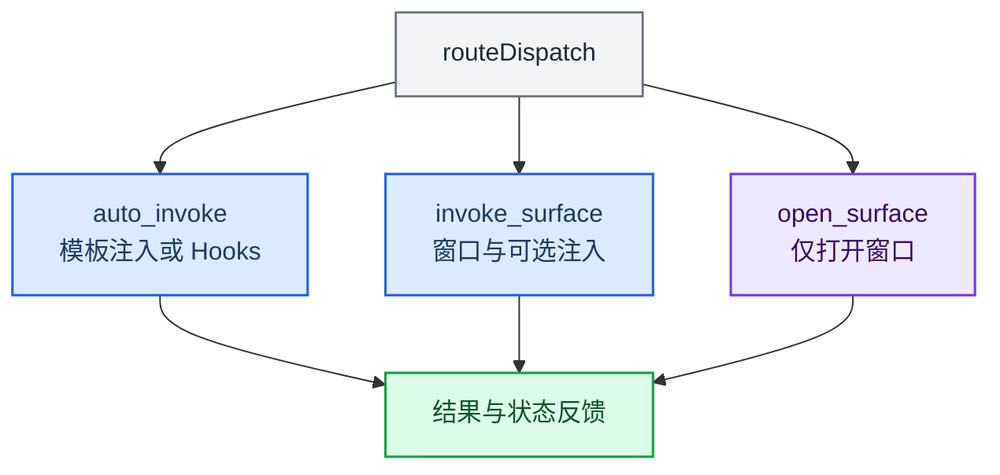

# uplugins 目录 — 用户自创 Plugin

> **权威协议**：[`../PROTOCOL.md`](../PROTOCOL.md)（§4 uplugin · §4.5 Surface invoke）  
> **部署位置**：`{dataRoot}/openforu/uplugins/`  
> **状态（2026-06）**：Plan 可 **deploy** uplugin。**三轨**：inject（`plugin.meta.json`）· Worker（`main.ts` 沙箱）· **Surface**（`surface.enabled` + 独立窗口）。主聊天 **`/关键词`** → 无 Surface 时 `auto_invoke`；有 Surface 时 **`invoke_surface` 自动开窗口**。

每个 Plugin 是一个子目录，包含 `manifest.json` 与 meta / 可选代码 / 可选 Surface HTML。

## 目录结构

```
uplugins/
├── CATALOG.md
├── _template/
├── examples/hello-world/
└── （部署后）data/openforu/uplugins/<slug>/
    ├── manifest.json
    ├── plugin.meta.json      ← injectTemplate + 可选 surface
    ├── surface.html          ← Surface 轨（Plan 常见）
    ├── main.ts               ← Worker 轨（可选）
    └── src/
```

## manifest.json 要点

与官方 Plugin 相同（`plugins/types.ts`），额外要求：

- id：`u/<name>@<version>`
- **dispatch** 块（与 uskill 相同结构，`mode: dispatched`）— 否则聊天调度无法命中

## plugin.meta.json（Surface 轨）

见 PROTOCOL.md §4.5。最小 Surface 声明：

```json
{
  "version": "1.0.0",
  "injectTemplate": "…",
  "surface": {
    "enabled": true,
    "title": "我的工具",
    "html": "<!DOCTYPE html>…"
  }
}
```

Plan 生成时会自动写入 `surface.invoke` 默认值（slash → 开窗口）。

## Plugin 沙箱 API

```typescript
interface PluginSandboxApi {
  getEngineSnapshot(): EngineSnapshot | null
  emitEvent(event): void
  readOwnFile(relativePath: string): Promise<string>
  writeOwnFile(relativePath: string, content: string): Promise<void>
  log(level, message): void
  getDataDir(): string
  notify?(…): void   // 需 grantedPermissions
  fetch?(…): Promise<Response>  // 需 grantedPermissions
}
```

Surface 窗口内另有窄 API：`ackem.extension.getContext()` · `close()`（`preload/surfacePreload.ts`）。

## 权限清单

| 权限 | 用户插件 |
|------|---------|
| readonly, engine_read | 默认自动授予 |
| engine_inject, network_outbound, system_notification, data_write | 需用户审批 |
| clipboard_read, foreground_detect | **禁止** |

## 调度接入



扩展中心：`openforu:surface:open` 手动开 Surface 窗口。

## 示例

`examples/hello-world/` — 情绪日志 + Worker hooks 例题。  
带 UI 的扩展请走 Plan Surface 轨或手改 `plugin.meta.json.surface`。
