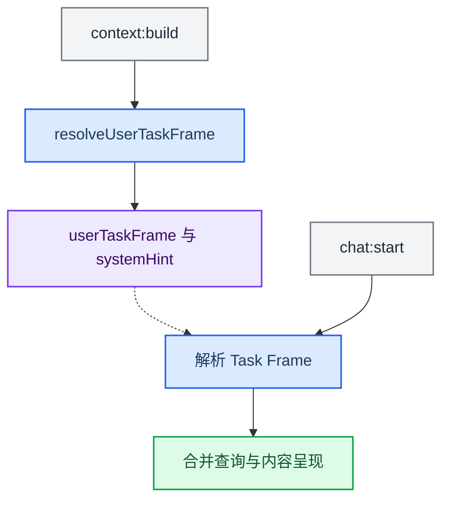

# Task Frame（L0·TF 交付理解）

## 与 work 任务的区别

Task Frame 描述搜索与内容呈现，不是 `tasks/` 的持久契约或执行状态。chat / plugin / work 路由决定处理职责；这里的“任务框架”不是 AckemCode 调度器。


> **最后更新**：2026-05-24 凌晨  
> **权威文档**：[当前路由与任务架构](../../../docs/architecture.zh.md#任务生命周期)

本目录实现 **L0·TF**，与 **L0.5 工作意图**、**Extension Dispatch**、**CTX/JP** 正交。

## 职责边界

| 本模块 | 其它层 |
|--------|--------|
| 表格 / 列表 / 对比 | L0.5：是否 `web_search` / 知识卡 |
| 合并多次 `web_search` | Dispatch：哪个扩展执行 |
| `searchSynthesis` 格式分支 | L1–L3：伴侣口吻（不能否决结构） |
| | CTX/JP：扩展何时打扰 |

## 对外 API

```typescript
// 主进程
import {
  resolveUserTaskFrame,
  buildTaskFrameSystemHint,
  buildCardBodyFormatBlock,
  planWebSearchExecution,
  runWebSearchWithTaskFrame
} from '../taskFrame'

// 扩展 / 共享（仅类型与规则，无 LLM）
import {
  detectTaskFrameRules,
  type UserTaskFrame
} from '../../shared/taskFrame'
```

## 数据流



## 测试

公开仓库不分发完整本地测试套件；按[源码验证](../../../docs/development.zh.md#验证)检查类型、构建和交付格式。

关联：`planDocument/intent.test.ts` · `searchQueryResolver.test.ts`
